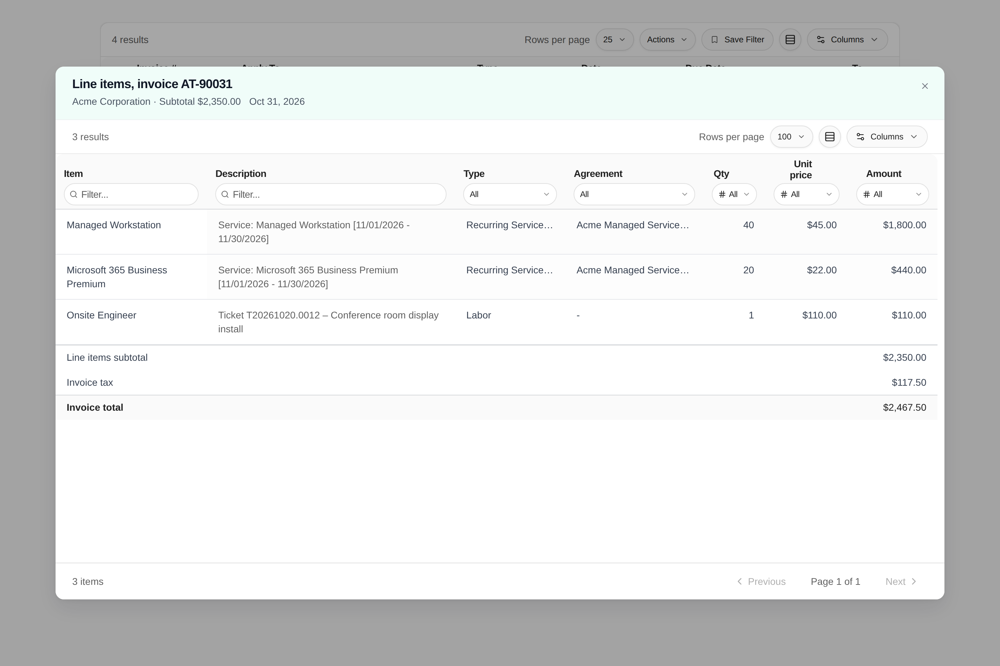
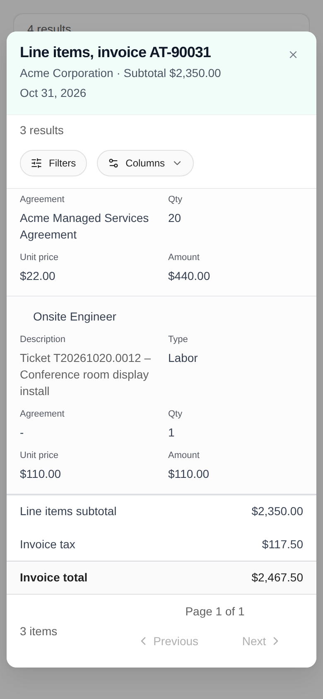

{/* Generated from /user-guides/invoices/view-invoices.mdx by scripts/sync-msp-guides.py. Edit the source page, then rerun the script. */}

This guide is for company users and MSP staff who need to find an invoice and check its status.

## Before you start

- You need invoice-viewing access from your MSP.
- If you can switch companies, set the company selector first.
- Invoices are copied from your PSA. Allow time for a new or changed invoice to arrive.

## Find an invoice

<Steps>
  <Step title="Open Invoices">Click **Invoices** in the sidebar.</Step>
  <Step title="Filter the list">
    Use the column filters. **Invoice #**, **Reference**, **Apply To**, and **PO
    #** take text. **Company** takes one or more companies. **Type**,
    **Status**, and **Date** have their own filters.
  </Step>
  <Step title="Show more columns">
    Use the column toggle to turn on hidden columns. A column only appears when
    your PSA supplies data for it. The **Company** column is hidden when you
    select one company.
  </Step>
  <Step title="Sort and page">
    Click a column heading to sort. The default is **Date**, newest first, with
    invoices from the same day ordered by **Invoice #**. Use the page controls
    at the bottom, or change the page size to 25, 50, 100, or 250.
  </Step>
  <Step title="Open the document">
    Click the **Invoice #**, or open the row menu and choose **View PDF**. See
    [Download and export invoices](/msp-guides/invoices/download-invoices).
  </Step>
</Steps>

## Read the columns

| Column                                                                      | What it shows                                                                                                 |
| --------------------------------------------------------------------------- | ------------------------------------------------------------------------------------------------------------- |
| **Items**                                                                   | How many line items MSPortal has for the invoice. Click the count to open them. A dash means none have synced |
| **Total**                                                                   | The invoice total                                                                                             |
| **Balance**                                                                 | The amount still due. A balance above zero shows in amber                                                     |
| **Payments**, **Subtotal**, **Sales Tax**, **Terms**, **Bill To**, **PO #** | More detail, when your PSA supplies it                                                                        |
| **Status**, **Sent**, **Synced**                                            | Values from the PSA, and when MSPortal last received the invoice                                              |
| **Due Date**                                                                | Turns red with a warning icon when it has passed and a balance remains                                        |
| **Apply To**                                                                | The agreement or other item the invoice applies to. It is not a payment button                                |

The list does not let you edit amounts, change status, void, or resend an invoice. Contact your MSP about corrections. MSP staff can see which PSA field fills each column in [Where invoice data comes from](/msp-guides/invoices/invoice-data-sources).

## Open an invoice's line items

<Note>
  Branch preview: the subtotal, tax, and total footer below is verified on an
  upcoming release branch.
</Note>

<Steps>
  <Step title="Find the Items count">
    The **Items** column sits next to **Total**. ConnectWise, Autotask, and Halo
    invoices show a count once their lines have synced.
  </Step>
  <Step title="Click the count">
    The **Line items** dialog opens for that invoice, with its company,
    subtotal, and date at the top. You can also open the row menu and choose
    **View line items**.
  </Step>
  <Step title="Read, filter, and total the lines">
    Each line shows the **Item**, **Description**, **Type**, **Agreement**,
    **Qty**, **Unit price**, and **Amount**. Filter any column; **Line items
    subtotal** at the bottom adds up the lines before tax. When a filter leaves
    only a subset of the lines, the label changes to **Filtered line items
    subtotal**. Turn on **Date** from the column toggle.
  </Step>
</Steps>

The footer separates the amounts:

| Amount                           | What it shows                                                               |
| -------------------------------- | --------------------------------------------------------------------------- |
| **Line items subtotal**          | The sum of all line amounts before tax                                      |
| **Filtered line items subtotal** | The sum before tax for the matching lines when a filter reduces the results |
| **Invoice tax**                  | Tax from the full original invoice                                          |
| **Invoice total**                | The full original invoice total, including tax                              |

**Invoice tax** and **Invoice total** stay the same when you filter. They come from the invoice supplied by your PSA; filtering does not recalculate tax or produce a new invoice total. The header continues to show the invoice subtotal.

For example, an invoice with a **Line items subtotal** of $2,350.00 and **Invoice tax** of $117.50 has an **Invoice total** of $2,467.50. Filtering to a $110.00 line shows **Filtered line items subtotal** of $110.00, while the tax stays $117.50 and the invoice total stays $2,467.50.

<Tabs>
  <Tab title="Desktop">
    
  </Tab>
  <Tab title="Mobile">
    
  </Tab>
</Tabs>

_Branch preview with synthetic Autotask example data._

{/* Capture provenance: reused parent browser-verification screenshots/invoice-lines/invoices-lines-autotask-desktop.png and invoices-lines-autotask-mobile.png from app branch t3/7487844c, reviewed 2026-11-18. Post-release follow-up: verify the footer and filtered amounts in production, replace both images at the same asset paths with reviewed production captures, and remove the branch-preview notice and caption. */}

The lines match the invoice subtotal, before tax. A ConnectWise invoice can include a **Not itemized** line for charges ConnectWise does not list line by line, such as adjustments, and an **Agreement** line for an agreement's recurring charge. Time covered by an agreement shows its hours with an amount of zero and the agreement's name. Unit cost and margin are never shown.

## Add an invoice to a meeting

<Steps>
  <Step title="Open the row menu">
    Click the three dots at the end of the invoice row and choose **Add to Meeting**. For several invoices, check their rows and choose **Actions > Add to Meeting**.
  </Step>
  <Step title="Check Items to add">
    The **Add to Meeting Agenda** dialog lists the invoices under **Items to add**.
  </Step>
  <Step title="Choose the meeting">
    Open **Select Meeting** and pick an upcoming meeting. The dialog does not create meetings. If none appears, create the meeting first.
  </Step>
  <Step title="Click Add to Agenda">
    Wait for the success message, then open the meeting to confirm the invoice is on its agenda.
  </Step>
</Steps>

**Cancel** closes the dialog without adding anything. This action does not email the invoice or pay it.

## Troubleshooting

| Problem                            | What to do                                                                                                                                                          |
| ---------------------------------- | ------------------------------------------------------------------------------------------------------------------------------------------------------------------- |
| An invoice is missing              | Clear filters, check the company selector, and page through the results. Your MSP may hide some statuses, and invoices with a zero or negative total are not shown. |
| **No Invoices Found**              | This does not prove there are no invoices. Ask your MSP to check the PSA sync and company mapping.                                                                  |
| **Invoices could not be loaded**   | Click **Try Again**. If it keeps failing, tell your MSP.                                                                                                            |
| The order does not match dates     | The default sort is by invoice number. Click **Date** to sort by date.                                                                                              |
| A total looks wrong                | Ask your MSP to correct it in the PSA. The fix arrives with the next sync.                                                                                          |
| **Items** shows a dash             | The invoice has no synced lines yet, or it was uploaded rather than synced from the PSA. New ConnectWise invoices get their lines on the next sync.                 |
| **Line items could not be loaded** | Click **Retry** in the dialog. If it keeps failing, tell your MSP.                                                                                                  |

## Frequently asked questions

<AccordionGroup>
  <Accordion title="Why is the Company column missing?">
    It is hidden when you select one company. Turn on all companies in the
    selector, or check the column toggle.
  </Accordion>
  <Accordion title="Does Apply To apply a payment?">
    No. It names the source item, such as an agreement.
  </Accordion>
  <Accordion title="Does Add to Meeting email the invoice?">
    No. It only adds an agenda item to the meeting you pick.
  </Accordion>
  <Accordion title="Where is Add to Planner?">
    The row menu has no Add to Planner action. It has **View PDF**, **View line
    items** when the invoice has lines, and **Add to Meeting**.
  </Accordion>
  <Accordion title="Why do the line items not add up to the invoice total?">
    The line amounts are before tax. Compare **Line items subtotal**, **Invoice
    tax**, and **Invoice total** in the footer. If you filter to fewer lines,
    only **Filtered line items subtotal** changes; tax and total still refer to
    the full invoice.
  </Accordion>
</AccordionGroup>

## Related guides

- [Invoices overview](/msp-guides/invoices/index)
- [Download and export invoices](/msp-guides/invoices/download-invoices)
- [Use an invoice payment link](/msp-guides/invoices/pay-an-invoice)
