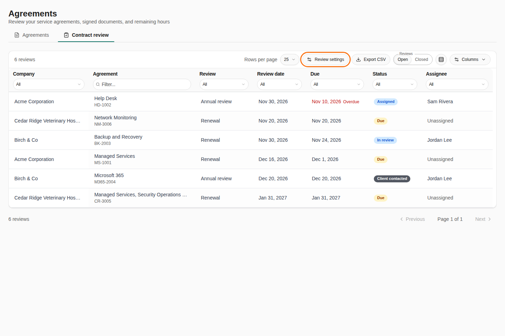
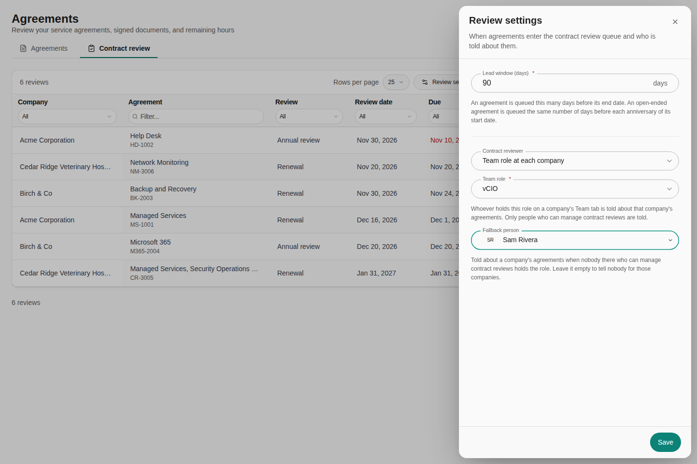
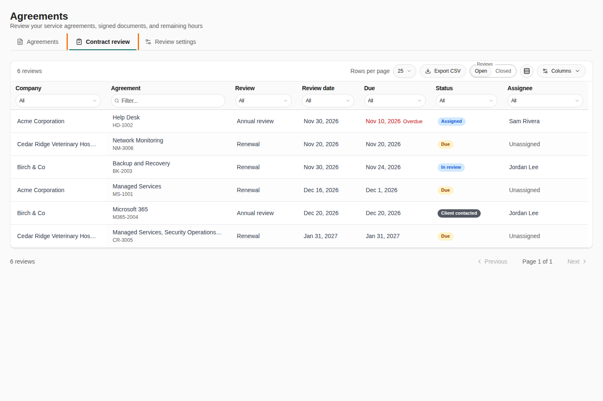
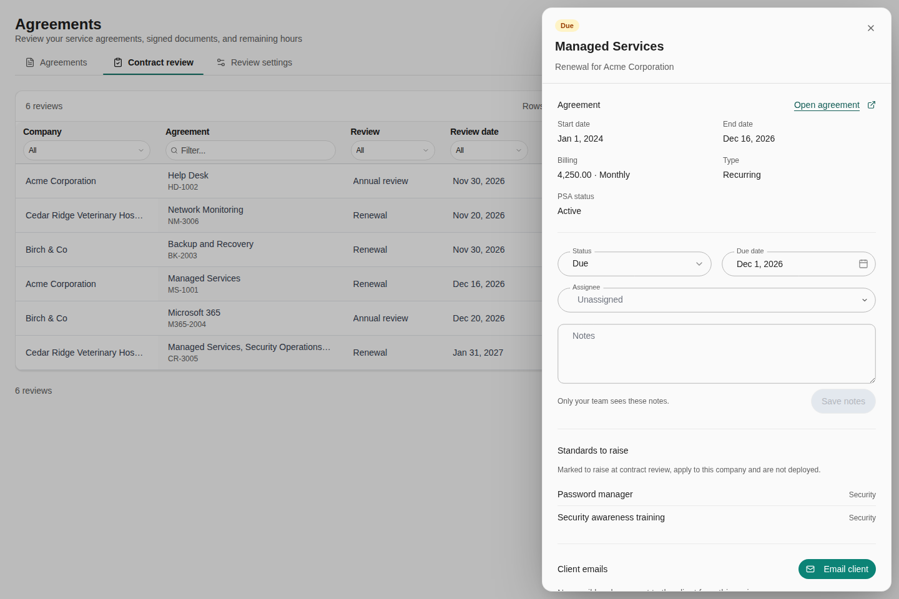
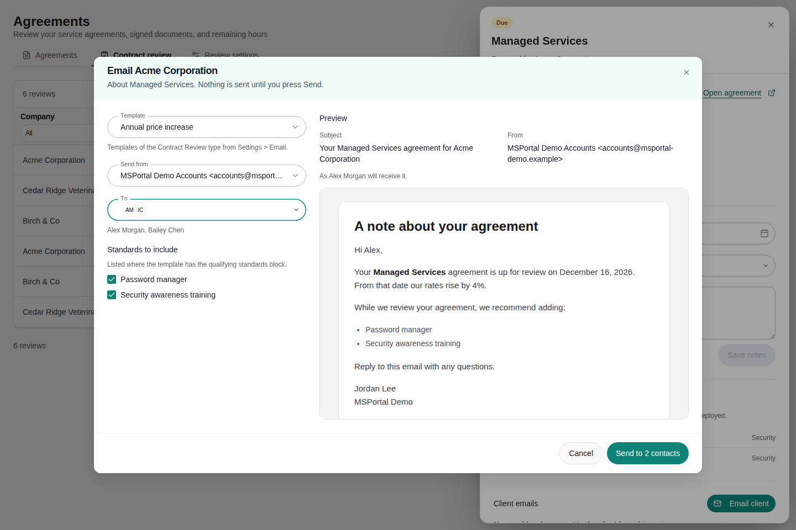
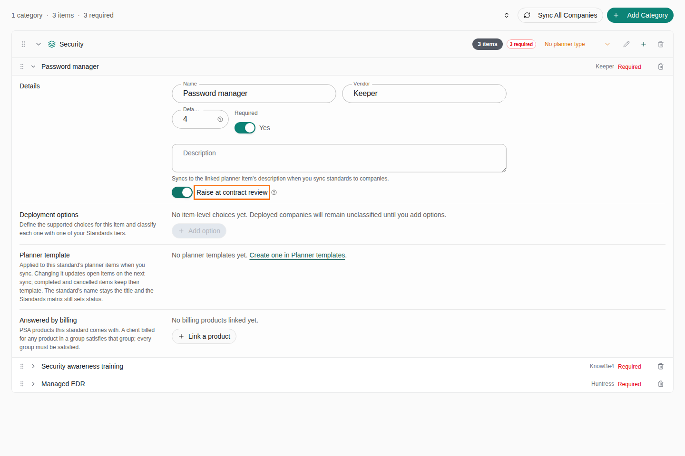

<Note>
  Branch preview: this feature and its screenshots show an upcoming update.
  It is turned on per MSP, so it may not be in your live portal yet.
</Note>

**Contract review** is a tab on **Agreements** (or **Contracts**) for MSP staff. It queues each agreement shortly before it ends, or before its yearly anniversary when it has no end date, so someone reviews it, tells the client about any price change, and renews or replaces it in time.

This guide is for MSP staff. Company users never see the tab.

## Before you start

- MSPortal turns **Contract review** on for your MSP. Until then the tab does not appear.
- You need **read agreements** and the **Agreements: Contract review** permission. **Read** opens the queue and shows the review settings. **Manage** also lets you assign and update reviews, email clients, and change the settings. No role has the permission at first, so a Primary Admin grants it in **Settings > Users & Roles**. See [Users and roles](/user-guides/settings/users-roles).
- Agreements come from your PSA. Contract review reads them and never changes the PSA.

## Set up the queue

Nothing is queued until someone with **Manage** saves the settings once.

<Steps>
  <Step title="Open Review settings">
    Click **Agreements**, then the **Contract review** tab, then the **Review settings** button in the toolbar above the list. The settings open in a panel on the right. Until the queue is set up, the empty list has a **Review settings** button too.
  </Step>
  <Step title="Set the Lead window (days)">
    An agreement enters the queue this many days before its end date. An agreement with no end date enters the same number of days before each anniversary of its start date. The default is 90. Use 1 to 365.
  </Step>
  <Step title="Choose the Contract reviewer">
    The contract reviewer is who MSPortal tells when agreements enter the queue. Pick one of:
    - **Team role at each company**, then the **Team role** your MSP uses for this, such as an account manager or vCIO role. For each agreement, whoever holds that role on the company's **Team** tab is told, so each company gets its own person. Optionally pick a **Fallback person**, who is told about a company's agreements when nobody there holds the role.
    - **One person**, then the **Person**. They are told about every agreement, whatever the company.
    - **Nobody**. Nobody is told. Agreements still enter the queue.

    A first setup starts on **Team role at each company**, so you choose who is told before you save.

    Only people with **Manage** on Contract review are told, because the notice asks them to assign the review. Team roles are set up in **Settings > Users & Roles > Team Roles**.
  </Step>
  <Step title="Click Save">
    Agreements already inside the window are queued straight away, and the message tells you how many. The panel closes.
  </Step>
</Steps>

<Frame caption="Branch preview: the Review settings button on the Contract review list, with sample data.">
  
</Frame>

<Frame caption="Branch preview: Review settings with a team role as the Contract reviewer, with sample data.">
  
</Frame>

Without **Manage**, you can open the panel and read the settings, but not change them. If you close the panel with changes you have not saved, MSPortal asks before it discards them.

Reviews already in the queue stay there if you make the window shorter.

## Which agreements are queued

MSPortal checks once a day. An agreement is queued when it is active in the PSA (its status is **Active** and it is not cancelled) and one of these is true:

| Review | When it is queued |
| --- | --- |
| **Renewal** | The agreement has an end date that falls inside the lead window. |
| **Annual review** | The agreement has no end date, and the next anniversary of its start date falls inside the lead window. |

A renewal whose end date passed in the last 30 days is queued too, as overdue, while the agreement is still active in the PSA. That covers an agreement that ended just before you turned contract review on. A one-time agreement (one the PSA bills once) gets no annual review.

An agreement the PSA marks as open-ended counts as having no end date, even when it still carries an old end date. So does an agreement whose end date is ten or more years away, such as the 12/31/2099 date HaloPSA gives an agreement with no end date: it gets an annual review, and the page shows it with no end date.

Each agreement has one open review at a time. When you close a review, it moves to **Closed** and stays there as history. Next year's review is a new one.

## Who is notified

When agreements enter the queue, MSPortal sends one email and one in-app notification to the **Contract reviewer** from Review settings:

- with **Team role at each company**: whoever holds the chosen role on the agreement's company **Team** tab. When nobody there holds it, or nobody who holds it has **Manage** on Contract review, the **Fallback person** is told instead. With no fallback person, nobody is told about that company's agreement: it still waits in the queue, and MSPortal tries again each day for a week in case someone is given the role.
- with **One person**: that person, for every agreement.

If the chosen team role is deleted later, the **Fallback person** is told about every agreement until someone picks a new role, and **Review settings** says the role was deleted.
- with **Nobody**: nobody. The queue still fills.

Only people with the **Manage** permission for Contract review are notified, because the notice asks them to assign the review. Someone with read access only sees the queue but gets no notice. Someone with several agreements gets one message listing them all. A review that someone assigns before the daily check is still announced. Agreements of the demo company are queued but never announced.

MSPortal never emails a client contact by itself. Only a person sends the client email, from a review.

## Work a review

<Steps>
  <Step title="Open the Contract review tab">
    **Open** lists every review that is not done or skipped, soonest due first. **Closed** lists the history. The list follows the company selector. A review past its **Due** date is marked **Overdue**.
  </Step>
  <Step title="Click a row">
    A panel shows the agreement's dates, billing and PSA status. **Open agreement** takes you to the agreement itself.
  </Step>
  <Step title="Assign it">
    Pick an **Assignee**. Only people with **Manage** on Contract review are listed. A review that was **Due** becomes **Assigned**, and the assignee gets an in-app notification.
  </Step>
  <Step title="Update Status, Due date and Notes">
    **Status** and **Due date** save when you change them. Type your **Notes** and click **Save notes**. Notes are for your team only.
  </Step>
  <Step title="Close it">
    Set **Status** to **Done** or **Skipped**. You can reopen a closed review by choosing another status, unless a newer review is already open for the same agreement.
  </Step>
</Steps>

<Frame caption="Branch preview: the Contract review queue, with sample data.">
  
</Frame>

<Frame caption="Branch preview: one review, with the Standards to raise.">
  
</Frame>

| Status | Meaning |
| --- | --- |
| **Due** | In the queue, nobody assigned. |
| **Assigned** | Someone owns it. Assign a person to reach it; setting an assigned review back to **Due** removes the assignee. |
| **In review** | Work has started. |
| **Client contacted** | The client has been told. Set automatically when you send the email. |
| **Done** | Finished. |
| **Skipped** | Closed without a review. |

If someone else changes a review while you have it open, your change is not saved. The panel reloads with theirs so you can make yours again.

## Email the client

<Steps>
  <Step title="Click Email client in the review">
    A dialog opens. Nothing is sent until you click **Send**.
  </Step>
  <Step title="Choose a Template">
    The list holds your templates of the **Contract Review** type and the built-in **Default Contract Review**. Create your own in **Settings > Email**. See [Email templates](/user-guides/settings/email).
  </Step>
  <Step title="Choose Send from">
    Pick one of your sender addresses. If your MSP has none, the email goes from the address your email settings resolve to.
  </Step>
  <Step title="Choose the contacts under To">
    The list holds the company's contacts that have an email address. Each contact gets their own email, so the greeting uses their name. The emails go out together: all of them, or none if the send fails.
  </Step>
  <Step title="Add a Message, if you want">
    Write anything for this client only, such as their new price. It appears where the template has the `{{message}}` block, as **Default Contract Review** does. Leave it empty to send the template as it is.
  </Step>
  <Step title="Untick any Standards you do not want to mention">
    See [Raise missing Standards](#raise-missing-standards).
  </Step>
  <Step title="Read the Preview, then click Send">
    The preview is the email exactly as the first contact receives it. **Send** stays off until the preview shows your current choices.
  </Step>
</Steps>

<Frame caption="Branch preview: the email, merged and ready to send.">
  
</Frame>

After the send, the review moves to **Client contacted** and the email appears under **Client emails** with who sent it, when, to whom, from which address, and which Standards it listed.

A **Contract Review** template can use these variables:

| Variable | Filled with |
| --- | --- |
| `{{recipient_greeting}}` | A greeting with the contact's first name, such as "Hi Alex,". |
| `{{recipient_name}}`, `{{recipient_firstname}}` | The contact's name. |
| `{{company_name}}` | The client company. |
| `{{agreement_name}}` | The agreement. |
| `{{agreement_start_date}}`, `{{agreement_end_date}}` | The agreement's dates. The end date is empty for an open-ended agreement. |
| `{{review_date}}` | The end date, or the anniversary under review. |
| `{{agreement_billing}}` | What the agreement bills now in the PSA, such as "1,500.00 · Monthly". Empty when the PSA has no amount. |
| `{{message}}` | The message you wrote in the dialog. Empty when you wrote none. |
| `{{qualifying_standards}}` | A line and a list of the missing Standards you left ticked. Empty when there are none. |
| `{{sender_name}}`, `{{sender_company}}` | You and your MSP. |
| `{{today}}`, `{{portal_name}}`, `{{company_logo_url}}` | The date, your portal name and your logo. |

## Raise missing Standards

Mark the Standards worth raising with a price change, such as a password manager. A review then lists the ones its company is missing.

<Steps>
  <Step title="Open Settings > Standards">
    You need **Manage** on Standards settings.
  </Step>
  <Step title="Open a standard and turn on Raise at contract review">
    The switch saves on its own.
  </Step>
</Steps>

<Frame caption="Branch preview: the switch in a standard's details.">
   Standards with the Raise at contract review switch turned on"
    width="1440" height="960" />
</Frame>

In a review, **Standards to raise** lists every marked standard that applies to the company and is neither deployed nor already billed. This is the same gap the Standards **White space** view shows as open. The list needs **read Standards** access and Standards white space turned on for your MSP. Without them, the review says the list is not available.

## Troubleshooting

| Problem | What to check |
| --- | --- |
| No **Contract review** tab | MSPortal has not turned it on for your MSP, or your role lacks **read agreements** or the **Agreements: Contract review** permission. |
| The queue says it is not set up | Click **Review settings** above the list and save the settings once. |
| No **Review settings** tab | Review settings are a button in the toolbar of the **Contract review** tab, not a tab. Old links to the settings open that panel. |
| An agreement is missing from the queue | It must be active in the PSA, and its end date or anniversary must be inside the lead window. The queue updates once a day and when settings are saved. An agreement with an open review does not get a second one. |
| A person is missing from **Assignee** or **Person** | Only active staff with **Manage** on Contract review are listed. |
| Someone in the reviewer role was not notified | They need **Manage** on Contract review and the chosen role on that company's **Team** tab. When nobody there qualifies, the **Fallback person** is told instead. Reviews already announced are not announced again; they are in the queue. |
| **Team role** has nothing to choose | Your MSP has no team roles yet. Add them in **Settings > Users & Roles > Team Roles**. |
| **Standards to raise** is empty | No standard is marked, or the company has them all. A standard outside the company's plan or applicability rules is not listed. |
| No contacts under **To** | The company has no contacts with an email address. |

## Frequently asked questions

<AccordionGroup>
  <Accordion title="Does this change the agreement in my PSA?">
    No. Renew, replace or reprice the agreement in the PSA. Contract review tracks the review and the email.
  </Accordion>
  <Accordion title="Will a client ever get an email automatically?">
    No. The daily notice goes to your own staff. A client email is sent only when a person clicks Send in a review.
  </Accordion>
  <Accordion title="Can company users see reviews or notes?">
    No. The tab, the reviews and the notes are for MSP staff.
  </Accordion>
  <Accordion title="What happens to a review when the agreement is removed from the PSA?">
    It leaves the queue with the agreement.
  </Accordion>
</AccordionGroup>

## Related guides

- [Agreements overview](/msp-guides/agreements/index)
- [Find and review an agreement](/msp-guides/agreements/view-agreements)
- [Standards settings](/user-guides/settings/standards)
- [Email settings](/user-guides/settings/email)
