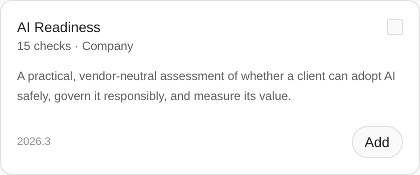
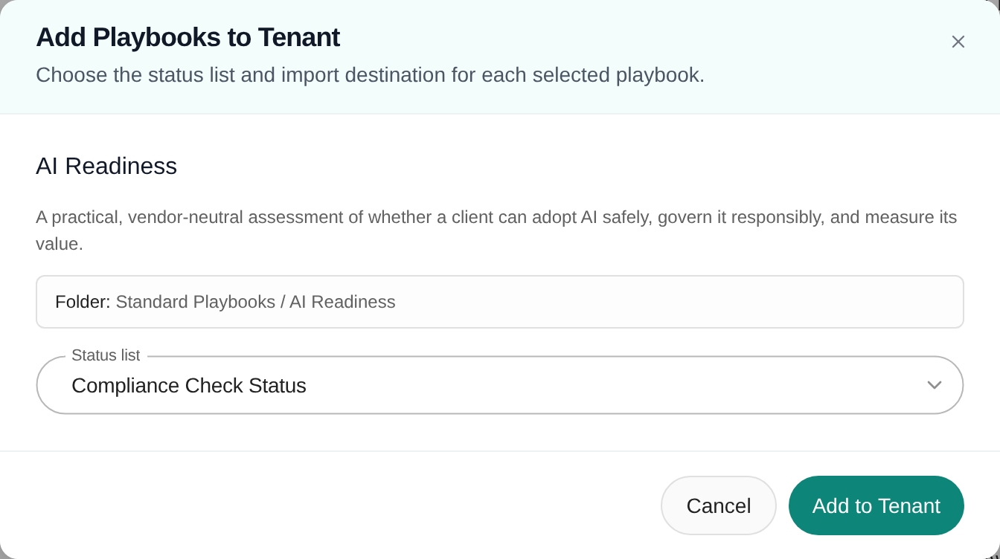
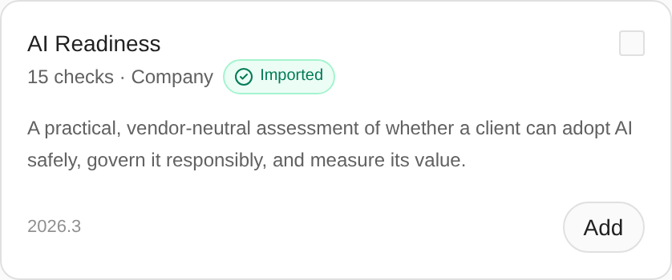
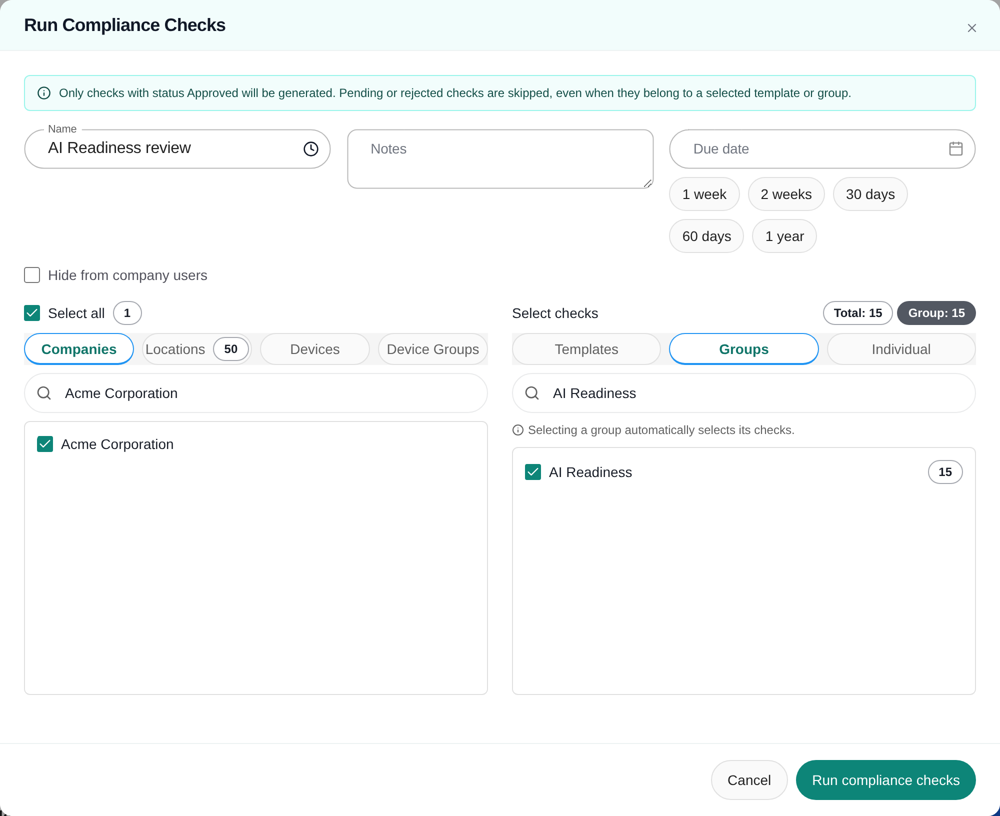
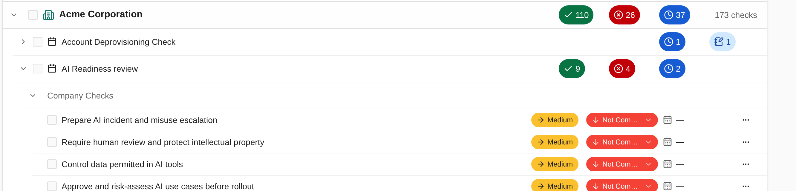
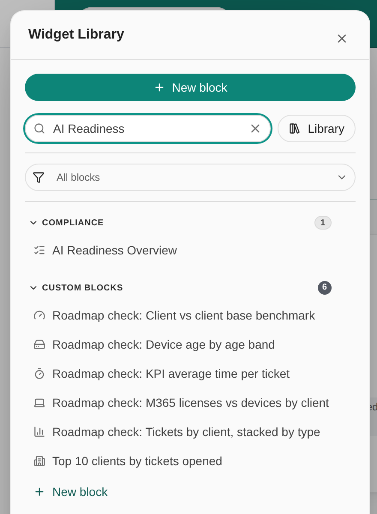
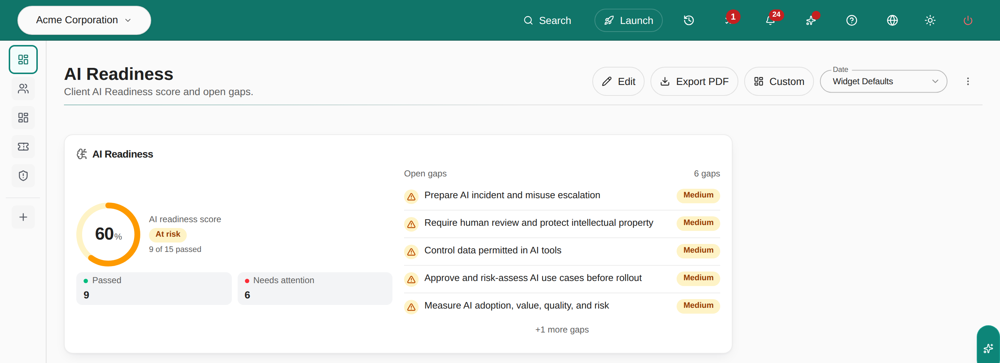
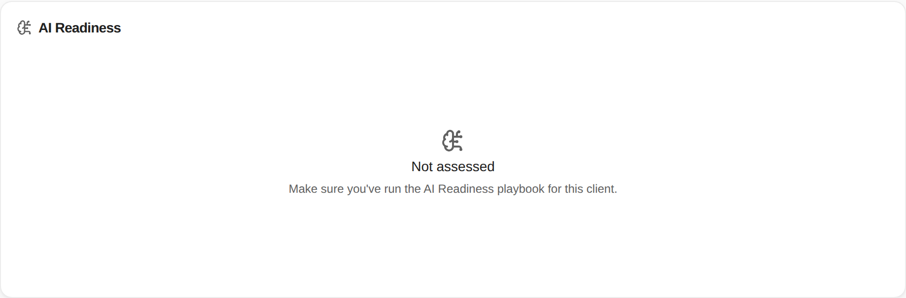

The **AI Readiness** playbook is a vendor-neutral review of whether a client can adopt AI safely, govern it, and measure its value. The **AI Readiness Overview** block turns that review into a score and a list of open gaps on a dashboard or report. This guide is for MSP staff.

<Warning>
Importing the playbook does not add anything to a dashboard. It only adds the checks to your library. The block shows a score once you complete all three parts: import the playbook, run its checks for a client, and add the block to a dashboard.
</Warning>

## Before you start

- To import, you need Playbooks management permission and an active subscription.
- To run the checks and record results, you need Compliance write access.
- To add the block, you need **Write** or **Manage** access to Dashboards, plus Compliance read access. The block does not appear in the **Widget Library** without Compliance access.
- Your tenant needs at least one status list. The import uses your default list unless you pick another.

## 1. Import the AI Readiness playbook

<Steps>
  <Step title="Open Best Practices">
    Open **Settings > Compliance > Playbooks** and click **Best Practices**. **AI Readiness** is under **Operational reviews**. It has 15 company-level checks.

    <Frame caption="AI Readiness in the Best Practices library.">
      
    </Frame>
  </Step>
  <Step title="Click Add">
    Click **Add** on the **AI Readiness** card. To read the checks first, click the playbook's name.
  </Step>
  <Step title="Check the folder and status list">
    In **Add Playbooks to Tenant**, the checks go to **Standard Playbooks / AI Readiness**. Your default **Status list** is already selected. Change it if you assess with another list.

    <Frame caption="Add Playbooks to Tenant for AI Readiness.">
      
    </Frame>
  </Step>
  <Step title="Click Add to Tenant">
    The card now shows **Imported**. MSPortal also creates a check group called **AI Readiness**, which you use in the next step. The imported checks start out **Approved**, so you can run them right away.

    <Frame caption="The Imported badge confirms the checks are in your library.">
      
    </Frame>
  </Step>
</Steps>

## 2. Assess a client

The block reads AI Readiness checks that are assigned to a company. A run assigns them.

<Steps>
  <Step title="Open Run Checks">
    Open **Compliance** and click **Run Checks**.
  </Step>
  <Step title="Name the run">
    Type a **Name**, such as **AI Readiness review**. **Notes** and **Due date** are optional. Leave **Hide from company users** clear if the client should see these checks in their portal.
  </Step>
  <Step title="Pick the client">
    On the **Companies** tab, search for the client and tick it. Tick several clients to assess them all in one run.
  </Step>
  <Step title="Pick the AI Readiness group">
    In **Select checks**, open the **Groups** tab, search for **AI Readiness**, and tick it. The badges read **Total: 15** and **Group: 15**.

    <Frame caption="One client and the AI Readiness group, ready to run.">
      
    </Frame>
  </Step>
  <Step title="Click Run compliance checks">
    MSPortal shows **Compliance run queued successfully** and assigns the checks in the background, usually within a minute.
  </Step>
  <Step title="Record the results">
    In the **Tree** view, expand the client, then the run, then **Company Checks**. Set each check's status from its status button. To set the same status on several checks, tick them, click **Actions** in the page header, and choose **Set Status**.

    <Frame caption="AI Readiness checks for one client, with results recorded.">
      
    </Frame>
  </Step>
</Steps>

To reassess on a cycle, add the **AI Readiness** group to a run template and schedule it. See [Compliance settings](/user-guides/settings/compliance) and [Schedule compliance assessments](/user-guides/settings/compliance-schedules).

## 3. Add the block to a dashboard

<Steps>
  <Step title="Open the dashboard editor">
    Open a custom dashboard and click **Edit**, or create one: click **Dashboards**, then the **+** button. See [Create and edit a dashboard](/user-guides/dashboards/create-and-edit-dashboard).
  </Step>
  <Step title="Find the block">
    Click **Widget Library** and search for **AI Readiness**. Click **AI Readiness Overview** under **Compliance**. The block appears in the first free spot on the dashboard.

    <Frame caption="AI Readiness Overview in the Widget Library.">
      
    </Frame>
  </Step>
  <Step title="Arrange it">
    Drag the grip to move the block, and use the size button to resize it. A larger block shows more gaps.
  </Step>
  <Step title="Click Save">
    Click **Save** in the page header and wait for **Dashboard saved**.
  </Step>
</Steps>

The same block is available in reports. Add **AI Readiness Overview** from the report builder's block list to put the score in a business review.

## Read the block

Pick the client in the company selector at the top of the page. In **Global View**, the block combines every company that has AI Readiness checks.

<Frame caption="AI Readiness for one client: 9 of 15 checks passed.">
  
</Frame>

| Part | What it shows |
| --- | --- |
| **AI readiness score** | The share of the client's AI Readiness checks with a passing status. The score leaves out statuses your status list excludes from scoring. |
| Score label | **Healthy** at 80% or more, **At risk** from 60% to 79%, **Failing** below 60%. |
| **Passed** | Checks whose status your status list marks as passing, such as **Compliant** or **Not Applicable**. |
| **Needs attention** | Checks that have not passed yet: **Not Compliant** results and checks still at **New** or **In Progress**. |
| **Open gaps** | The checks that need attention, highest priority first. A small block shows fewer and adds **+N more gaps**. |

A client with no AI Readiness checks assigned shows **Not assessed** with **Make sure you've run the AI Readiness playbook for this client.** Run the playbook for that client to fill it.

<Frame caption="A client without an AI Readiness run.">
  
</Frame>

## What clients see

Company users see the block only on a dashboard or report your MSP shares with them, and only for their own company. The block counts only checks visible to them, so a run created with **Hide from company users** does not appear in their view. To share a dashboard, see [Dashboard settings](/user-guides/dashboards/manage-dashboard-settings).

## Troubleshooting

| Problem | What to do |
| --- | --- |
| I imported the playbook but no dashboard shows AI Readiness | Expected. Importing only adds checks. Run them for a client, then add **AI Readiness Overview** to a dashboard. |
| The block shows **Not assessed** | No AI Readiness checks are assigned to the selected company. Check the company selector, then run the **AI Readiness** group for that client. |
| The score stays at 0% | Every check is still **New**. Record results in **Compliance**. |
| **AI Readiness Overview** is missing from the Widget Library | You need Compliance read access. Ask your MSP admin. |
| **AI Readiness** is missing from the run's **Groups** tab | The playbook is not imported, or the group was renamed or deleted. Check **Settings > Compliance > Groups**. |
| The run finished but some checks are missing | Only **Approved** checks are assigned. Approve them in **Settings > Compliance > Checks**, then run again. |
| My own checks do not count toward the score | The block counts only checks imported from the AI Readiness playbook. Checks you write yourself, even in the same group, are left out. |

## Frequently asked questions

<AccordionGroup>
  <Accordion title="Does importing the playbook turn on the dashboard?">
    No. Importing adds 15 checks and an **AI Readiness** group to your library. It does not assign them to a company or add a block to any dashboard. Complete the three parts in this guide.
  </Accordion>
  <Accordion title="What happens when I reassess a client?">
    The score counts AI Readiness checks from every run for that client, open or completed. Completed runs still count. When a client has more than one run, the block also compares the latest run's score with the previous one.
  </Accordion>
  <Accordion title="Can I change the checks?">
    Yes. Edit the imported checks in **Settings > Compliance > Checks**. Your edits stay when you import the playbook again, which only adds checks you do not have yet.
  </Accordion>
  <Accordion title="Can I show AI Readiness for several clients at once?">
    In **Global View**, or with several companies selected, the block combines their checks into one score. For a per-client view, pick one company in the selector.
  </Accordion>
</AccordionGroup>

## Related guides

- [Playbook settings](/user-guides/settings/playbooks)
- [Compliance](/user-guides/compliance/index)
- [Find checks and understand results](/user-guides/compliance/find-and-read-checks)
- [Create and edit a dashboard](/user-guides/dashboards/create-and-edit-dashboard)
