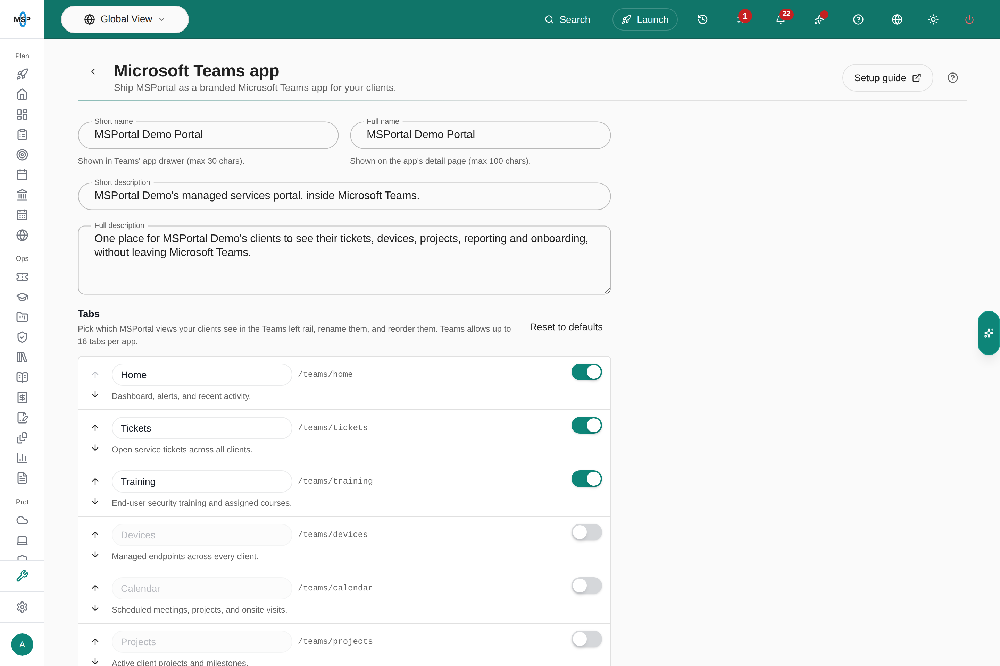
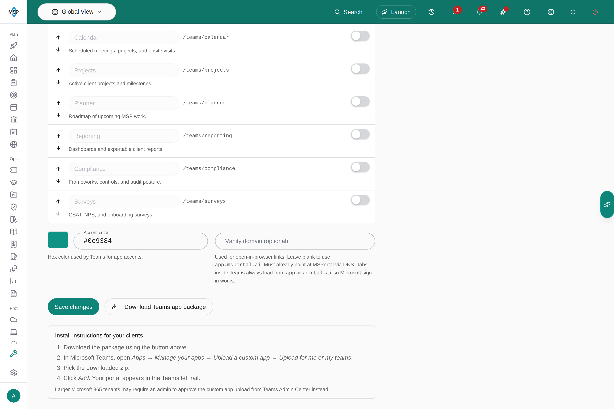

This guide walks you through publishing MSPortal as a branded Microsoft Teams app for your clients. You configure the app's name, branding, and tabs in MSPortal, download a ready-to-install app package, and upload it into Microsoft Teams.

## Overview

The Microsoft Teams integration packages your portal as a custom Teams app that lives in the Teams left rail. With it, you can:

- Give clients a branded app carrying your name, description, and accent color
- Choose exactly which portal views appear as tabs: tickets, training, devices, reporting, and more
- Let clients sign in with their Microsoft account and work with live portal data inside Teams
- Rename and reorder tabs to match how your clients think about your services

## How the App Works

- **One package for all of your clients.** You configure the app once and download one zip. Every client organization installs that same package; there is no per-client build.
- **The tabs show the live portal.** Each tab loads the matching MSPortal view inside Teams, so new features, fixes and data reach your clients without a new package.
- **A new package only for app changes.** Re-upload the package only after you change the app itself: its name, descriptions, icon, accent color or tabs. See [Updating an Installed App](#updating-an-installed-app).

The Microsoft Teams app is available on every MSPortal account. Find it under **Settings > Integrations**.

## Prerequisites

- MSPortal.ai account with integration management permissions
- Microsoft Teams in the client's Microsoft 365 environment
- Permission to upload custom apps in the client's Teams environment (larger organizations may require a Teams administrator to approve the upload)

## Part 1: Configure Your Teams App

Set up the app's branding and tabs in MSPortal.

<Steps>
  <Step title="Navigate to Integrations">
    In MSPortal.ai, go to **Settings > Integrations**.
  </Step>

  <Step title="Open the Teams App Settings">
    Locate the **Microsoft Teams** card and click **Set up Teams app** (or **Manage Teams app** if you have configured it before).
  </Step>

  <Step title="Set the App Name and Descriptions">
    Configure how the app presents itself to your clients:

    | Field | Description |
    |-------|-------------|
    | **Short name** | Shown in Teams' app drawer (max 30 characters) |
    | **Full name** | Shown on the app's detail page (max 100 characters) |
    | **Short description** | One-line summary (max 80 characters) |
    | **Full description** | Longer description shown on the app's detail page |

    MSPortal pre-fills these with sensible defaults based on your organization name.
  </Step>

  <Step title="Choose Your Tabs">
    In the **Tabs** section, pick which MSPortal views your clients see in the Teams left rail. For each tab you can:

    - **Enable or disable** it with the toggle
    - **Rename** it by editing the label
    - **Reorder** it with the up and down arrows

    **Home**, **Tickets**, and **Training** are enabled by default. Click **Reset to defaults** to return to the default set at any time.

    <Note>
      Teams allows up to 16 tabs per app, and at least one tab must be enabled.
    </Note>

    
  </Step>

  <Step title="Set the Accent Color">
    Pick the hex color Teams uses for app accents. It defaults to your brand's primary color from **Settings > Tenant > Branding**.
  </Step>

  <Step title="Set a Vanity Domain (Optional)">
    Optionally enter a custom domain (for example `portal.yourmsp.com`) to use for open-in-browser links. The domain must already be verified and active for your account under **Settings > Tenant > Domains**, and it must point at MSPortal through DNS. Leave it blank to use the standard MSPortal address.

    <Info>
      Tabs inside Teams always load from the standard MSPortal address so Microsoft sign-in works; the vanity domain only affects links that open in the browser.
    </Info>
  </Step>

  <Step title="Save">
    Click **Save changes** and wait for the **Teams app saved** message. Tab toggles, reordering and **Reset to defaults** change the form only until you save. The download uses the saved configuration.

    
  </Step>
</Steps>

---

## Part 2: Download and Install the App Package

MSPortal generates a Teams app package (a zip file) from your configuration. Install it in each client's Microsoft 365 organization, either for the whole organization from the Teams admin center or by a user uploading it in Teams.

### Deploy to a Whole Client Organization (Recommended)

A Teams administrator in the client's organization (or your team, through delegated admin access) publishes the app once for everyone.

<Steps>
  <Step title="Download the Package">
    Click **Download Teams app package**. This downloads a zip file containing your branded app.
  </Step>

  <Step title="Upload It to the Organization's App Catalog">
    In the client's [Teams admin center](https://admin.teams.microsoft.com), open **Teams apps > Manage apps** and choose **Upload new app**, then select the zip.
  </Step>

  <Step title="Make It Available">
    Allow the app for the users who should have it. To add it for them automatically, add it to a setup policy under **Teams apps > Setup policies** (**Installed apps**, and **Pinned apps** to pin it to the left rail).
  </Step>
</Steps>

Teams can take several hours to apply setup-policy changes to every user.

### Install for Yourself or a Single Team

Where the organization allows custom app uploads, a user can install the app directly.

<Steps>
  <Step title="Download the Package">
    Click **Download Teams app package** in MSPortal, or use the zip your MSP sent you.
  </Step>

  <Step title="Upload the App in Microsoft Teams">
    In Microsoft Teams, open **Apps > Manage your apps > Upload a custom app > Upload for me or my teams**.
  </Step>

  <Step title="Pick the Downloaded Zip">
    Select the zip file you downloaded from MSPortal.
  </Step>

  <Step title="Add the App">
    Click **Add**. Your portal appears in the Teams left rail with the tabs you configured.
  </Step>
</Steps>

<Note>
  Larger Microsoft 365 organizations may block direct custom app uploads. In that case, a Teams administrator can approve and deploy the custom app from the Teams admin center instead.
</Note>

---

## Available Tabs

You can offer any of the following MSPortal views as tabs in your Teams app:

| Tab | Description | Enabled by Default |
|-----|-------------|--------------------|
| **Home** | Dashboard, alerts, and recent activity | Yes |
| **Tickets** | Open service tickets across all clients | Yes |
| **Training** | End-user security training and assigned courses | Yes |
| **Devices** | Managed endpoints across every client | No |
| **Calendar** | Scheduled meetings, projects, and onsite visits | No |
| **Projects** | Active client projects and milestones | No |
| **Planner** | Roadmap of upcoming MSP work | No |
| **Reporting** | Dashboards and exportable client reports | No |
| **Compliance** | Frameworks, controls, and audit posture | No |
| **Surveys** | CSAT, NPS, and onboarding surveys | No |

Inside Teams, users sign in with their Microsoft account and see live MSPortal data. Each user sees only what their MSPortal permissions and company scope allow.

---

## Managing Your Teams App

Return to **Settings > Integrations** and click **Manage Teams app** at any time to update the configuration.

| Action | Description |
|--------|-------------|
| **Save changes** | Update the name, descriptions, tabs, accent color, or vanity domain |
| **Download Teams app package** | Download a package reflecting your last saved configuration |
| **Reset to defaults** | Restore the default tab set in the Tabs section |

### Updating an Installed App

Your clients get MSPortal updates inside Teams automatically: the tabs load the live portal, so new features, fixes and data appear without any action from you.

A new package is needed only when you change the app itself. Each time you save the Teams app settings, and when you change your logo under **Settings > Tenant > Branding**, MSPortal raises the app's version number. To roll those changes out:

1. Download the package again.
2. Upload it where the app was first installed: in the Teams admin center, open the app under **Teams apps > Manage apps** and upload the new file; for a direct install, upload the new version in Teams.

The app keeps the same app ID, so Teams treats the new package as an update to the installed app rather than a second app.

---

## Troubleshooting

| Issue | Solution |
|-------|----------|
| Microsoft Teams card missing from Integrations | Your role needs permission to manage integrations; ask an administrator on your MSPortal account |
| "Save your configuration first" when downloading | Click Save before downloading the app package |
| Save button disabled | Check the Tabs section: at least one tab must be enabled, and no more than 16 |
| Client cannot upload the app in Teams | Their organization restricts custom app uploads; a Teams administrator must approve the app from the Teams admin center |
| Tab changes not visible to clients | Download the updated package and upload the new version in Teams |

---

## Security & Privacy

- **Sign-in**: Users authenticate with their Microsoft account; all data access follows your existing MSPortal permission model
- **Fixed tab set**: Tabs can only point at MSPortal views; the app cannot be configured to load arbitrary destinations
- **Data Isolation**: Clients only see the data their MSPortal accounts already have access to

---

## Next Steps

After publishing your Teams app:

<CardGroup cols={2}>
  <Card title="Configure Branding" icon="palette" href="/user-guides/settings/tenant">
    Set your brand colors and custom domains
  </Card>
  <Card title="Ticketing" icon="ticket" href="/user-guides/ticketing/index">
    Explore the ticketing experience your clients see in Teams
  </Card>
  <Card title="Training" icon="graduation-cap" href="/user-guides/training/index">
    Assign security training courses your clients complete from Teams
  </Card>
  <Card title="Other Integrations" icon="plug" href="/user-guides/integrations/index">
    Explore additional integration options
  </Card>
</CardGroup>

## Frequently asked questions

<AccordionGroup>
  <Accordion title="Why does the download miss my latest tab edits?">
    The package is built from saved settings. Select **Save changes** and wait for it to succeed before you download.
  </Accordion>
  <Accordion title="Does Reset to defaults change the installed app?">
    No. It resets the tab editor only. Save, download a new package and upload it in Teams to change installed tabs.
  </Accordion>
  <Accordion title="Does adding a tab give clients access to its data?">
    No. Each signed-in user still needs the matching MSPortal access and company scope. Test with a client account before you distribute the app.
  </Accordion>
  <Accordion title="Why is my vanity domain rejected even though DNS resolves?">
    The domain must be verified and active for your account under **Settings > Tenant > Domains**. You cannot use a domain that belongs to another account or MSPortal's own host.
  </Accordion>
  <Accordion title="Do I need a separate package for each client?">
    No. One package works for all of your clients. Each client's Microsoft 365 organization installs the same zip, and each user sees only the companies and data their MSPortal access allows.
  </Accordion>
  <Accordion title="Do clients need a new package when MSPortal releases new features?">
    No. The tabs load the live portal, so product updates appear in Teams automatically. Upload a new package only after you change the app's name, descriptions, icon, accent color or tabs.
  </Accordion>
  <Accordion title="Does Save deploy the app to all clients?">
    No. Saving updates the configuration and raises the package version. Download the package and distribute it through each organization's Teams process.
  </Accordion>
  <Accordion title="What should I check before rolling it out?">
    Install the saved package for a test user, sign in, and check the enabled tabs, their data and the browser links. A Teams administrator may need to approve distribution.
  </Accordion>
</AccordionGroup>

## Need Help?

For assistance with the Microsoft Teams integration, contact support@msportal.ai.
