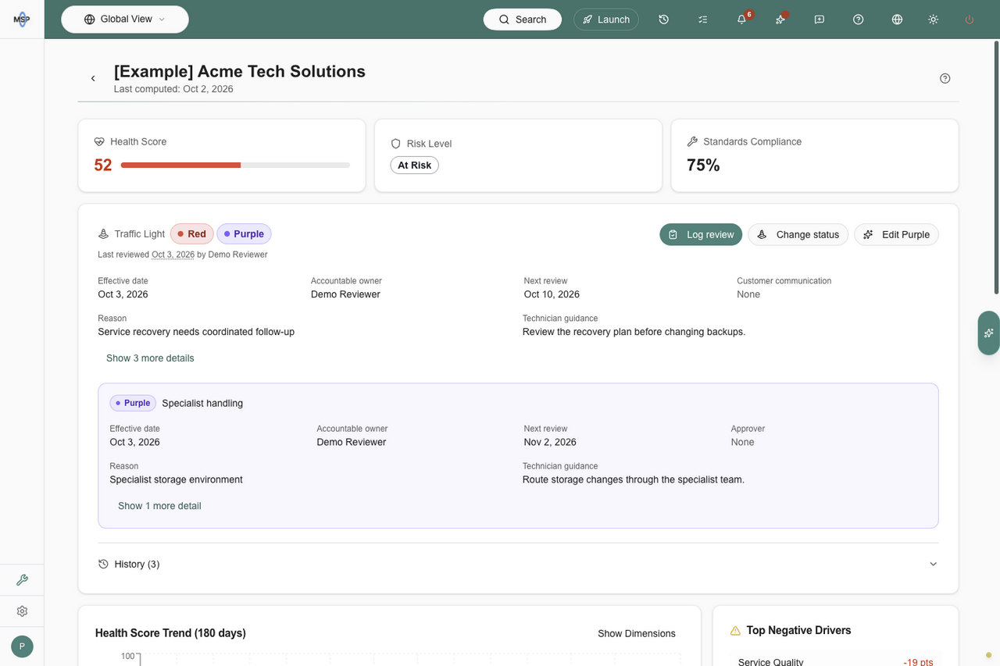
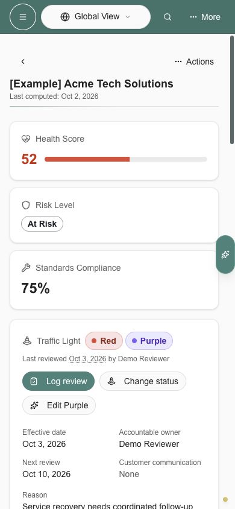

This guide shows MSP staff how to read a company's Client Health detail page. Company portal users cannot open it.

## Before you start

- You need Client Health read access (`read_customer_success`).
- Client Health needs at least one published scorecard. See [Refresh Client Health scores](/user-guides/msp-tools/refresh-client-health).

## Open a company's details

<Steps>
  <Step title="Open Client Health">
    In the sidebar, open **MSP Tools > Client Success**, then select the **Health** tab.
  </Step>
  <Step title="Open the company">
    Click a company row, or click a company in **Spotlight**.
  </Step>
  <Step title="Check the date">
    The page header shows **Last computed** with the scorecard date. Check it before you read the numbers.
  </Step>
  <Step title="Go back">
    Click the back arrow to return to the **Health** tab.
  </Step>
</Steps>

## Read the summary cards

<Steps>
  <Step title="Read the Health Score card">
    The score runs from 0 to 100. Hover it to see the dimensions that feed it and their weights. The card is missing when the company has too little evidence. The default model needs at least three scored dimensions and 40% evidence coverage.
  </Step>
  <Step title="Read the Risk Level card">
    The level comes from the score: **Thriving** at 80 or above, **Healthy** at 60 or above, **At Risk** at 40 or above, and **Critical** below 40. A manual risk flag replaces the label. It does not change the score. See [Manage manual risk flags](/user-guides/msp-tools/manage-client-risk-flags).
  </Step>
  <Step title="Read Standards Compliance">
    This card appears when the company has applicable required standards. It shows the Standards percentage saved in the scorecard.
  </Step>
</Steps>

Scores show as rounded numbers, but the risk level uses the underlying score. A number that looks close to a band edge can sit on the other side of it.

## Read Traffic Light guidance

When enabled for a participating tenant, the **Traffic Light** panel shows the manual status and separate Purple flag, reasons, technician guidance, owners and review dates. Expand **History** to read prior changes and reviews.

Use **Log review**, **Change status**, **Set Purple** or **Edit Purple** with Client Health write access. Green and Remove Purple need an approver and rationale. The calculated score remains separate.

<Note>Traffic Light is available only to tenants included in the pilot.</Note>

<Frame></Frame>

<Frame></Frame>

See [Traffic Light Review](/user-guides/msp-tools/traffic-light-review) for the full workflow.

## Read the areas and drivers

<Steps>
  <Step title="Find Health by Area">
    **Health by Area** sits below the trend chart. It has a box for each area (dimension): **Service Quality**, **Engagement**, **Financial**, **Sales**, **Projects**, **Standards**, **Environment** and **Operational**.
  </Step>
  <Step title="Read the area grade">
    Each area gets a score out of 100 from its metrics that have data, shown as a letter: **A** 80 or more, **B** 60 to 79, **C** 40 to 59, **D** 20 to 39 and **F** under 20. Hover, click or tap the grade to see how it's worked out and what share of the overall health score the area makes up. Areas with missing data count for less. An area that shows **No data** instead of a grade does not count toward the overall health score yet.
  </Step>
  <Step title="Read the metric rows">
    Each row shows a metric's value and its own grade. Percent, days, currency and hours are different units, so compare grades, not raw numbers. Change metrics carry a sign, such as **+100.0%** for a doubling. **Up from 0** means there were none in the 4 weeks before, so any increase counts as a rise. **No comparison** on **Change in Time to Close** means the 4 weeks before averaged 0 days to close.
  </Step>
  <Step title="Check rows marked No data">
    **No data** means the metric is switched on but has nothing to grade yet. Hover it or open it to see why, for example there isn't enough ticket history yet, or the integration it comes from isn't connected or hasn't synced in the last 14 days. A **No data** metric does not count against the area's grade.
  </Step>
  <Step title="Open a metric">
    Hover a row for a short explanation, or click it to open its details. The dialog shows **What it measures**, **Where the data comes from**, **The numbers for** the company, **How it's graded** and the metric's grade.

    For a Service Quality ticket metric, the dialog also lists the company's 10 oldest open tickets, each linked to the ticket. Click **View all N open tickets** to open the Tickets page filtered to the company. The list shows tickets open right now, while the metric uses weekly snapshots and leaves out tickets excluded from ticket trends, so the two can differ. You need ticket access to see the list.

    For a Financial metric, users with financial reporting access (`read_financial_reporting`) also see **Open the Financial tab**. The company's row there has the hours, revenue and endpoints behind the metric.
  </Step>
  <Step title="Check for exclusions">
    **Not counted in the overall health score** under an area means it is switched off in [scoring settings](/user-guides/settings/scoring), so it does not change the overall score. A metric marked **Off** is switched off there too. It is shown for reference only and does not affect the grade.
  </Step>
  <Step title="Read Top Negative Drivers">
    This card lists the dimensions that cost the most points, such as **-6 pts**. The points are score impact. They are not money or ticket counts. Open the matching area of MSPortal and check the records before you act.
  </Step>
</Steps>

An area that does not apply to the company, or has nothing to show, is left out of **Health by Area**. A missing area is not a healthy result. A company can show drivers even when it has no overall score.

## Read the 180-day trend

<Steps>
  <Step title="Find Health Score Trend (180 days)">
    The chart plots the overall score from published scorecards.
  </Step>
  <Step title="Show the dimension lines">
    Click **Show Dimensions** to add a line per dimension and a legend. Click **Hide Dimensions** to go back to the overall line.
  </Step>
  <Step title="Hover for values">
    Hover the chart to read the values for a date.
  </Step>
</Steps>

The line breaks when the scoring model changes, because scores from different models are not comparable. History starts with the first scorecard of the current model. With too few points, the chart shows a message that snapshots are collected daily. A score that rose after your work is not proof your work caused it. Compare data freshness, enabled metrics and coverage too.

## Compare the Standards list

The **Standards** card below the breakdown lists each standard with a badge such as **4/9 deployed**. It has these columns.

| Column | What it shows |
| --- | --- |
| **Item** | The standard name, with its vendor under it. |
| **Category** | The category. Hidden on narrow screens. |
| **Status** | **Deployed**, **In Progress**, **Not Started**, **N/A** or **Declined**. |
| **Notes** | The linked Planner item's public notes, or its private notes when there are no public ones. Hidden on smaller screens. |

The **Open in Planner** icon at the end of a row opens the linked Planner item.

This list counts deployed items out of every listed item. The Standards Compliance percentage counts only applicable required checks and treats one-of groups as one check. The two numbers can differ. Use the [Standards matrix](/user-guides/msp-tools/read-standards-matrix) for the scored view. The list is read-only. To change a status, see [Update a company's Standards deployments](/user-guides/msp-tools/update-standard-deployments).

## Troubleshooting

| Problem | What to do |
| --- | --- |
| The Health Score card is missing | The company has too little evidence. Check which areas and metrics show **No data** and the connected integrations. |
| An area is missing | It does not apply to the company, or it has nothing to show. |
| A metric shows **No data** | Hover or open it to see why. Common causes are too little ticket history and an integration that isn't connected or hasn't synced in the last 14 days. |
| The oldest open tickets don't match the metric | The list shows tickets open right now. The metric uses weekly snapshots and ticket trend exclusions. |
| The trend has a gap | The scoring model changed. Scores before and after the gap are not comparable. |
| The chart is empty | Not enough scorecards yet. Click **Show Dimensions** to see whether dimension history exists. |
| The Standards list and Standards Compliance differ | They count differently. See the section above. |
| A stale banner shows | The source data is more than 36 hours old. Check integration sync health, then click **Refresh Scores** on the **Health** tab. |

## Frequently asked questions

<AccordionGroup>
  <Accordion title="Where do I see why a company scored low?">
    Open the company, then read **Health by Area** and **Top Negative Drivers**. Click a metric with a low grade to see the numbers behind it.
  </Accordion>
  <Accordion title="Does an A grade always raise the overall score?">
    No. Hover the grade to see the area's share of the overall health score. An area that doesn't count toward the score adds nothing.
  </Accordion>
  <Accordion title="What do the negative-driver points mean?">
    They are score points lost, not money and not a count of incidents.
  </Accordion>
  <Accordion title="Why does a change metric say Up from 0?">
    There were none in the 4 weeks before, so there is no percentage to show. Any increase from zero counts as a rise.
  </Accordion>
  <Accordion title="Why is the trend line broken?">
    The scoring model changed, or scores are missing for those dates.
  </Accordion>
  <Accordion title="Can I edit a Standards status here?">
    No. Use the Standards matrix.
  </Accordion>
  <Accordion title="Why does a rounded score look like another risk band?">
    The band uses the underlying score. Also look for a **Manual** label.
  </Accordion>
</AccordionGroup>

## Related guides

- [Understand Client Health scoring and evidence](/user-guides/msp-tools/understand-health-scoring)
- [Find companies in Client Health](/user-guides/msp-tools/find-client-health)
- [Manage manual risk flags](/user-guides/msp-tools/manage-client-risk-flags)
- [Read the Standards matrix](/user-guides/msp-tools/read-standards-matrix)
