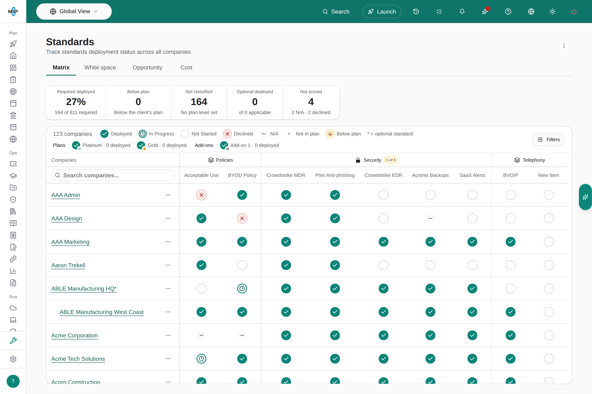
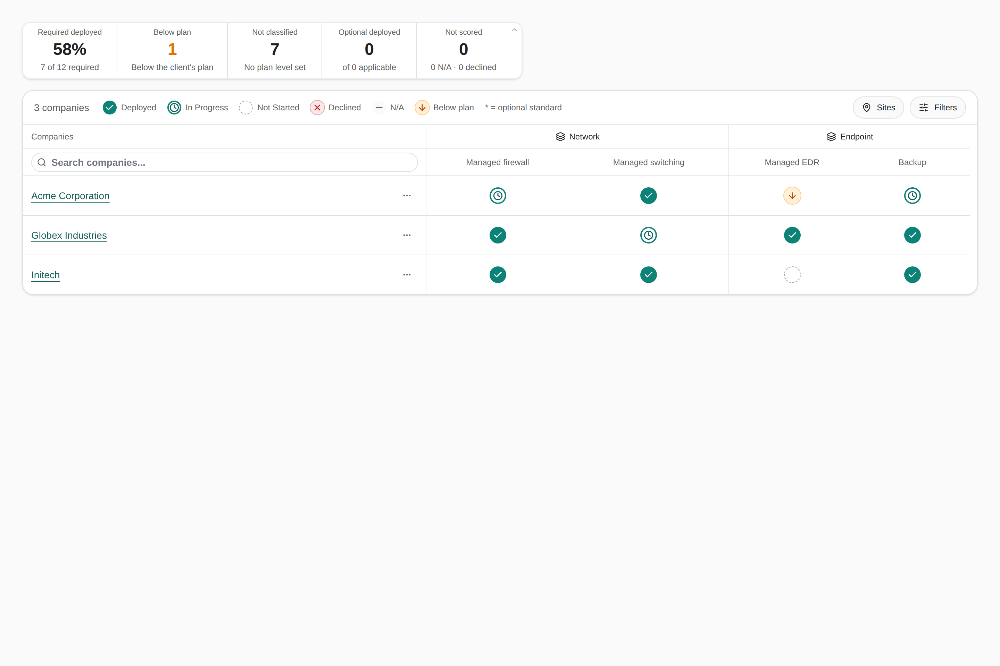
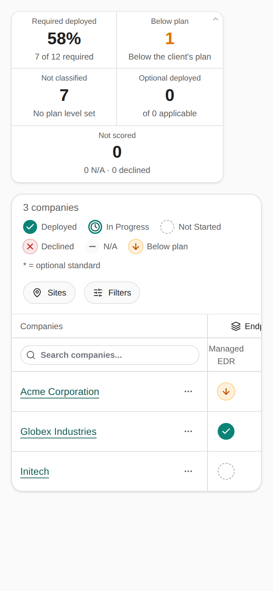
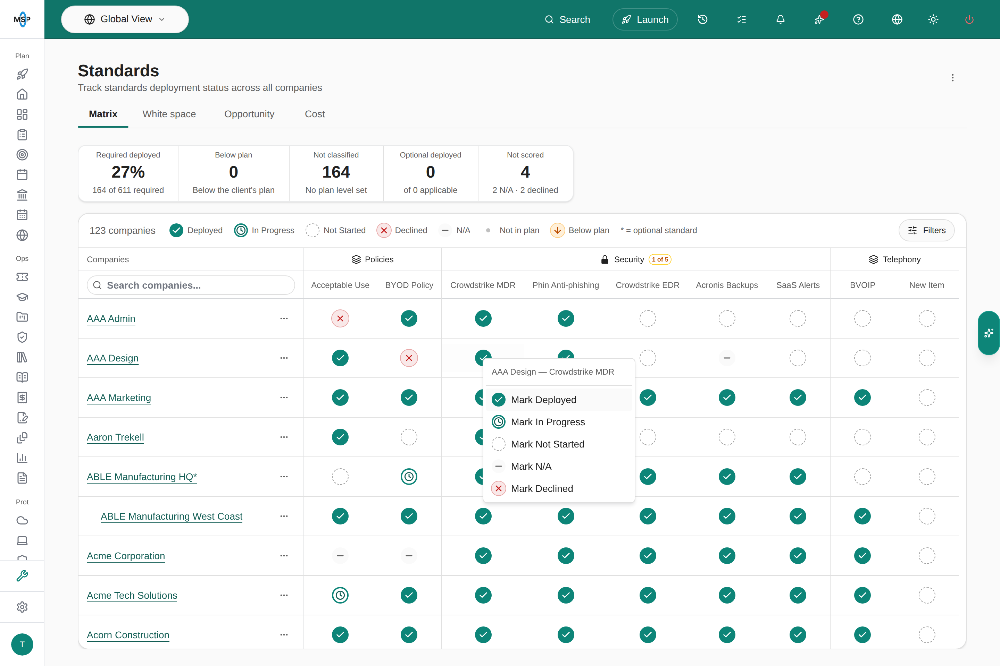
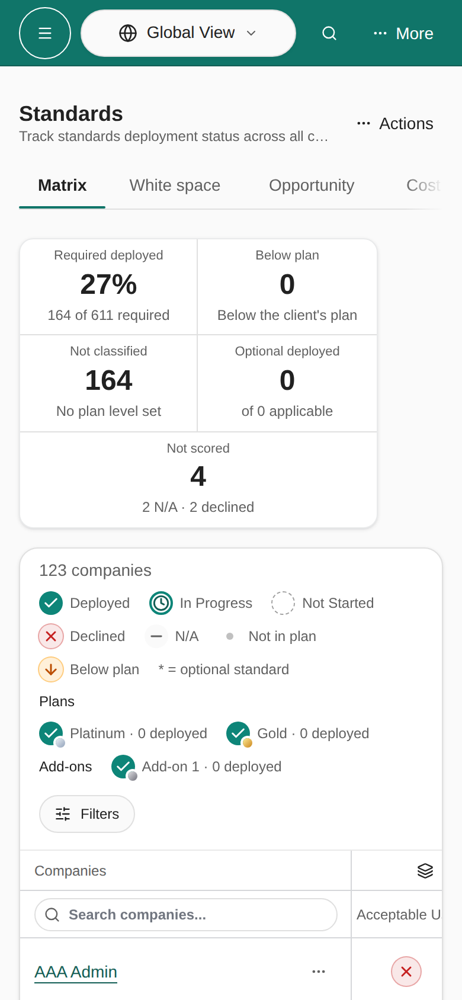

This guide shows MSP staff how to read the Standards matrix: which statuses mean what, how the deployment percentage is calculated, and how to reach the Planner work behind a cell. Company users should read [Standards work in Planner](/user-guides/planner/understand-standards-items) instead.

<Note>
  Branch preview: manual **Below plan** is an upcoming change. Its database
  migration is pending and has not been deployed. Any Below plan screenshots on
  this page use synthetic fixtures, not production saves.
</Note>

## Before you start

- You need Standards read access and the Client Health feature turned on for your tenant. Reading the matrix does not let you change it.
- Define categories and standards first in [Settings > MSP Tools > Standards](/user-guides/settings/standards). Without them the page shows **No standards configured**.
- Standards records the status your team sets. It does not scan devices or confirm that a product is installed.

## Find a company and standard

<Steps>
  <Step title="Open Standards">
    In the sidebar, open **MSP Tools > Standards**.
  </Step>
  <Step title="Check the company selector">
    The selector at the top of the app limits which companies load into the matrix.
  </Step>
  <Step title="Search for the company">
    Type the name in **Search companies...** in the matrix header.
  </Step>
  <Step title="Read across the row">
    Find the standard under its category header. Scroll sideways to see more columns.
  </Step>
  <Step title="Clear the search">
    Delete the text in **Search companies...** to see all loaded companies again.
  </Step>
</Steps>

Child companies appear as their own rows. Each row has its own statuses, so a parent's status does not describe its children.

## Read the status symbols

<Note>
  Branch preview: this section and its screenshots show an upcoming Standards
  update. The marks and layout may differ from your live portal until it is
  released.
</Note>

Every cell shows one round mark, the same marks the business review plan uses. The key sits in the table's header row, next to the company count. On a phone the key wraps above the matrix controls.

<Frame caption="Branch preview, MSPortal Demo: the status key in the header row, a pinned header, and company names with their plan level underneath.">
  
</Frame>

| Display                                            | Meaning                                                                                                               |
| -------------------------------------------------- | --------------------------------------------------------------------------------------------------------------------- |
| Filled teal circle with a check                    | **Deployed**.                                                                                                         |
| Teal ring with a clock                             | **In Progress**.                                                                                                      |
| Dashed empty ring                                  | **Not Started**. A standard with no tracking row also shows this.                                                     |
| Light red circle with an X                         | **Declined**. The company turned the standard down.                                                                   |
| Gray circle with a dash                            | **N/A**. The standard does not apply to this company.                                                                 |
| Small gray dot                                     | **Not in plan**. The standard is outside this company's plan and add-ons, so nothing is owed.                         |
| Small colored dot in the corner of a Deployed mark | The deployment is classified to a plan level, and the dot is that level's color. Hover to read the option and level.  |
| Amber circle with a down arrow                     | **Below plan**. Your team marked an outstanding gap manually, or a deployed option is below the company's plan level. |
| Small teal dot in the cell corner                  | The status was answered automatically from billing. Hover to see the matching SKUs.                                   |
| Italic column name with **\***                     | Optional standard that is not in a one-of group.                                                                      |
| **1 of N** badge on a category                     | Any one deployed standard in the category meets the requirement.                                                      |

A Deployed mark with no corner dot is **Deployed, not classified**: no deployment option is selected, so it has no plan level.

Hover a deployed cell to see which option was deployed and its plan level. The plan names are configured by your MSP. Ask the person who manages Standards settings what each plan includes. The key's **\* = optional standard** explains the asterisk beside an optional column name.

When the **White space** and **Opportunity** tabs are available, switching between them and **Matrix** preserves your search and table filters. Changing the company selector resets those controls for the new scope.

The table header stays pinned while you scroll through companies. Each company name is a teal link, and its plan level, or **Excluded**, shows on a second line under the name. The **⋯** row menu sits at the right of the name cell. The plan level is set in [Standards tiers](/user-guides/settings/standards-tiers).

Standards that do not apply because of a company's device platform or a company field rule cannot be changed. Hover the cell to read the reason.

<Frame caption="Branch preview, desktop: fixture-backed; migration pending, not deployed.">
  
</Frame>

<Frame caption="Branch preview, mobile: fixture-backed; migration pending, not deployed.">
  
</Frame>

## Show sites

When a category is [tracked by site](/user-guides/settings/standards#track-a-category-by-site), its standards get a status for each site of a company that has two or more sites. A site is one of the company's locations. Companies with one site or none keep a single status.

<Steps>
  <Step title="Click Sites">
    The **Sites** button sits in the table toolbar. It appears when at least one
    category is tracked by site and a company in view has two or more sites.
  </Step>
  <Step title="Read the site rows">
    Each such company gets one row per site, under the company's own row.
    Standards tracked by site show a status mark for each site.
  </Step>
  <Step title="Read the empty cells">
    Standards that are not tracked by site are answered once for the company, so
    their cells on site rows are empty.
  </Step>
  <Step title="Hover the company's cell">
    For a standard tracked by site, the company's cell reads **Deployed at X of
    Y sites**. Sites marked N/A or Declined are left out of both numbers.
  </Step>
  <Step title="Click Sites again">
    This hides the site rows. It does not change any status.
  </Step>
</Steps>

To change a site's status, see [Update a company's Standards deployments](/user-guides/msp-tools/update-standard-deployments#change-one-site).

### How sites roll up to the company

The company's status for a standard tracked by site is worked out from its sites. Sites marked **N/A** or **Declined** are left out first.

| Sites                                       | Company status                                 |
| ------------------------------------------- | ---------------------------------------------- |
| Any site is **Below plan**                  | **Below plan**, regardless of the other sites. |
| Every remaining site is **Deployed**        | **Deployed**                                   |
| Every remaining site is **Not Started**     | **Not Started**                                |
| Any other mix without **Below plan**        | **In Progress**                                |
| Every site is **N/A**                       | **N/A**                                        |
| The sites are only **N/A** and **Declined** | **Declined**                                   |

One site deployed and one not started is **In Progress** for the company, never **Deployed**.

The deployment percentage, Client Health, **Cost**, **White space**, **Opportunity**, reports and exports use the company status, which is this rollup. Deployment options and notes stay on the company, not on individual sites.

### When a company's sites change

- A new site never changes the company's status. If the company is **Deployed**, **Declined** or **N/A**, the new site starts with that status. Otherwise it starts as **Not Started**.
- When a site is deleted, the company follows the sites that remain.
- When a company goes from one site to two, both sites start with the company's status.

## Read the deployment percentage

The summary above the matrix shows a percentage and a **deployed/required** count. It follows the company search and company scope, and it skips excluded companies.

- Each **Required** standard counts as one check, unless it is **N/A** or **Declined**. Manual **Below plan** stays in the required count as an outstanding gap; it does not count as deployed.
- A **1 of N** category counts as one check. Any deployed member meets it, and deploying several does not add checks.
- Optional standards show as **deployed/total optional** and do not change the percentage.
- Counts for **N/A**, **declined**, **unclassified** and **Below plan** appear next to the percentage when they apply.
- A standard tracked by site counts once per company, using the company's rolled-up status. Sites do not add checks.

For example, three deployed checks, one In Progress check and one N/A check give **3/4 required**, or **75% deployed**. The N/A check is outside the count.

<Note>
  Marking a standard N/A, recording a decline, or excluding a company can raise
  the percentage without deploying anything. Read the N/A and declined counts
  next to it. **0/0 required** means no required check applies to that result.
</Note>

The same percentage feeds the Standards dimension of [Client Health](/user-guides/msp-tools/client-health). The Client Health score uses all non-excluded companies and refreshes on its own schedule, so it can differ from a filtered matrix.

## Open the Planner work behind a cell

<Steps>
  <Step title="Click a status cell">
    A cell with a linked Planner item opens that item. A cell without a link
    does nothing.
  </Step>
  <Step title="Or click a company name">
    This opens Planner List View filtered to that company's Standards items.
  </Step>
  <Step title="Review the item">
    See [Read a Planner item](/user-guides/planner/read-item-details) for dates,
    status and notes. [Standards work in
    Planner](/user-guides/planner/understand-standards-items) explains how
    Standards statuses map to Planner statuses.
  </Step>
</Steps>

A site cell works differently: clicking it opens its status menu. When the site has its own Planner item, which the **Split Planner items by site** sync option creates, the menu ends with **Open Planner item**.

## See what the right-click menus do

Right-click a status cell for one standard at one company. Right-click a company name, or use its **⋯** menu, for all that company's standards. Right-click a column header for one standard across companies.

Right-clicking a status cell opens a menu headed by the company and standard, with a mark beside each status.

<Frame caption="Branch preview, MSPortal Demo: the status cell menu.">
  
</Frame>

On a phone the key wraps under the company count, above **Filters**.

<Frame caption="Branch preview, MSPortal Demo: the Standards matrix on a phone.">
  
</Frame>

Opening a menu does not save anything. Choosing a status or exclusion does.

<Warning>
  A column's **Mark all companies as** action ignores the company search. It
  covers every non-excluded company in the loaded scope, including rows the
  search hides.
</Warning>

## Show excluded companies

Excluded companies are hidden by default.

<Steps>
  <Step title="Click Show N excluded">
    The button appears above the matrix when at least one company is excluded.
  </Step>
  <Step title="Find the faded rows">
    Excluded rows show an **Excluded** badge and a crossed-out name.
  </Step>
  <Step title="Click Hide N excluded">
    This hides them again. It does not change any company's exclusion.
  </Step>
</Steps>

To change an exclusion, see [Exclude or include companies in Standards](/user-guides/msp-tools/manage-standards-exclusions).

## Make changes

- [Update a company's Standards deployments](/user-guides/msp-tools/update-standard-deployments)
- [Update Standards in bulk](/user-guides/msp-tools/bulk-update-standards)
- [Exclude or include companies in Standards](/user-guides/msp-tools/manage-standards-exclusions)

## Troubleshooting

| Problem                                                     | What to do                                                                                                                                              |
| ----------------------------------------------------------- | ------------------------------------------------------------------------------------------------------------------------------------------------------- |
| The company is missing                                      | Check the company selector, the matrix search, and **Show N excluded**.                                                                                 |
| The standard is missing                                     | Scroll sideways. Then check that the standard exists in a category in Settings.                                                                         |
| A cell does not open Planner                                | The cell has no linked item, or you cannot access that item. Ask an administrator to run the Standards sync.                                            |
| A Deployed mark has no corner dot                           | The standard is deployed with no option selected. Right-click the cell and choose the implementation.                                                   |
| The summary changed after a search                          | The summary recalculates for the matching rows. Clear the search.                                                                                       |
| **No standards configured** shows unexpectedly              | Reload the page. If it persists, ask an administrator to check your Standards access.                                                                   |
| A status differs from Planner                               | Open both records, then ask an administrator to check the Standards sync.                                                                               |
| The **Sites** button is missing                             | No category is tracked by site, or no company in view has two or more sites. Check the company's locations and the category's **Track by site** switch. |
| A site row has empty cells                                  | Those standards are not tracked by site, so they are answered once for the company.                                                                     |
| A company shows **In Progress** although a site is deployed | The company is **Deployed** only when every site that is not N/A or Declined is deployed. Click **Sites** to see which sites are not.                   |

## Frequently asked questions

<AccordionGroup>
  <Accordion title="Does Deployed mean the product is healthy on every device?">
    No. It is the status your team recorded. Check device health in your
    inventory and security tools.
  </Accordion>
  <Accordion title="What does Deployed, not classified mean?">
    The standard is deployed but no deployment option is selected, so it has no
    tier. It does not tell you whether the company's target tier is met.
  </Accordion>
  <Accordion title="Can a deployed standard be below target?">
    Yes. A deployed option can sit in a lower tier than the company's plan
    level. It still counts as deployed but shows an amber down arrow (**Below
    plan**) instead of the check.
  </Accordion>
  <Accordion title="Is Declined the same as N/A?">
    No. Declined means the company turned the standard down. N/A means it does
    not apply. Neither counts as deployed, and both leave the required count.
  </Accordion>
  <Accordion title="What does the 1 of N badge mean?">
    The category counts as one required check. Any one deployed member meets it.
  </Accordion>
  <Accordion title="Do optional standards change the percentage?">
    No. They show separately as deployed/total optional.
  </Accordion>
  <Accordion title="Why did the percentage change after I searched?">
    The summary follows the matching rows. Clear the search to see the full
    loaded scope.
  </Accordion>
  <Accordion title="Do child companies inherit their parent's status?">
    No. Each row shows its own recorded statuses.
  </Accordion>
  <Accordion title="Does one deployed site make the company Deployed?">
    No. For a standard tracked by site, the company is **Deployed** only when
    every site that is not N/A or Declined is deployed. Any mix is **In
    Progress**.
  </Accordion>
  <Accordion title="Do sites count as extra checks in the percentage?">
    No. Each standard counts once per company, using the company's rolled-up
    status.
  </Accordion>
  <Accordion title="Why do I still see Tool Stack in some links?">
    Tool Stack is the former name. Some older links and web addresses still use
    it. The Planner source filter says Standards.
  </Accordion>
</AccordionGroup>

## Related guides

- [Standards overview](/user-guides/msp-tools/standards)
- [Update a company's Standards deployments](/user-guides/msp-tools/update-standard-deployments)
- [Standards work in Planner](/user-guides/planner/understand-standards-items)
- [Configure Standards](/user-guides/settings/standards)
