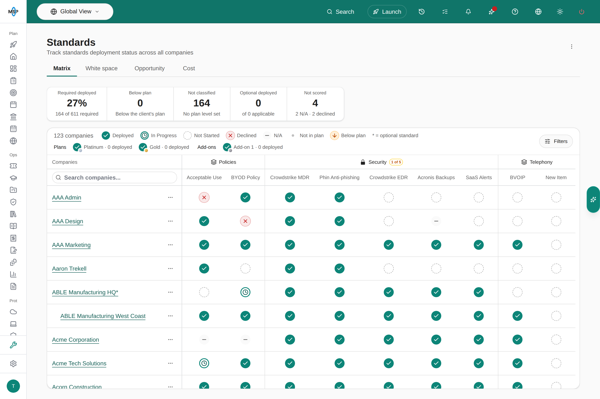
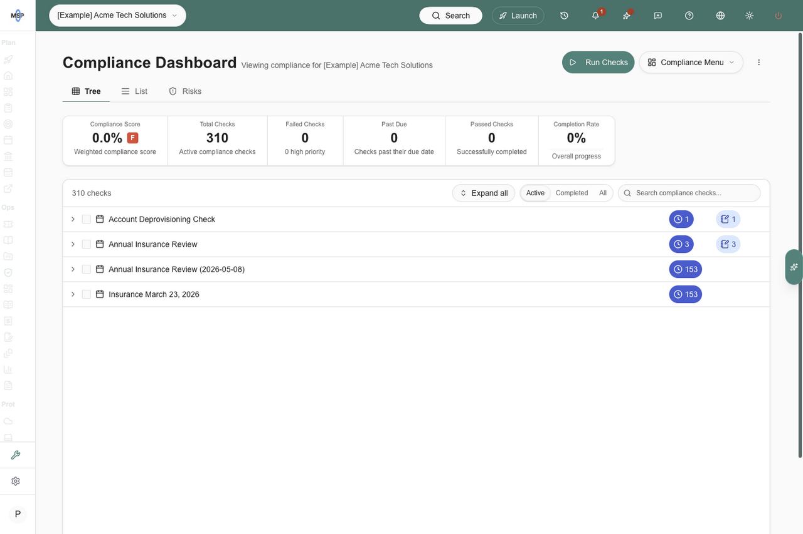

Standards and Compliance both describe the state of a client, so it is easy to wonder which one a question belongs in. The short version:

- **Standards** asks, "Do they have it?"
- **Compliance** asks, "Is it configured properly, and does it meet the requirements?"

They go hand in hand. Standards tells you which of your standard tools, services and policies each client has. Compliance checks that what they have is set up the way it should be, against your own configuration baseline or an outside set of requirements such as a CIS benchmark or a cyber insurance review. This guide is for MSP staff.

## At a glance

| | Standards | Compliance |
| --- | --- | --- |
| **The question** | Do they have it? | Is it configured properly, and does it meet the requirements? |
| **Examples** | Do they have our standard firewall and switch? Have they adopted an acceptable use policy? | Is the firewall using our standard security features, and is its configuration backed up? Do they meet their cyber insurance requirements? |
| **The answer** | One status per client and standard: **Deployed**, **In Progress**, **Not Started**, **N/A** or **Declined**. In practice, yes or no. | A status from the check's own status list, such as Pass, Fail or Needs review, plus notes, evidence, a priority and a due date. |
| **Automatic answers** | Agreement billing, RMM software, integrations and onboarding tasks. | Linked Liongard metrics. |
| **When it updates** | One current answer per client. Automatic answers refresh every night. | In runs, started by hand or on a schedule. Each run keeps its own results and history. |
| **Follow-up work** | One Planner item per client and standard. | **Add to Planner**, **Create Ticket** in your PSA, **Add to Meeting**, or the risk register. |
| **Who usually answers** | Account managers, vCIOs and sales. Little technical knowledge needed. | Technicians, engineers and security leads. |
| **What it feeds** | The Standards dimension of Client Health, plus white space and opportunity revenue. | The Compliance Score, Check History and risk register. |
| **Where it lives** | **MSP Tools > Standards** and **Settings > MSP Tools > Standards** | **Compliance** and **Settings > Compliance** |

## Standards: do they have it?

Use Standards for your standard offering: the tools, services and policies you expect every client to have, and the projects you want to recommend to every client. For example:

- Your standard firewall, switches and wireless
- Endpoint protection, backup and email security
- Security awareness training
- An acceptable use policy the client has adopted

Each standard gets one answer per client, and you can read it as yes or no: the standard is **Deployed**, or it is work still to do. **N/A** and **Declined** drop out of the score, so a client is not marked down for a standard that does not fit them or one they turned down.

<Frame caption="MSPortal Demo: companies are rows, standards are columns, and each cell holds one status.">
  
</Frame>

### Let MSPortal answer for you

Many standards can be answered without anyone touching the matrix. Choose the evidence that proves each standard in the **Detection** step of **Settings > MSP Tools > Standards > Setup**, or link billed products under **Answered by billing**.

| Evidence | The standard is answered when |
| --- | --- |
| **Billing** | The client's PSA agreement bills a product or SKU linked to the standard. |
| **Software** | Matching software shows up on the client's devices in your RMM inventory. |
| **Integration** | The company is mapped to an active connection for the tool, such as your backup or security platform. |
| **Onboarding** | A linked onboarding task is completed. |
| **Manual** | Someone on your team sets the status in the matrix. |

Hover a cell to see where its answer came from, for example **Answered from billing** or **Detected from software**. Automatic answers refresh every night and are withdrawn when the evidence goes away. They never overwrite a status a person set.

You can also limit a standard to the clients it fits, such as Mac management only for companies with Macs, or a compliance-focused tool only for one industry. Companies that do not match show the standard as a locked N/A. See [Choose which Standards apply](/user-guides/settings/standards-applicability).

### Turn missing standards into work

Each standard links one to one with a Planner item for each client, which makes a missing standard easy to turn into work for that client. **Sync All Companies** creates the items, and each one follows its matrix status: **Deployed** shows as **Completed**, and **N/A** or **Declined** show as **Cancelled**. Use those items to build the client's roadmap, add them to a meeting agenda, and share them with the client when you are ready.

The **White space** and **Opportunity** tabs put a monthly value on missing standards that are linked to agreement SKUs, so you can see the revenue behind the gaps.

## Compliance: is it configured properly?

Compliance goes deeper. It checks whether the things a client has are configured properly, or whether the client meets a particular set of requirements. For example:

- Is the firewall using your standard security features, running current firmware, and backed up?
- Is multifactor authentication enforced for every administrator?
- Do the client's computers meet the CIS benchmark for their operating system?
- Can the client answer yes to each control on their cyber insurance application?

### How Compliance is organized

| Piece | What it is |
| --- | --- |
| **Check** | One requirement, with guidance and a status list. It is assessed for a company, location or device. |
| **Group** | A set of related checks, such as Firewall configuration. |
| **Run template** | The groups and checks you assess together, such as an annual insurance review. |
| **Run** | One assessment of the targets you choose. Each check in it records its own result. |
| **Schedule** | Creates runs from a template once, or on a repeating cadence from weekly to annually. |

Build checks yourself in **Settings > Compliance**, or import them from **Playbooks**, which include [CIS Benchmarks](/user-guides/compliance/adding-cis-benchmarks) and [NIS2](/user-guides/compliance/adding-nis2-playbooks). Keep separate templates for separate purposes: one for your configuration baseline, one for an insurance review, one for a framework a client must meet. With Liongard connected, [Liongard metrics](/user-guides/compliance/liongard-metrics) can update a check's status on their own.

<Frame caption="MSPortal Demo: one company's insurance review runs on the Compliance Dashboard.">
  
</Frame>

### Statuses fit the requirement

A standard has a fixed set of statuses. A compliance check uses a status list you define in **Settings > Customization > Statuses**: you name each status, pick its color, and mark which ones count as compliant or complete. One list might be Pass, Fail and Needs review. Another for an insurance review might add Risk accepted or Not applicable. A note template linked to a status can add client-ready text to the check when an assessor picks it.

### Record findings and act on them

Each assessed check records a status, a priority, a due date, public notes the client can read, private notes for your team, and uploaded evidence. When a check fails:

- **Create Ticket** opens a ticket in your PSA. Use it for in-scope work your agreement already covers.
- **Add to Planner** creates a Planner item. Use it for a project or anything that needs the client's approval or budget.
- **Add to Meeting**, from **Actions** after you select checks, adds the findings to a meeting agenda for that client.
- **Add to risk register** tracks a gap you cannot close right away, when risk tracking is on. See [Risk Management](/user-guides/compliance/risk-management).

The **Compliance Score** weights each check by its scope, criticality and priority. It summarizes the checks you assessed. It is not a certification.

## How they work together

Standards and Compliance work best as a pair. Standards confirms the client has the right things; Compliance confirms those things are set up correctly.

<Tabs>
  <Tab title="Firewall">
    1. **Standard:** Managed firewall. Your firewall agreement SKU answers it, so every billed client shows **Deployed**. The rest get a Planner item to propose.
    2. **Compliance:** a Firewall configuration group with checks for your standard security features, current firmware, restricted admin access and a configuration backup. A quarterly schedule runs it for every company.
    3. **Follow-up:** a failed backup check becomes a ticket, because it is in-scope work. A firewall that needs replacing becomes a Planner item.
  </Tab>
  <Tab title="Acceptable use policy">
    1. **Standard:** Acceptable use policy. A linked onboarding task marks it **Deployed** when the client adopts the policy, or an account manager sets it in the matrix.
    2. **Compliance:** an insurance review check asking whether a signed policy is on file and was reviewed in the last 12 months, with the signed copy uploaded as evidence.
    3. **Follow-up:** a policy that is overdue for review goes on the agenda for the client's next meeting.
  </Tab>
</Tabs>

To connect the two directly, give a standard a [Planner template](/user-guides/settings/standards#apply-a-planner-template) with **Compliance auto-link**. On the next sync, each client's Planner item for that standard links to that client's matching compliance checks, so the work and the proof sit together. Both also feed [Client Health](/user-guides/msp-tools/client-health): Standards through its own dimension, and Compliance through compliance completion.

## Which one should I use?

| If you want to know | Use |
| --- | --- |
| Which clients do not have our standard firewall? | Standards |
| Which clients have not adopted an acceptable use policy? | Standards |
| What should be on each client's roadmap? | Standards |
| Where is our white space and upsell opportunity? | Standards |
| Is each firewall configured to our baseline and backed up? | Compliance |
| Does this client meet a CIS benchmark? | Compliance |
| Is the client ready for their cyber insurance review? | Compliance |
| What changed since the last assessment? | Compliance |

A simple rule: if someone without technical knowledge can answer it yes or no, it is a standard. If a technician has to look at settings, or you need evidence on file, it is a compliance check.

## Get started

<Steps>
  <Step title="Build your Standards catalog">
    Open the **Standards** phase in Launch Center, or **Settings > MSP Tools > Standards > Setup**. Discovery reads your agreement billing, software and product evidence and suggests standards to create. See [Manage the Standards catalog](/user-guides/settings/standards).
  </Step>
  <Step title="Let evidence answer them">
    Link agreement SKUs and choose detection evidence for each standard. See [Use PSA billing to answer Standards](/user-guides/settings/standards-sku-automation).
  </Step>
  <Step title="Sync to Planner">
    Click **Sync All Companies** to create a Planner item for each client and standard. See [Sync Standards to companies](/user-guides/settings/sync-standards).
  </Step>
  <Step title="Build your compliance library">
    Import playbooks such as CIS Benchmarks, then add checks for your own standard configurations and organize them into groups. See [Compliance settings](/user-guides/settings/compliance).
  </Step>
  <Step title="Package and schedule assessments">
    Create a run template for each purpose, then a schedule to run it. See [Schedule compliance assessments](/user-guides/settings/compliance-schedules).
  </Step>
</Steps>

## Frequently asked questions

<AccordionGroup>
  <Accordion title="Do I need both?">
    No. Each works on its own. Standards is usually the quicker start, because billing, RMM and integration data you already sync can answer much of it. Add Compliance when you want to verify configuration or assess a client against a set of requirements.
  </Accordion>
  <Accordion title="Does Deployed mean the tool is configured correctly?">
    No. **Deployed** records that the client has the standard. Whether it is configured properly is a compliance check.
  </Accordion>
  <Accordion title="Can a standard be technical?">
    Yes. Endpoint protection and backup are common standards. The standard still only answers whether the client has it.
  </Accordion>
  <Accordion title="What do clients see?">
    Company users never see the Standards matrix. They see the Standards Planner items you share with them. In Compliance, they can read the checks and public notes shared with their company. Private notes stay internal, and **Hide from company users** keeps a whole run internal.
  </Accordion>
  <Accordion title="Does a high Compliance Score certify a client?">
    No. It summarizes the checks you assessed.
  </Accordion>
  <Accordion title="Are Standards and Tool Stack different?">
    No. Tool Stack is the former name for Standards.
  </Accordion>
</AccordionGroup>

## Related guides

<CardGroup cols={2}>
  <Card title="Standards" icon="wrench" href="/user-guides/msp-tools/standards">
    The matrix, white space, opportunity and cost.
  </Card>
  <Card title="Compliance" icon="shield-halved" href="/user-guides/compliance/index">
    Run checks, record findings and read scores.
  </Card>
  <Card title="Standards work in Planner" icon="list-check" href="/user-guides/planner/understand-standards-items">
    How matrix statuses map to Planner items.
  </Card>
  <Card title="Compliance settings" icon="gear" href="/user-guides/settings/compliance">
    Checks, groups and run templates.
  </Card>
</CardGroup>
