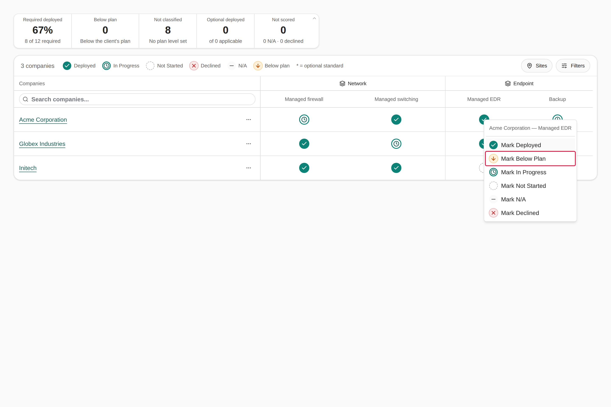
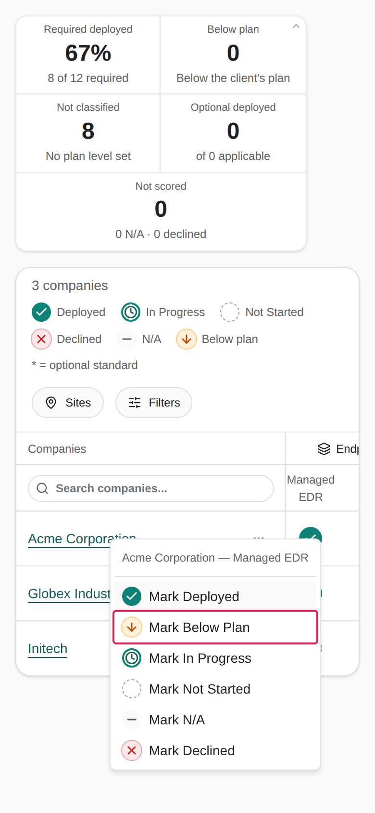

This guide shows MSP staff how to record a status for one standard at one company. Company users can read their shared work in [Standards work in Planner](/msp-guides/planner/understand-standards-items).

<Note>
  Branch preview: manual **Below plan** is an upcoming change. Its database
  migration is pending and has not been deployed. Any Below plan screenshots on
  this page use synthetic fixtures, not production saves.
</Note>

## Before you start

- You need Planner Write permission and active billing. Viewing the matrix needs only Standards read access.
- Changing the catalog (categories, standards, options) is a separate permission and is not needed here.
- Read [Read the Standards matrix](/user-guides/msp-tools/read-standards-matrix) if you have not used the matrix before.

## Change one company and one standard

<Steps>
  <Step title="Open Standards">
    In the sidebar, open **MSP Tools > Standards**.
  </Step>
  <Step title="Find the company">
    Check the company selector at the top of the app. Then type the name in **Search companies...**.
  </Step>
  <Step title="Find the standard">
    Find the cell where the company's row meets the standard's column. Check the category and standard name, especially when two standards have similar names.
  </Step>
  <Step title="Right-click the cell">
    The menu header shows the company and standard names. Check them. To cancel, press **Escape** or click outside the menu.
  </Step>
  <Step title="Choose a status">
    Pick **Mark Deployed**, **Mark Below Plan**, **Mark In Progress**, **Mark Not Started**, **Mark N/A** or **Mark Declined**. The change saves right away. There is no Save button or confirmation.
  </Step>
  <Step title="Check the result">
    A toast reads **Marked as** followed by the status. Click the cell to open the linked Planner item and check its status.
  </Step>
</Steps>

A normal click on a cell with a linked item opens the Planner item. It does not open the status menu. Right-click to change the status.

## Choose the recorded status

| Menu choice          | What it records                                             | Linked Planner status |
| -------------------- | ----------------------------------------------------------- | --------------------- |
| **Mark Deployed**    | The standard is deployed.                                   | Completed             |
| **Mark Below Plan**  | Your team assessed the standard as below the client’s plan. | Not Started           |
| **Mark In Progress** | Deployment is underway.                                     | In Progress           |
| **Mark Not Started** | Deployment has not started.                                 | Not Started           |
| **Mark N/A**         | The standard does not apply to this company.                | Cancelled             |
| **Mark Declined**    | The company turned the standard down.                       | Cancelled             |

N/A and Declined both leave the required count and both map to Cancelled in Planner. Deployed records a status. It does not install the product or check devices.

A status change in the matrix replaces the linked Planner status, including On Hold or Pending Approval.

## Mark a standard Below plan

Choose **Mark Below Plan** from the company or site status menu, even when the standard has no deployment options. The amber down-arrow records your assessment and leaves an applicable required standard as an outstanding gap. You can also choose it in [bulk status menus](/user-guides/msp-tools/bulk-update-standards).

To clear the manual assessment, select another status in **Standards**. The linked Planner item shows **Not Started**; automated reconciliation of that Planner status preserves the Below plan assessment. Change the assessment in Standards, rather than using Planner’s Not Started status to clear it.

Automatic detection still shows **Below plan** when a deployed option is below the company’s target tier. That tier comparison keeps the underlying **Deployed** status; the manual choice records an outstanding gap instead.

<Frame caption="Branch preview, desktop: fixture-backed; migration pending, not deployed.">
  
</Frame>

<Frame caption="Branch preview, mobile: fixture-backed; migration pending, not deployed.">
  
</Frame>

## Record which implementation is deployed

When your MSP has [configured deployment options](/user-guides/settings/standards-tiers) for a standard, the cell menu lists them under tier headings.

<Steps>
  <Step title="Right-click the cell">
    Right-click the status cell for the company and standard.
  </Step>
  <Step title="Choose the option">
    Click the option that matches what the company runs, under its tier heading.
    This marks the standard **Deployed** with that option. The toast reads
    **Marked as deployed** followed by the option name.
  </Step>
  <Step title="Check the cell">
    The Deployed mark gets a small dot in the plan level's color. Hover it to
    read the option and level. An amber down arrow in place of the check means
    the option is below the company's plan level (**Below plan**).
  </Step>
</Steps>

To mark a standard deployed without choosing an option, click **Deployed — option not specified**. This clears the selected option. When a standard has no configured options, the menu shows **Mark Deployed** instead.

Changing a standard to Below plan, In Progress, Not Started, N/A or Declined can keep the earlier option. Check the option the next time you mark it Deployed.

## Change one site

When the standard's category is [tracked by site](/user-guides/settings/standards#track-a-category-by-site) and the company has two or more sites, you can record a status for each site.

<Steps>
  <Step title="Show the sites">
    Click **Sites** in the table toolbar. Each company with two or more sites
    gets one row per site under its own row.
  </Step>
  <Step title="Click the site's cell">
    Click, or right-click, the cell where the site's row meets the standard's
    column. The menu header shows the site and standard names.
  </Step>
  <Step title="Choose a status">
    Pick **Mark Deployed**, **Mark Below Plan**, **Mark In Progress**, **Mark
    Not Started**, **Mark N/A** or **Mark Declined**. The change saves right
    away.
  </Step>
  <Step title="Check the company's cell">
    The company's status is recalculated from its sites. Hover its cell to read
    **Deployed at X of Y sites**.
  </Step>
</Steps>

Standards that are not tracked by site have empty cells on site rows. Set them on the company's own row.

How the site statuses roll up is in [Read the Standards matrix](/user-guides/msp-tools/read-standards-matrix#how-sites-roll-up-to-the-company). One site deployed and one not started is **In Progress** for the company.

- **Marking the company sets every site.** A status set on the company's own cell, with a row or column **Mark all** action, or through the API or MCP, is set on every site of that company.
- **Options and notes stay on the company.** The site menu has no deployment options. Choose an option on the company's cell.
- **Automatic answers set every site.** Answers from billing (PSA SKUs), detection rules and onboarding are found for the company as a whole, so they set every site. Once a person sets a site's status, that standard is theirs for that company and automatic answers stop rewriting it.

## Check the saved result

- The cell updates on screen before the save finishes. If the save fails, the cell reverts and a toast reads **Failed to update status**.
- The status change and the Planner update are separate saves. After an error, reload the page and compare the matrix cell with the Planner item before you try again.
- A single-cell status change keeps the note stored on the Standards record. Notes on the linked Planner item are separate and stay. These menus do not edit notes.
- If a cell has no linked Planner item, changing its status does not create one. Ask an administrator to run [Sync Standards to companies](/user-guides/settings/sync-standards).

For many changes at once, see [Update Standards in bulk](/user-guides/msp-tools/bulk-update-standards).

## Troubleshooting

| Problem                                                   | What to do                                                                                                                            |
| --------------------------------------------------------- | ------------------------------------------------------------------------------------------------------------------------------------- |
| Right-click shows nothing                                 | The standard does not apply to that company because of a device platform or company field rule. Hover the cell to read the reason.    |
| **Failed to update status** appears                       | Check that you have Planner Write permission and active billing, then try once more.                                                  |
| Clicking opens Planner instead of a menu                  | Right-click the cell. A normal click opens the linked item.                                                                           |
| The Planner status does not match                         | Reload, open the Planner item, and set the matrix status again.                                                                       |
| A cell has a small teal dot                               | The status was answered from billing. Choosing a status here replaces that answer with yours.                                         |
| Marking a site Deployed did not make the company Deployed | Every site that is not N/A or Declined must be deployed. Mark the other sites, or mark a site N/A where the standard does not belong. |
| A site row has no status marks for a standard             | The standard's category is not tracked by site. Set the status on the company's row.                                                  |
| Marking the company changed every site                    | This is expected. A company-level status is set on all its sites. Click a site's cell to set that site alone.                         |

## Frequently asked questions

<AccordionGroup>
  <Accordion title="Which permission do I need to change a status?">
    Planner Write permission and active billing. Standards read access lets you
    view the matrix.
  </Accordion>
  <Accordion title="Do I need to click Save?">
    No. Choosing a status or option saves it.
  </Accordion>
  <Accordion title="Does Mark Deployed install the product?">
    No. It records the status. It does not install software or check devices.
  </Accordion>
  <Accordion title="What is the difference between N/A and Declined?">
    N/A means the standard does not apply to the company. Declined means the
    company turned it down. Both map to Cancelled in Planner and leave the
    required count.
  </Accordion>
  <Accordion title="Can a matrix change replace On Hold in Planner?">
    Yes. A matrix status change sets the linked Planner status.
  </Accordion>
  <Accordion title="Does changing away from Deployed clear its option?">
    Not always. Check the selected option the next time you mark it Deployed.
  </Accordion>
  <Accordion title="Can a failed change have partly saved?">
    Yes. The Standards and Planner updates are separate saves. Check both before
    you try again.
  </Accordion>
  <Accordion title="Can I use the keyboard instead of right-click?">
    Only for company, column and site menus. Click the three-dot button beside a
    company name, focus a column header and press **Enter** or **Space**, or
    focus a site's cell and press **Enter**. Company status cells open their
    menu with right-click only.
  </Accordion>
  <Accordion title="Can I record a deployment option or note for one site?">
    No. Options and notes stay on the company. Sites carry a status only.
  </Accordion>
  <Accordion title="Will billing or detection overwrite a site I set?">
    No. Once a person sets a site's status, automatic answers stop rewriting
    that standard for that company.
  </Accordion>
</AccordionGroup>

## Related guides

- [Read the Standards matrix](/user-guides/msp-tools/read-standards-matrix)
- [Update Standards in bulk](/user-guides/msp-tools/bulk-update-standards)
- [Standards tiers and deployment options](/user-guides/settings/standards-tiers)
- [Standards work in Planner](/msp-guides/planner/understand-standards-items)
