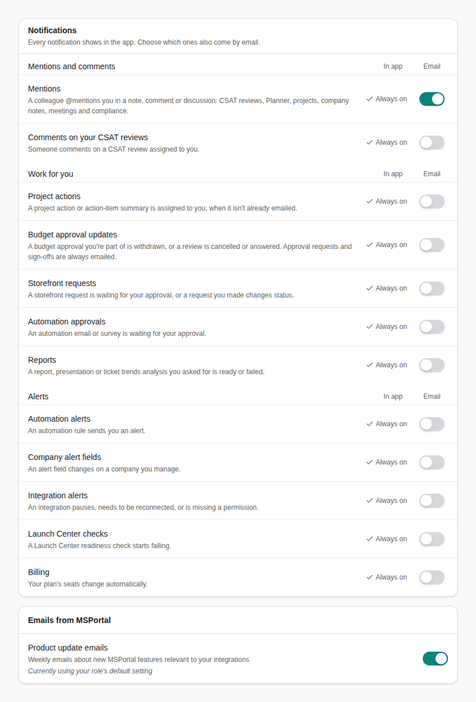

Every notification shows in the portal under the bell. On the **Notifications** tab of your user settings you choose which kinds also come to you by email. This guide is for MSP staff and company users. Each person sees only the kinds of notification they can receive.

## Before you start

- Every signed-in user has the **Notifications** tab. The switches are yours alone; nobody else changes them.
- Email is on for **Mentions** until you turn it off. Every other kind is off until you turn it on.
- In-app notifications are always on. The switches control email only.
- While someone views the portal as you, the switches are read-only.

## Turn email on or off

<Steps>
  <Step title="Open the Notifications tab">
    Go to **Settings > User Settings** and select the **Notifications** tab.
  </Step>
  <Step title="Find the notification">
    Notifications are grouped under **Mentions and comments**, **Work for you** and **Alerts**. Each row says when you get it. The **In app** column reads **Always on**.
  </Step>
  <Step title="Switch email on or off">
    Turn the **Email** switch for that row on or off. It saves right away, and a message confirms the change. There is no Save button.
  </Step>
</Steps>

<Frame caption="The Notifications tab for MSP staff, with email on for Mentions.">
  
</Frame>

## What each switch covers

| Switch | You get it when | Who has it |
| --- | --- | --- |
| **Mentions** | A colleague @mentions you in a note, comment or discussion: CSAT reviews, Planner, projects, company notes, meetings and compliance | MSP staff |
| **Comments on your CSAT reviews** | Someone comments on a CSAT review assigned to you | MSP staff |
| **Project actions** | A project action or action-item summary is assigned to you and was not already emailed | Staff and company users |
| **Budget approval updates** | A budget approval you're part of is withdrawn, or a review is cancelled or answered | Staff and company users |
| **Storefront requests** | A storefront request waits for your approval, or a request you made changes status | MSP staff |
| **Automation approvals** | An automation email or survey waits for your approval | MSP staff |
| **Reports** | A report, presentation or ticket trends analysis you asked for is ready or failed | Staff and company users |
| **Automation alerts** | An automation rule sends you an alert | Staff and company users |
| **Company alert fields** | An alert field changes on a company you manage | MSP staff |
| **Integration alerts** | An integration pauses, needs to be reconnected, or is missing a permission | MSP staff |
| **Launch Center checks** | A Launch Center readiness check starts failing | MSP staff |
| **Billing** | Your plan's seats change automatically | MSP staff |

Notifications that are always emailed have no switch here, so you never get the same email twice. These include approval requests (tickets, changes, budgets and scheduled reports), CSAT review assignments and copies, and project chat, which has its own email setting on each project's chat.

## What the email looks like

- The email comes from your MSP's portal address and names the MSP.
- It arrives within about five minutes. Several notifications in that time come together in one email, so a burst of @mentions is one message, not one per mention.
- Each item links to the record in the portal. A notification you already read in the portal before the email goes out is not emailed.
- Every email ends with a link back to this tab, so you can turn it off from there.

## Product update emails

The **Emails from MSPortal** panel on the same tab holds **Product update emails**. See [Manage your profile and email preferences](/user-guides/account/manage-your-profile#turn-product-update-emails-on-or-off).

## Troubleshooting

| Problem | What to do |
| --- | --- |
| An @mention did not arrive by email | Check that **Mentions** is on. If you read the notification in the portal within a few minutes, no email is sent. |
| A row is missing | You only see the kinds of notification you can receive. Company users don't get @mentions. |
| The switches are greyed out | Someone is viewing the portal as you. Sign in as yourself to change them. |
| The emails land in junk | Add your MSP's portal sender address to your safe senders. |

## Frequently asked questions

<AccordionGroup>
  <Accordion title="Can I turn off in-app notifications?">
    No. Every notification stays under the bell. The switches only add or remove email.
  </Accordion>
  <Accordion title="Can someone else change my switches?">
    No. Each person sets their own on this tab.
  </Accordion>
  <Accordion title="Do the switches change ticket emails?">
    No. Ticket replies and other emails your MSP sends through its own workflows are set up separately.
  </Accordion>
</AccordionGroup>

## Related guides

- [Read and manage notifications](/user-guides/notifications/read-notifications)
- [Manage your profile and email preferences](/user-guides/account/manage-your-profile)
- [Review low CSAT ratings](/user-guides/surveys/review-low-csat-ratings)
