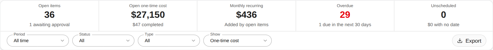
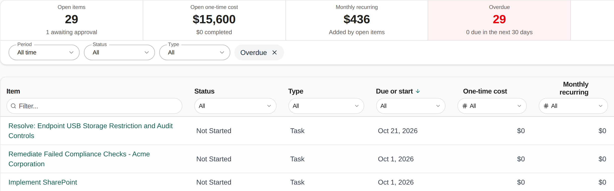

Use Planner Analytics to answer three questions before a client review. How much work is open? What will it cost? Which items need a date or a follow-up?

<Note>Branch preview. This guide shows the upcoming Planner Analytics page.</Note>

## Before you start

- Staff need **Manage Planner**. Client users and staff with only Read or Write Planner cannot open Analytics.
- The company selector at the top of the portal sets which clients appear.
- Analytics excludes archived items. Find them in [List View](/user-guides/planner/find-archived-items).

## Open and filter Analytics

<Steps>
  <Step title="Choose the clients">
    Open **Planner Menu > Analytics**. Use the company selector to choose a client or a wider view. If items in scope use several currencies, choose **Currency**. Analytics shows one currency at a time without conversion.
  </Step>
  <Step title="Choose a period">
    **Period** starts at **All time**, including undated work. Choose **This quarter**, **Next quarter**, **Next 4 quarters**, **This year** or **Next year** to see dated items. The due date sets the quarter. If there is no due date, the start date sets it. **Next 4 quarters** includes the current quarter and the following three.
  </Step>
  <Step title="Choose the work and measure">
    Use **Status** to select an exact status or **Type** to select an item type. Choose **No type** to find items without a type. On **Overview**, use **Show** to read charts as **One-time cost**, **Monthly recurring** or **Items**. Changing the measure keeps the same items in view.
  </Step>
</Steps>

<Frame caption="Branch preview. Read Acme Corporation’s open costs and deadlines alongside the filters.">
  
</Frame>

## Read the summary

| Figure | What it counts |
| --- | --- |
| **Open items** | Each item outside the Completed and Cancelled status categories. The smaller count shows how many open items are awaiting approval. |
| **Open one-time cost** | The sum of one-time cost lines on open items. The amount underneath is the one-time cost of completed items. |
| **Monthly recurring** | Monthly cost lines on open items, plus their annual cost lines divided by 12. For example, 100 per month and 600 per year add 150 to this figure. |
| **Overdue** | Open items with a due date before today in the MSP’s time zone. Start dates never make an item overdue. The count underneath covers items due today through 30 days from today. |
| **Unscheduled** | Open items with neither a due date nor a start date. This figure looks across all quarters. With a period selected, **All time ·** appears before the undated amount. The amount follows **Monthly recurring** when selected and otherwise shows one-time cost. |

Amounts of 100 or more display in whole currency units. Amounts under 100 show cents when they have a fractional part, for example $31.50.

## Find the items behind a figure

On **Overview**, select a forecast quarter, **Overdue** or **Unscheduled** to narrow the page. Other ways to add a filter chip are to select a client on **Clients**, open a full **Needs attention** group, or select a missing field in **Planning data**. Selecting a status row or type bar changes the **Status** or **Type** toolbar filter directly.

Chips combine. For example, select a quarter and then **No owner** to find open items in that quarter that need an owner. A different quarter replaces the selected quarter. **Unscheduled** replaces a quarter and switches **Period** to **All time**. Choosing a dated **Period** clears either the selected quarter or the **Unscheduled** chip. Use the × on a chip to remove it, or **Clear all** when two or more chips are active. Clearing chips preserves your toolbar filters.

Open **Items** to see one row for each item matching the page filters and chips, including completed and cancelled items when they match. Select a title under **Item** to open it in Planner. **Due or start** shows the due date when available and the start date otherwise. When you sort by date, undated items come last in either direction. Both cost columns show **—** when the item has no cost at all.

The **Owner** column appears only when at least one item in view has an owner. In a single-company view the table hides **Client**. The footer counts the rows and totals **One-time cost** and **Monthly recurring**, including any column filters you apply inside the table.

<Frame caption="Branch preview. The Overdue chip carries into Items, with the most recently missed due date first.">
  
</Frame>

For the rules behind each panel, see [Planner Analytics charts and client coverage](/user-guides/planner/understand-analytics-charts).

## Export to CSV

On **Overview**, **Export** downloads one row per item matching the page filters and chips, including items with zero cost. On **Items**, the CSV contains exactly the rows the table shows after you apply its column filters.

The item CSV columns are **Title**, **Client**, **Status**, **Type**, **Start date**, **Due date**, **One-time cost**, **Monthly cost**, **Annual cost**, **Hours**, **Owner** and **ISO 4217** (the currency code). All three cost columns appear for every **Show** measure. **Monthly cost** and **Annual cost** sum the item’s cost lines at their original frequency.

On **Clients**, select **Export** for one row per visible client. The file follows the client table’s column filters and **No open items** selection. It contains the client table columns plus **ISO 4217**.

## Troubleshooting

| Problem | What to check |
| --- | --- |
| Analytics opens the timeline | Check that the staff role has **Manage Planner**. |
| An expected item is missing | Check the company selector and currency. Remove active chips, choose **All time**, and set **Status** and **Type** to **All**. Check List View for archived items. |
| A quarter shows no items but **Unscheduled** is above zero | Those open items have neither date. Select **Unscheduled** to see them across all time. |
| **Export** is unavailable | The current tab has no matching rows. Widen the selection. |
| The page shows a loading error | Select **Retry** to reload the data before reading the totals. |

## Frequently asked questions

<AccordionGroup>
  <Accordion title="Does choosing a quarter multiply the monthly cost by three?">
    No. **Period** selects items by date. **Monthly recurring** still shows one month of recurring costs.
  </Accordion>
  <Accordion title="Why is an item with a past start date missing from Overdue?">
    Only a past due date makes an open item overdue. An item due today appears under **Due soon**.
  </Accordion>
</AccordionGroup>

## Related guides

- [Plan costs and hours](/user-guides/planner/plan-costs-and-hours)
- [Find Planner items in List View](/user-guides/planner/find-planner-items)
