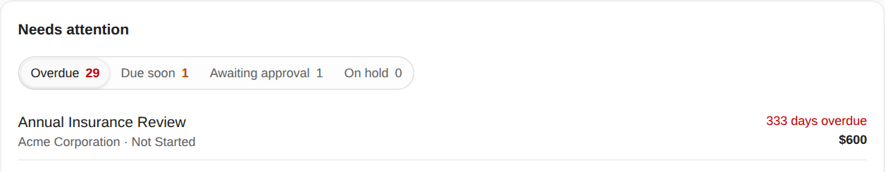
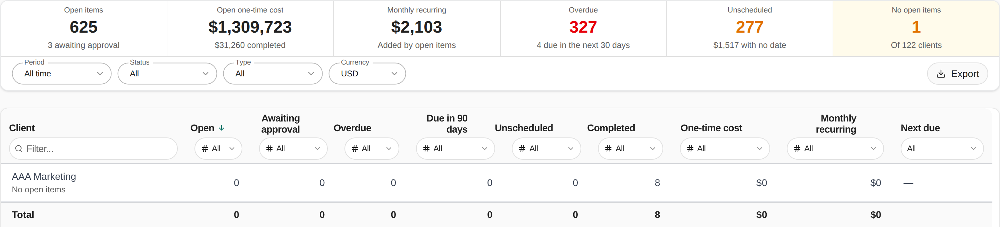

Open **Planner Menu > Analytics** with **Manage Planner**. Use **Overview** to explore work by quarter, status and type. Open **Items** to inspect the records behind a selection. Use **Clients** to compare roadmaps for the clients in the company selector.

<Note>Branch preview. This guide shows the upcoming Planner Analytics page.</Note>

## Forecast by quarter

Each column groups dated items by due date, or by start date when the due date is empty. The colored segments split the column by status category. Completed work is included. Cancelled work is excluded. **Show** sets the column height to one-time cost, monthly recurring cost or item count.

The line under the title names the displayed measure and explains “By due date, else start date.” If dated work has no cost in the chosen measure, the forecast counts items and explains the switch. On a chart, every quarter has a label and a pill marks the current quarter. On phones, a list shows each quarter with work and its value.

The chart shows up to four quarters before it and seven after it, trimming empty quarters at the ends. **Earlier** and **Later** collect dated work beyond that window. Select a quarter or range to focus the page on its items. All chart columns stay in place and the others dim. A note explains that the legend still totals every quarter shown. Select the same quarter again to clear it.

The strip below the chart counts open items with neither date, even when a period is selected. In a cost view it also shows their cost in the selected measure. Select **Show them** to open **Items** with the **Unscheduled** chip.

<Frame caption="Branch preview. Select Q3 2026 to compare its one-time costs by status while keeping the other quarters in view.">
  
</Frame>

## By status

Each row uses the exact status name in the configured Planner status order, including custom statuses. Completed and cancelled items count here. The bar and percentages follow **Show**. In **Items**, each share is a percentage of the item count. In a money view, each row shows the item count, its share of the selected cost, and the amount. A positive share below 1% reads **&lt;1%**. If no status has a cost in the chosen measure, the panel uses item counts.

Select a status row to set **Status** in the toolbar. Other rows stay visible and dim. The panel explains that the shares still use every status in view. Select the same row again to clear the filter.

## Needs attention

Choose a group to see the items that need follow-up. On phones, use the dropdown to switch between the four groups. Dates use the MSP’s time zone.

| Group | Items shown |
| --- | --- |
| **Overdue** | Open items with a due date before today. The most recently missed due date comes first. |
| **Due soon** | Open items due today through 30 days from today, inclusive. |
| **Awaiting approval** | Items in the Pending Approval status category, including custom statuses in that category. |
| **On hold** | Items in the On Hold status category. |

Select an item title to open it in Planner. Each row shows its one-time cost when present. If it has only recurring cost, the amount appears with **/mo**. When a group has more than six items, select **Show all** followed by the count. This opens **Items** with a chip for that group. **Overdue** opens with the latest due date first.

<Frame caption="Branch preview. Show all 29 opens the overdue items, including M365 Licenses at $436/mo.">
  
</Frame>

## Open work by type

The bars rank types by the selected **Show** measure for open items. When no open item has a positive amount for the selected cost measure, the bars rank types by item count instead. Select a bar to set **Type** in the toolbar. Selecting the **No type** bar filters to items without a type. Select it again to clear the filter.

## Planning data

Each row shows how many open items have a detail filled in, out of all open items in view. Each row also shows the number missing. Only **Cost** and **Due or start date** turn amber when fewer than half of the open items have that detail. Select a field name with missing entries to focus on the open items that need that detail. Select the same row again to clear the filter.

| Field | What counts as filled in |
| --- | --- |
| **Cost** | A positive one-time or monthly recurring amount, including annual costs spread over 12 months. |
| **Due or start date** | Either date is present. |
| **Owner** | An owner is assigned. |
| **Hours** | Estimated hours are greater than zero. |

## Clients

The **Clients** tab lists every client in the current company scope and currency, including clients with **No open items**. **Global View** leaves out companies hidden from Global View. When you filter to a quarter, client, attention group or missing detail, the table shows only clients represented by matching, non-cancelled items. Remove the chip to check coverage across the whole scope.

| Column | How to read it |
| --- | --- |
| **Client**, **Open**, **Awaiting approval** | Client name, number of open items and number in the Pending Approval category. |
| **One-time cost**, **Monthly recurring** | The client’s one-time and monthly recurring totals for open items. |
| **Overdue**, **Due in 90 days** | Open items past their due date, and open items due today through 90 days from today. |
| **Unscheduled**, **Completed** | Open items with neither date, and items in the Completed category. Unscheduled work is counted across periods. Completed work follows the selected period. |
| **Next due** | The earliest open due date today or later. |

The sixth summary figure, **No open items**, counts clients with nothing open on their whole roadmap in the selected company scope and currency. The total number of clients in scope appears underneath. Page and table filters leave this count unchanged.

With the page filters clear, select **No open items** to list those clients and add a **No open items** chip. Remove the chip or select the figure again to restore the list. Choosing another page filter or changing the company selection also clears the chip.

Use the table’s column filters to compare a subset of clients. **Total** and the client CSV follow those filters. Select a client name to open **Overview** with a removable client chip. If the client has nothing in view, Overview shows the client’s name followed by “has no items in this view.”

<Frame caption="Branch preview. Select No open items to list only clients with nothing open in Global View.">
  
</Frame>

## Related guides

- [Read and export Planner Analytics](/user-guides/planner/read-analytics)
- [Plan costs and hours](/user-guides/planner/plan-costs-and-hours)
