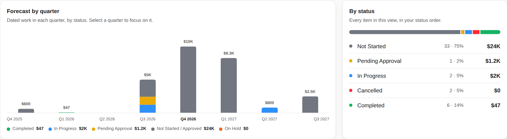

Open **Planner Menu > Analytics** with **Manage Planner**. Use **Overview** to explore work by quarter, status and type. Use **Clients** to compare roadmaps for the clients in the company selector.

<Note>Branch preview. This guide shows the upcoming Planner Analytics page.</Note>

## Forecast by quarter

Each column groups dated items by due date, or by start date when the due date is empty. The colored segments split the column by status category. Completed work is included. Cancelled work is excluded. **Show** sets the column height to one-time cost, monthly recurring cost or item count.

The current quarter appears in bold. The chart shows up to four quarters before it and seven after it, trimming empty quarters at the ends. **Earlier** and **Later** collect dated work beyond that window. Select a column to focus the page on its entire quarter or range.

The strip below the chart counts open items with neither date, even when a period is selected. In a cost view it also shows their cost in the selected measure. Select **Show them** to see the undated work.

<Frame caption="Branch preview. Compare quarterly costs with the count and cost of items in each status.">
  
</Frame>

## By status

Each row uses the exact status name in the configured Planner status order, including custom statuses. The count and percentage show how many of all matching items have that status. This includes completed and cancelled items. In a cost view, the row also shows the amount for that status. Select a status name to focus on its items.

## Needs attention

Choose a group to see the items that need follow-up. Dates use the MSP’s time zone.

| Group | Items shown |
| --- | --- |
| **Overdue** | Open items with a due date before today. The oldest due date comes first. |
| **Due soon** | Open items due today through 30 days from today, inclusive. |
| **Awaiting approval** | Items in the Pending Approval status category, including custom statuses in that category. |
| **On hold** | Items in the On Hold status category. |

Select an item title to open it in Planner. If the group has more than six items, select **Show all** to expand the list.

<Frame caption="Branch preview. Select an overdue item to open it in Planner.">
  
</Frame>

## Open work by type

The bars rank types by the selected **Show** measure for open items. When no open item has a positive amount for the selected cost measure, the bars rank types by item count instead. **No type** groups items without a type. Select a bar to focus the page on that type.

## Planning data

Each row shows how many open items have a detail filled in, out of all open items in view. A bar turns amber when the share is below 50%. Select a field name with missing entries to focus on the open items that need that detail.

| Field | What counts as filled in |
| --- | --- |
| **Cost** | A positive one-time or monthly recurring amount, including annual costs spread over 12 months. |
| **Due or start date** | Either date is present. |
| **Owner** | An owner is assigned. |
| **Hours** | Estimated hours are greater than zero. |

## Clients

The **Clients** tab lists every client in the current company scope and currency, including clients with **No open items**. **Global View** leaves out companies hidden from Global View. With a selection chip active, the table shows only clients represented by matching, non-cancelled items. Remove the chip to check coverage across the whole scope.

| Column | How to read it |
| --- | --- |
| **Roadmap**, **Open**, **Awaiting approval** | Whether any open items match, how many are open, and how many are in the Pending Approval category. |
| **One-time cost**, **Monthly recurring** | The client’s one-time and monthly recurring totals for open items. |
| **Overdue**, **Due in 90 days** | Open items past their due date, and open items due today through 90 days from today. |
| **Unscheduled**, **Completed** | Open items with neither date, and items in the Completed category. These columns follow the page’s period. |
| **Next due** | The earliest open due date today or later. |

Use the table’s column filters to compare a subset of clients. **Total** follows those filters. Select a client name to open **Overview** with a removable client chip.

<Frame caption="Branch preview. Select a client name to review its open work in Overview.">
  
</Frame>

## Related guides

- [Read and export Planner Analytics](/user-guides/planner/read-analytics)
- [Plan costs and hours](/user-guides/planner/plan-costs-and-hours)
