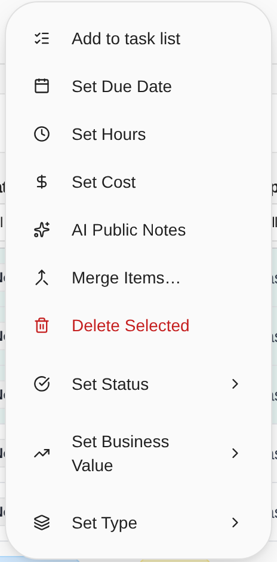
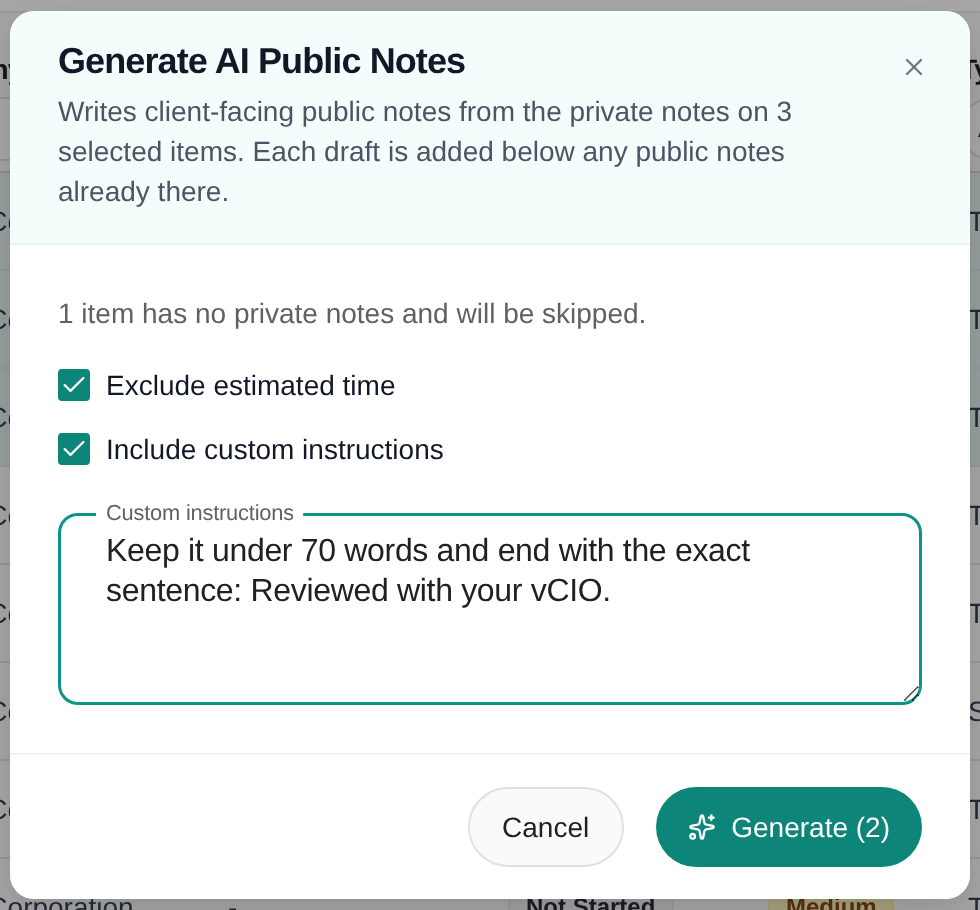
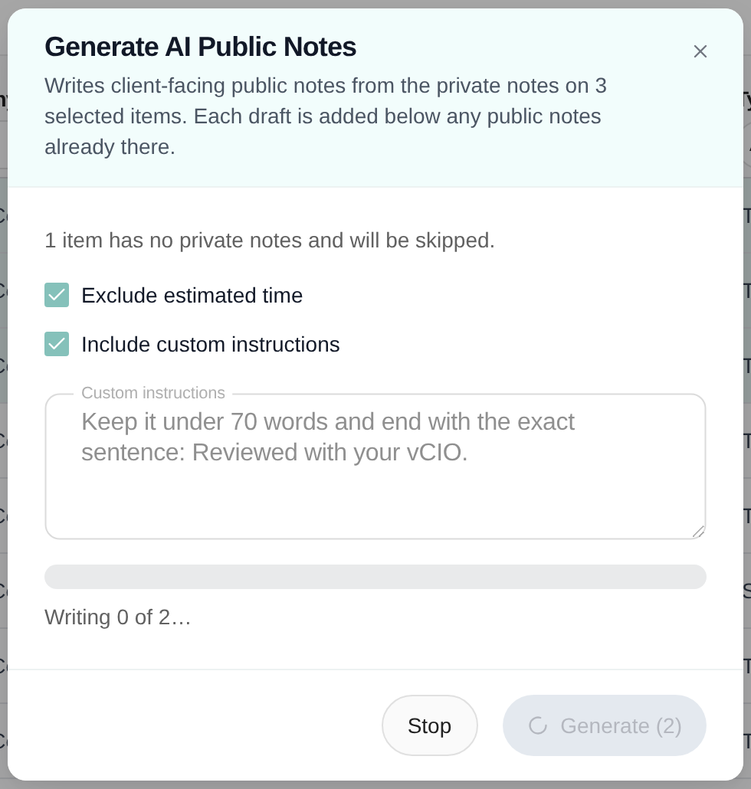
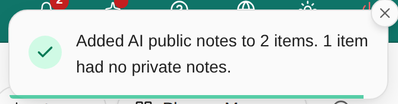
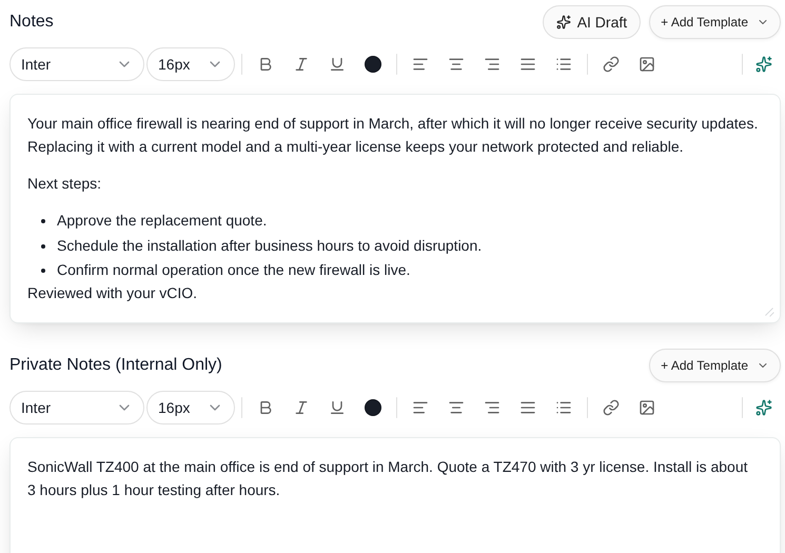

Change the same field on many Planner items at once from List View. This guide is for MSP staff with Manage Planner. **AI Public Notes** also works with Write Planner.

## Before you start

- You need **Manage Planner**. Bulk actions are in List View, which is in **Planner Menu**.
- List View shows 25 rows per page by default. Bulk actions work on the rows you select on the current page.
- **AI Public Notes** needs **Write Planner** or **Manage Planner**, and AI turned on for your MSP. See [Draft public notes with AI](#draft-public-notes-with-ai).
- Bulk changes edit Planner data only. They do not change linked tickets or projects in your PSA.

## Select the items

<Steps>
  <Step title="Open List View">
    Choose **Planner Menu > List View** and set the company selector.
  </Step>
  <Step title="Filter to the right work">
    Use the active list or **Archived**, then filter the table to the items you want.
  </Step>
  <Step title="Tick the rows">
    Tick individual row checkboxes, or the header checkbox to select the current page.
  </Step>
  <Step title="Check the count">
    The **Actions (N)** button in the page header shows how many rows are selected. It appears once you select a row.
  </Step>
</Steps>

Changing the page, the filters, the company or the **Archived** switch clears the selection. A successful bulk update also clears it.

## Change status, business value or type

<Steps>
  <Step title="Open Actions">
    Click **Actions (N)**.

    <Frame caption="The Actions menu for two selected items.">
      
    </Frame>
  </Step>
  <Step title="Pick the field">
    Point at **Set Status**, **Set Business Value** or **Set Type**.
  </Step>
  <Step title="Pick the value">
    Choose a status (Not Started, In Progress, Pending Approval, Completed, On Hold or Cancelled), a value (High, Medium or Low), or one of your Planner types. The change saves as soon as you choose it.
  </Step>
</Steps>

**Set Type** appears only when your MSP has Planner types.

## Set a due date

<Steps>
  <Step title="Choose Set Due Date">
    Click **Actions (N) > Set Due Date**.
  </Step>
  <Step title="Pick a date">
    Choose a date on the calendar, then click **Set Date**.
  </Step>
  <Step title="Remove the date instead (optional)">
    Click **Clear Date** to remove the due date from every selected item. It applies at once.
  </Step>
</Steps>

Click **Cancel** to close the dialog without changing anything.

## Set hours or cost

<Steps>
  <Step title="Choose the action">
    Click **Actions (N) > Set Hours** or **Set Cost**.
  </Step>
  <Step title="Enter a value">
    Type a number of zero or more. The value applies to **each** selected item. It is not split between them. Setting 4.5 hours on two items gives each item 4.5 hours.
  </Step>
  <Step title="Click Set Hours or Set Cost">
    The change saves when you click the button. **Clear Value** sets the value to zero.
  </Step>
</Steps>

There is no separate **Save** button after a bulk action. Wait for the success message, then check a few rows. A dialog can close before the update finishes.

### Check before you use Set Cost

**Set Cost replaces each selected item's cost rows with one row.** It does not add a line or adjust the existing lines. The new row keeps the item's current recurrence. The bulk dialog cannot choose a recurrence. **Clear Value** does the same replacement with a zero amount.

To keep separate lines, descriptions or recurrences, edit each item's **Costs** instead. See [Plan costs and hours](/user-guides/planner/plan-costs-and-hours).

The same number applies in each item's own currency. The dialog does not convert currencies, and it hides the currency symbol when your selection mixes currencies. Select items from one currency where you can.

## Draft public notes with AI

<Note>
  Branch preview: this feature and its screenshots show an upcoming Planner
  update. It may not be in your live portal until it is released.
</Note>

**AI Public Notes** writes client-facing **Notes** for many items at once. It reads each item's **Private Notes**, the same source as the **AI Draft** button in the item editor. See [Create and edit Planner items](/user-guides/planner/create-and-edit-items#add-notes-with-a-template-or-ai).

The menu entry shows only when AI is turned on for your MSP and you have **Write Planner** or **Manage Planner**.

<Steps>
  <Step title="Select the items">
    Tick the rows in List View. On a phone, open **Actions** first.
  </Step>
  <Step title="Open AI Public Notes">
    Click **Actions (N) > AI Public Notes**. The **Generate AI Public Notes** dialog opens.

    <Frame caption="Branch preview: AI Public Notes sits between Set Cost and Merge Items.">
      
    </Frame>
  </Step>
  <Step title="Read what will be skipped">
    The dialog says how many selected items have no private notes. Those items are skipped and nothing is written for them.
  </Step>
  <Step title="Choose the options (optional)">
    Tick **Exclude estimated time** to leave out any implementation or testing time estimate. Without it, the draft includes a one-line estimate.

    Tick **Include custom instructions** to show a **Custom instructions** box. Type writing preferences for this run, such as length or focus. The box holds up to 2,000 characters. Your instructions apply to this run only and are not saved. **Generate** stays off while the option is ticked and the box is empty.

    <Frame caption="Branch preview: both options are ticked and the Custom instructions box is open.">
      
    </Frame>
  </Step>
  <Step title="Click Generate">
    Click **Generate (N)**, where N is the number of items that have private notes. The dialog works through the items in batches of five and shows progress, for example "Writing 3 of 12…". Click **Stop** to end the run after the current batch. Items already written keep their notes.

    <Frame caption="Branch preview: progress while the notes are written.">
      
    </Frame>
  </Step>
  <Step title="Read the summary">
    A message tells you how many items got notes, how many were skipped and how many failed.

    <Frame caption="Branch preview: the summary after a run.">
      
    </Frame>
  </Step>
</Steps>

Each draft is added below any public notes already on the item. It never replaces them. Open an item to read and edit the draft, and set **Hide from company users** as you need. The draft is saved to the item as soon as it is written, so there is no **Save** to click.

<Frame caption="Branch preview: an item's Notes after a run. The private notes stay as they were.">
  
</Frame>

Read every draft before a client sees it. AI can misread short private notes.

## Merge similar items

Use **Merge Items** when several items describe the same work for one company, for example overdue hardware lifecycle items from different quarters.

1. Select two or more items for the same company.
2. Choose **Actions (N) > Merge Items…**.
3. Under **Item to keep**, pick the item that stays. The others are merged into it.
4. Read **What moves to** the kept item: the devices, tickets, licenses, goals, projects, opportunities, invoices, Secure Score controls, compliance checks, security findings, meeting links, tasks, attachments, budget lines, cost lines, notes, custom field values and tags that move to it.
5. Choose **Merge N items**.

The kept item gains every linked record from the other items; a record it already has is not duplicated. Their cost lines are appended to its Costs section, their hours are added to its hours, and their public and private notes are appended under a "Merged from" heading. Its title, description, status, dates and type do not change.

The other items are archived, not deleted. Find them under **Archived** and [restore one](/user-guides/planner/archive-restore-delete) if you merged it by mistake; the linked records stay on the kept item. Each merge is recorded in **Settings > Activity & Audit** for every item involved.

Merge is unavailable, with the reason shown in the dialog, when:

- the items belong to different companies;
- an item is kept in sync by a Standard or an automation rule (the Standard or rule would recreate it);
- an item [keeps its devices linked automatically](/user-guides/planner/link-supporting-records#keep-devices-linked-automatically) (choose **Stop keeping linked** on that item first; its current links stay);
- the item to keep is archived;
- an item hidden from company users would be merged into one they can see;
- the kept item would have more than 20 cost lines.

Lines on approved or obsolete budgets are locked, so they stay linked to the archived item.

## Delete selected items

<Steps>
  <Step title="Select the exact rows">
    Tick the rows on the current page.
  </Step>
  <Step title="Choose Delete Selected">
    Click **Actions (N) > Delete Selected**.
  </Step>
  <Step title="Read the confirmation">
    The dialog asks "Delete N planner items?" and says the items are permanently deleted with their costs and links.
  </Step>
  <Step title="Confirm">
    Click **Delete N Items**, or **Cancel** to keep them. Then check the list.
  </Step>
</Steps>

Deleted items cannot be restored. To keep an item for later, use **Archive** on its row instead. See [Archive, restore or delete Planner items](/user-guides/planner/archive-restore-delete).

**Delete Selected** does not appear if your selection includes a Standards item.

## Troubleshooting

| Problem | What to do |
| --- | --- |
| **Actions** is missing | Select at least one row. |
| Fewer items changed than you expected | Check the count in **Actions (N)**. Rows on other pages are not selected. |
| **Set Type** is missing | Your MSP has no Planner types yet. See [Manage Planner types and defaults](/user-guides/planner/manage-types). |
| An updated item disappeared from the list | Its new value no longer matches your filter. Clear the filters and check **Archived**. |
| A number is rejected | Use zero or higher. Read the message under the box. |
| Cost lines disappeared | **Set Cost** replaced them with one row. Re-enter the detail lines on the item if you need them. |
| **Merge Items** is missing | Select at least two items and check Manage Planner permission. |
| The Merge button stays disabled | Read the reason in the Merge dialog, such as items from different companies or an item managed by a Standard or automation rule. |
| **AI Public Notes** is missing | AI must be turned on for your MSP, and you need Write Planner or Manage Planner. |
| An item got no public notes | It had no private notes. Add private notes, then run **AI Public Notes** again. |
| Some items failed | Select just those rows and run it again. Check the summary message for the counts. |
| **Delete Selected** is missing | You need Manage Planner, and no selected item may be a Standards item. |

## Frequently asked questions

<AccordionGroup>
  <Accordion title="Does Select all pick every matching page?">
    No. It selects the rows on the current page. Do the other pages separately.
  </Accordion>
  <Accordion title="Where do I change several statuses at once?">
    Select the rows, then **Actions (N) > Set Status** and choose a status. It saves immediately.
  </Accordion>
  <Accordion title="Does a bulk change wait for a Save button?">
    No. Menu choices apply at once. The date, hours and cost dialogs apply when you click their button.
  </Accordion>
  <Accordion title="Are hours divided between the selected items?">
    No. Each item gets the full value you enter.
  </Accordion>
  <Accordion title="How do I remove due dates from several items?">
    **Actions (N) > Set Due Date > Clear Date**. It applies immediately.
  </Accordion>
  <Accordion title="Does Set Cost keep my existing cost lines?">
    No. It replaces them with one row in the item's current recurrence.
  </Accordion>
  <Accordion title="Does AI Public Notes replace the notes already on an item?">
    No. Each draft is added below any public notes already there.
  </Accordion>
  <Accordion title="Can I stop AI Public Notes part way?">
    Yes. Click **Stop**. The run ends after the current batch, and items already written keep their notes.
  </Accordion>
  <Accordion title="Can I archive several items at once?">
    No. Archive and Restore are row actions. The Actions menu has field updates, **AI Public Notes**, **Merge Items** and **Delete Selected**.
  </Accordion>
  <Accordion title="Can I use bulk actions on archived items?">
    Yes, if you have permission. Updating a field does not restore the item.
  </Accordion>
  <Accordion title="Can I undo a merge?">
    Restore the merged items from Archived. Their linked records, cost lines and notes stay on the kept item, so move anything back by editing the items.
  </Accordion>
  <Accordion title="Why can't I merge automation items?">
    An automation rule keeps its own items in sync and would recreate or change them on its next run. Rules that use the current period for past dates already keep one item per company for each period.
  </Accordion>
</AccordionGroup>

## Related guides

- [Find Planner items in List View](/user-guides/planner/find-planner-items)
- [Archive, restore or delete Planner items](/user-guides/planner/archive-restore-delete)
- [Plan costs and hours](/user-guides/planner/plan-costs-and-hours)
