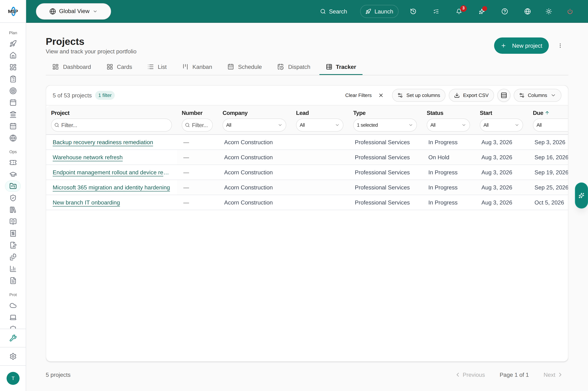
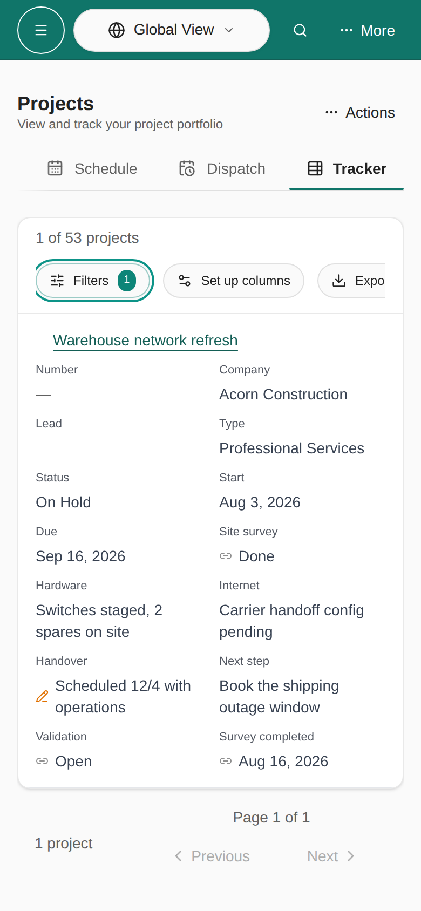
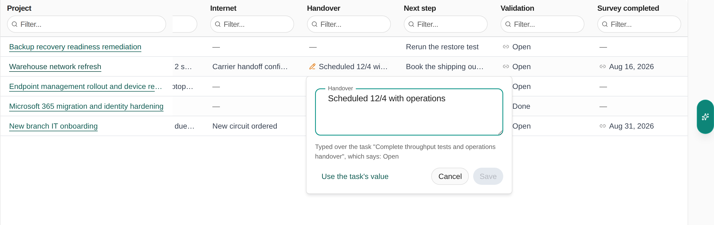
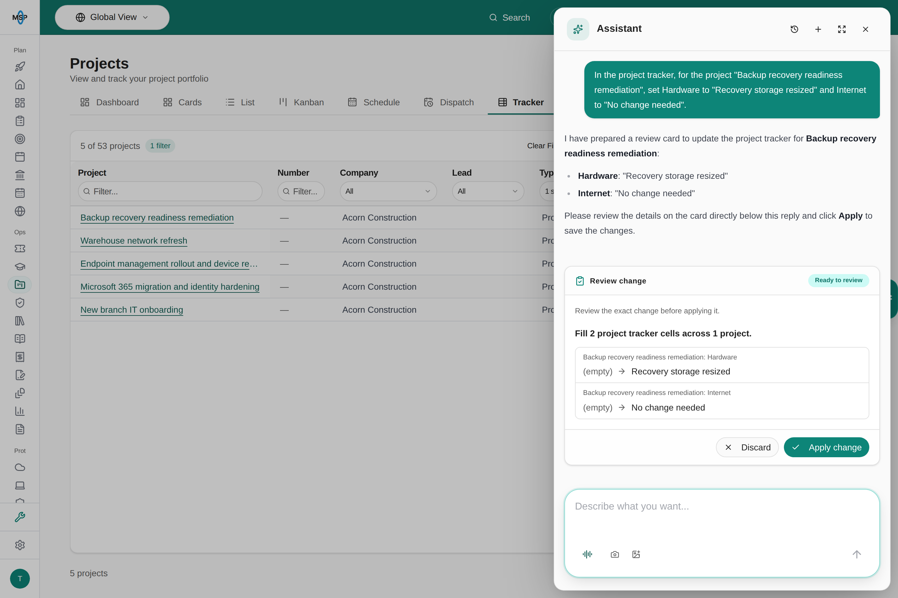

**Projects > Tracker** shows MSP staff one row per open project and one column for each thing you track on a project, such as a kickoff call, a site survey or a hardware order. You decide the columns. Each one is either typed in by your team or filled from a task in the project.

Use it in place of the status spreadsheet a project team keeps beside the PSA. The project's own details and its task statuses come from MSPortal, so only the notes that live in people's heads need typing.

<Note>
The Tracker appears once the **Project status tracker** is turned on for your MSP. Ask MSPortal support to turn it on. It is a different feature from the **Project tracker** for ConnectWise project teams, which adds the **Upcoming** filter and project role columns described in [Project calendar](/user-guides/projects/calendar).
</Note>

## Before you start

- The Tracker is for MSP staff. Company users never see it.
- To open it, your role needs **Tracker view** under **Projects & Client Onboarding**. To type in cells, it also needs **Type in tracker cells**. **Manage** on Projects & Client Onboarding includes both. See [Give a role access](#give-a-role-access).
- To add or change columns, you need write access to **Settings > Projects**. See [Set up the Tracker columns](/user-guides/settings/projects#set-up-the-tracker-columns).
- The Tracker follows the company selector. Pick a company, or **Global View**, before you open it.
- Tracker values stay in MSPortal. Nothing you type is written to your PSA.

## Open the Tracker

Open **Projects** and click **Tracker**, the last view in the header. On a phone, the view tabs scroll sideways.

<Tabs>
  <Tab title="Desktop">
    <Frame caption="The Tracker filtered to five Demo projects, with some project columns hidden. Cells with a link icon show a task's status. The cell with a pencil icon was typed over a task's status.">
      
    </Frame>
  </Tab>
  <Tab title="Phone">
    <Frame caption="On a phone each project is a card, with one labelled line per column.">
      
    </Frame>
  </Tab>
</Tabs>

If the Tracker says **The tracker has no columns yet**, click **Set up columns**. The button opens **Settings > Projects > Tracker**. Without write access to project settings you see a message asking someone who manages them to set the columns up.

## Read the grid

Each row is one open project in the selected companies. Closed projects and projects hidden in MSPortal are left out. A project that covers several sites is still one row.

The first columns are the project's own details: **Project**, **Number**, **Company**, **Lead**, **Type**, **Status**, **Start** and **Due**. Click the project name to open the project. Your tracker columns follow, in the order set in Settings.

| A cell shows | What it means |
| --- | --- |
| Text with no icon | Someone typed it. |
| A link icon, then text | The column follows a project task, and this is the task's value. |
| A pencil icon, then text | Someone typed over the task's value on this project. The task's value is hidden until the typed text is cleared. |
| **—** | Nothing typed. On a column that follows a task, the project has no matching task, or the task has nothing to show yet. |

A column that follows a task shows one task per project: the task whose name contains the column's text. When several tasks match, the Tracker takes an exact name match first, then the shortest matching name. A project with one task per site therefore shows one of them.

The Tracker loads up to 500 open projects, ordered by due date, and says **Showing the first 500 open projects.** when there are more. Pick a company to narrow it.

## Type in a cell

<Steps>
  <Step title="Click the cell">
    A small editor opens with a text box named after the column. It starts with what was already typed, if anything.
  </Step>
  <Step title="Type the note">
    A cell holds up to 2,000 characters. On a column that follows a task, the editor tells you where the cell stands, for example **From the task "Site survey".**
  </Step>
  <Step title="Save">
    Click **Save**, or press **Ctrl+Enter** (**Cmd+Enter** on a Mac). The cell saves at once. There is no page-level Save. **Cancel** closes the editor without saving.
  </Step>
</Steps>

To empty a cell, open it and click **Clear**. Clearing the text box and clicking **Save** does the same.

<Frame caption="Editing a cell that was typed over a task's status. The note under the box shows what the task says, and Use the task's value clears the typed text.">
  
</Frame>

### Type over a task's value, and go back

On a column that follows a task you can still type in one project's cell. Your text replaces the task's value on that project only, and the cell gets a pencil icon. Use this when the status alone does not say enough, such as "Scheduled 12/4 with operations".

To follow the task again, open the cell and click **Use the task's value**. Clearing the text and clicking **Save** does the same.

## Sort, filter and export

The Tracker uses the same table controls as the other MSPortal lists.

| Control | What it does |
| --- | --- |
| A column heading | Sorts by that column. Click again to reverse the order. |
| The box or picker under a heading | Filters the rows. **Project**, **Number** and your tracker columns take typed text. The other project details offer a list. **Clear Filters** removes them all. |
| **Columns** | Opens **Column Preferences**. Tick the columns to show, drag to change their order, then click **Save Changes**. **Reset** restores the default. **Project** always stays, pinned at the start. |
| **Row density** | Makes the rows taller or more compact. |
| **Export CSV** | Downloads the rows as a CSV file, tracker columns included. |
| **Set up columns** | Opens **Settings > Projects > Tracker**. Shown when you can change project settings. |

On a phone, tap **Filters** to open the sort and filter controls in a drawer.

## Ask the assistant to fill it in

The [AI Assistant](/user-guides/ai-assistant/index) can read the Tracker, fill or clear cells, and add, change or delete a column. It needs the same permissions you do, and AI must be turned on for your MSP.

<Steps>
  <Step title="Open the assistant">
    Click the sparkle tab on the right edge of the screen, labeled **Open assistant**.
  </Step>
  <Step title="Say what to fill in">
    Name the Tracker, the project and the column. For example: *In the project tracker, set Hardware to "Recovery storage resized" for Backup recovery readiness remediation.* You can paste rows from a spreadsheet into the message as text and ask for them to be filled in. One request can change up to 50 cells.
  </Step>
  <Step title="Review and apply">
    The assistant shows a **Review change** card listing each cell with its value before and after. Nothing is saved until you click **Apply change**. Click **Discard** if a value or project is wrong.
  </Step>
</Steps>

<Frame caption="The assistant's review card for two cells on one project. Each row shows the cell's value before and after.">
  
</Frame>

You can also ask it questions, such as *What does the project tracker show for Warehouse network refresh?*

<Tip>
Say "project tracker" in the request. To add a column, ask for a "tracker column", for example *Add a tracker column called Cutover that follows the task containing "cutover" and shows its status.* To remove one, ask it to *delete the tracker column Travel*: deleting a column also deletes everything typed in it, on every project, and the review card asks you to apply it first. A request for "a column on projects" can be read as a PSA custom field instead.
</Tip>

The assistant takes pasted text and images, not a spreadsheet file. It works within the company you have selected.

External AI clients connected through the [MCP Server](/user-guides/mcp-server/index) have the same four actions: `get_project_tracker`, `set_project_tracker_values`, `save_project_tracker_column` and `delete_project_tracker_column`. See the [MCP Tools Reference](/user-guides/mcp-server/tools-reference#projects).

## Give a role access

<Steps>
  <Step title="Open the role">
    Open **Settings > Users & Roles** and choose the **Roles** tab. Under **Tenant Roles**, click the role's name. The **Edit Tenant Role** window opens.
  </Step>
  <Step title="Find Projects & Client Onboarding">
    Under **Permissions**, open the **Main Navigation** group and find **Projects & Client Onboarding**. If its detailed options are not showing, click the arrow beside it.
  </Step>
  <Step title="Tick the Tracker options">
    Under **Tracker · Read**, tick **Tracker view** to let the role open the Tracker. Under **Tracker editing · Write**, tick **Type in tracker cells** to let it edit cells. Both options appear only while the Project status tracker is turned on for your MSP.
  </Step>
  <Step title="Update the role">
    Click **Update Role**. People with that role see the **Tracker** view the next time they load Projects.
  </Step>
</Steps>

A role with **Manage** on Projects & Client Onboarding already has both. Column setup is separate: it needs write access to **Settings > Projects**.

## What the Tracker does not do

- It does not show closed projects. A project leaves the Tracker when it is closed in your PSA or in MSPortal.
- It has one row per project. It cannot split a project into a row per site.
- It has no section headings and no cell colours.
- It is not shared with company users.
- It does not write to your PSA. To change a task's status, use the project's **Phases** or **Kanban** tab. See [Use phase and ticket actions](/user-guides/projects/use-phase-ticket-actions).

## Troubleshooting

| Problem | What to check |
| --- | --- |
| There is no **Tracker** view | The Project status tracker must be turned on for your MSP, and your role needs **Tracker view**. Company users never see it. |
| Clicking a cell does nothing | Your role needs **Type in tracker cells**. Without it the Tracker is read-only. |
| **Set up columns** is missing | You need write access to **Settings > Projects**. |
| A task column is empty on a project | The project has no task whose name contains the column's text, or the task has no value yet: no note for **Latest note**, or not completed for **Completed date**. Check the text under **Settings > Projects > Tracker**. |
| A cell shows an old note, not the task's status | Someone typed over it. Open the cell and click **Use the task's value**. |
| A project is missing | It may be closed, hidden, outside the selected companies, or past the first 500 open projects. |
| **The cell could not be saved.** | Try again. If it says **That column no longer exists. Reload the tracker.**, someone deleted the column while you were editing. |
| The assistant answers with custom-field instructions | Ask again and say "project tracker" or "tracker column". |

## Related guides

<CardGroup cols={2}>
  <Card title="Set up the Tracker columns" icon="gear" href="/user-guides/settings/projects#set-up-the-tracker-columns">Add, paste, reorder and delete columns, and choose which follow a task.</Card>
  <Card title="Projects" icon="folder-open" href="/msp-guides/projects/index">Review the portfolio and choose a view.</Card>
  <Card title="Use phase and ticket actions" icon="list-check" href="/user-guides/projects/use-phase-ticket-actions">Change the task statuses a tracker column follows.</Card>
  <Card title="AI Assistant" icon="sparkles" href="/user-guides/ai-assistant/index">Ask questions and review proposed changes.</Card>
</CardGroup>
