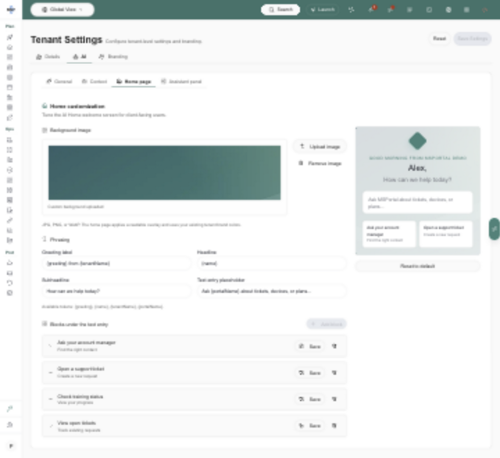

AI settings control whether your organization and your clients can use AI, what the assistant knows about your business, and how AI Home and the Assistant panel look. This page is for MSP staff who manage those settings.

## Before you start

- You need AI Settings access. Read access lets you view the page. Write access lets you change every section and save it with **Save Settings**, including AI keys, models and the assistant voice key. Without write access the controls are disabled.
- Tenant Settings access alone does not open this page. Ask an administrator to give your role AI Settings access in [Users & Roles](/user-guides/settings/users-roles#settings-permissions).

## Open AI settings

<Steps>
  <Step title="Open Settings > Customization > AI">
    The page header has four tabs: **General**, **Context**, **Home page** and **Assistant panel**.
  </Step>
</Steps>

## Save your changes

The page header has **Reset** and **Save Settings** buttons. **Save Settings** stays disabled until you change something.

- **Save Settings** saves every tab on this page at once.
- **Reset** returns the form to its last saved values.
- If you leave the page with unsaved changes, MSPortal asks you to choose **Discard changes** or **Keep editing**.

## Configure AI features

<Steps>
  <Step title="Open the General tab">
    **General** has the AI switches.
  </Step>
  <Step title="Set Enable all AI-powered features">
    Check it to allow AI for your whole organization. Uncheck it and no users, automations or background jobs can generate AI content.
  </Step>
  <Step title="Set Enable AI features for client users">
    Uncheck it so company users get the non-AI experience while your team keeps AI. This switch is disabled while the master switch is off, because turning the master switch off disables AI for everyone. To keep one client's data away from AI completely, see [Turn off AI for a company](/user-guides/settings/companies#turn-off-ai-for-a-company).
  </Step>
  <Step title="Set AI-Powered Home Page (Global)">
    Check **Enable AI assistant on the home page for chat-based navigation and queries**. When unchecked, every company sees the classic home page. When checked, you can switch individual companies in **Settings > Companies**. This box is also disabled while the master switch is off.
  </Step>
  <Step title="Click Save Settings">
    All three switches are on by default.
  </Step>
</Steps>

## Add AI context

<Steps>
  <Step title="Open the Context tab">
    Fill in what the AI assistant can share and use: the portal name (**What do you call the Portal?**), **AI advisor name**, **Support Email**, **Support Phone**, **Sales Phone**, **Emergency Phone**, **Business Hours**, **Website URL** and **General Notes**.
  </Step>
  <Step title="Click Save Settings">
    **General Notes** holds up to 3,500 characters.
  </Step>
</Steps>

## Customize the AI Home welcome screen

<Steps>
  <Step title="Open the Home page tab">
    You need manage access to edit these controls. The preview on the right shows sample welcome text and blocks as you edit.
  </Step>
  <Step title="Upload a background image">
    Under **Background image**, click **Upload image** and choose a JPG, PNG or WebP file no larger than 3 MB. Wait for the upload confirmation and check the preview. The image applies after you save in the last step. A large landscape image such as 1920 × 1080 pixels is a good start. The image fills the welcome area and crops around the center on narrow screens, and MSPortal adds an overlay to keep the text readable.
  </Step>
  <Step title="Personalize the welcome text">
    Under **Phrasing**, edit **Greeting label**, **Headline**, **Subheadline** and **Text entry placeholder**. You can use `{greeting}`, `{name}`, `{tenantName}` and `{portalName}`. For example, use `{greeting}` for the label and `{name}` for the headline. Empty fields use the standard welcome text.
  </Step>
  <Step title="Add shortcut blocks">
    Under **Blocks under the text entry**, click **Add block**. Give each block a **Label**, an **Icon**, an optional **Description** and a **Prompt sent to AI**. The prompt runs when someone selects the block. For example, label a block `Open a support ticket` with the prompt `I want to open a support request`. You can add up to four blocks. Custom blocks replace the default quick actions.
  </Step>
  <Step title="Save and check Home">
    Click **Save Settings** in the header. The **Save** button on a block saves the same form. Then open **Home** with an account that has AI Home enabled, on a desktop and a phone, and check the background and text. The preview is only a sample. The live greeting uses the viewer's name and the time of day. For a company user, AI Home must also be enabled for that company.

    <Frame caption="Example AI Home settings with a background, personalized welcome, and shortcut blocks.">
      
    </Frame>
  </Step>
</Steps>

To remove the image, click **Remove image**, then **Save Settings**. To restore the standard phrasing and quick actions, click **Reset to default**, then **Save Settings**.

## Customize the Assistant panel

<Steps>
  <Step title="Open the Assistant panel tab">
    This tab sets the starter questions people see when they open the assistant from any page.
  </Step>
  <Step title="Add or edit starter questions">
    Click **Add question** and enter a **Label**, an **Icon** and a **Prompt sent to the assistant**. You can add up to six. Remove them all to open the panel with only the prompt box. **Reset to default** restores the standard questions.
  </Step>
  <Step title="Click Save Settings">
    The panel's **Preview** updates as you edit.
  </Step>
</Steps>

## Troubleshooting

| Problem | What to do |
| --- | --- |
| **AI** is missing under **Settings > Customization**. | Your role has no AI Settings access. Tenant Settings access alone does not open it. Ask an administrator. |
| **Save Settings** is disabled. | You have not changed anything, a save is running, or you do not have write access to AI Settings. |
| Fields and switches are greyed out. | Changing them needs manage access to AI Settings. Ask an administrator. |
| The **Enable AI features for client users** or **AI-Powered Home Page** box is disabled. | Turn on **Enable all AI-powered features** first. |
| I uploaded an AI Home background but nothing changed. | Uploads are drafts. Click **Save Settings**. |
| A home background will not upload. | Use JPG, PNG or WebP at 3 MB or smaller. |

## Frequently asked questions

<AccordionGroup>
  <Accordion title="What turns off when I disable AI features?">
    Users, automations and background jobs can no longer generate AI content. Existing records are not deleted.
  </Accordion>
  <Accordion title="Does enabling AI give clients access to all data?">
    No. Company scope and permissions still apply.
  </Accordion>
  <Accordion title="Where did AI go from Tenant Settings?">
    AI moved to **Settings > Customization > AI**. Old links to the AI tab of Tenant Settings open the new page.
  </Accordion>
</AccordionGroup>

## Related guides

- [Support identity and AI settings](/user-guides/getting-started/onboarding/ai-settings)
- [Turn off AI for a company](/user-guides/settings/companies#turn-off-ai-for-a-company)
- [Use the Home AI Assistant](/user-guides/ai-assistant/use-home-assistant)
- [Users & Roles](/user-guides/settings/users-roles)
- [Settings overview](/user-guides/settings/index)
