Use **Settings > Users & Roles > Automatic Import** to decide who becomes a portal user without anyone importing them by hand, and who is disabled when they leave. Every source is listed on one page: your clients' Microsoft 365 tenants, each PSA connection's contacts, and the technicians and Microsoft 365 accounts of your own team. This page is for MSP staff.

## Before you start

- You need read access to **Users** settings to see the **Automatic Import** tab.
- Changing anything under **Client users** needs write access to both **Users** and **Company Users** settings. Deleting a rule also needs manage access to Users settings.
- Changing anything under your own staff, or under **Exclusion rules**, needs write access to **Users** settings, and manage access to delete a rule.
- You can only give a role whose permissions your own role holds. Role lists turn off the roles you cannot give.
- Create the roles first, on the **Roles** tab. Client users get a Company role. Staff get a Tenant role.
- A source appears once its integration is connected and syncing users. With nothing connected, the page shows **No user sources connected** and a link to your integrations.

<Frame caption="Sample data: every user source in two panels, each with its switch and a summary of its rules, and the Exclusion rules panel under them.">
  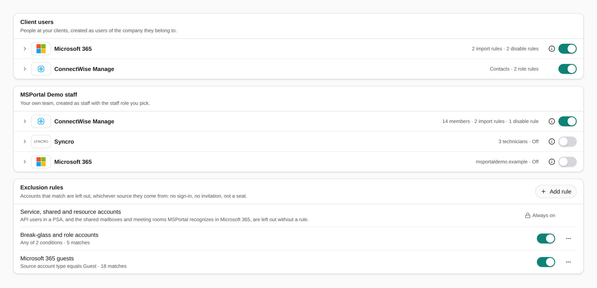
</Frame>

<Accordion title="Phone preview">
  <Frame caption="The same page on a phone. A source's summary moves inside the row when you open it.">
    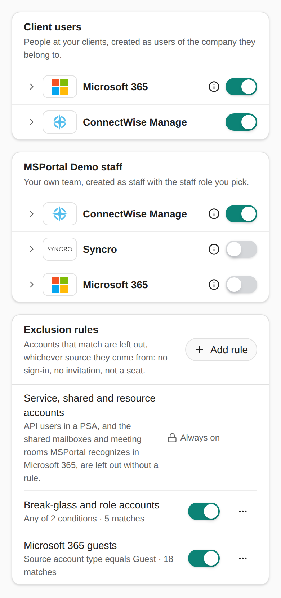
  </Frame>
</Accordion>

## Read the page

The page has three panels:

| Panel | What it decides | Sources |
| --- | --- | --- |
| **Client users** | Who becomes a Company user of the company they belong to | **Microsoft 365**, and the contacts of each ConnectWise, Autotask or Halo PSA connection |
| **Your MSP's name, then staff** | Who on your own team becomes MSP staff, with the Tenant role you pick | The technicians of each PSA connection, and your own Microsoft 365 tenant |
| **Exclusion rules** | Which accounts are left out: service accounts, shared mailboxes, break-glass accounts. See [Add exclusion rules](#add-exclusion-rules) | Every source in the two panels above |

Each source is one row:

- **The switch** on the right is **Import from this source automatically**. On means the source is creating users.
- **The summary** beside the switch says what the source does today, for example **2 import rules · 2 disable rules**, or **Off**. Built-in disables are counted. A summary in amber, such as **Pick a default role**, names something to fix before the source can import.
- **Click the row** to open its rules. **Import rules** decide who becomes a user and with which role. **Disable rules** decide who is turned off and signed out.

Every rule row has its own switch to pause or resume it, which saves right away, and a **⋯** menu with **Edit rule** and **Delete rule**.

## Import client users from Microsoft 365

Open **Microsoft 365** under **Client users**. Its rules read the people synced from every client tenant you have connected.

<Steps>
  <Step title="Add an import rule">
    Click **Add rule** beside **Import rules**. With no rules yet, turning the source's switch on opens the same dialog.
  </Step>
  <Step title="Choose the role and priority">
    **Role for imported users** lists your Company roles. Pick the role with the least access these people need. **Priority** decides which rule gives the role when several rules match one person: the lowest number wins.
  </Step>
  <Step title="Name the rule">
    Enter a **Rule name** and, optionally, a **Description**.
  </Step>
  <Step title="Add the conditions">
    Choose **Match all conditions** or **Match any condition**, then click **Add condition** for each one. Every condition has a **Field**, an **Operator** and a **Value**. The fields are **Microsoft 365 license**, **Microsoft 365 group**, **Microsoft 365 user type**, **Source account enabled**, **Display name**, **Email address**, **Job title**, **Department**, **Office location**, **Microsoft 365 employee type** and **Microsoft 365 employee ID**. A new import rule starts with **Microsoft 365 license** **is assigned**.
  </Step>
  <Step title="Preview the matches">
    Click **Preview matches** to list up to 100 people who match. The summary shows how many will be imported out of all matches, and each person shows an outcome from [Who an import rule skips](#who-an-import-rule-skips).
  </Step>
  <Step title="Save and apply">
    Leave **Apply this rule** on and click **Save and apply**. Matching people are imported right away. A paused rule is saved but has no effect.
  </Step>
</Steps>

<Frame caption="Sample data: Microsoft 365 open, with two import rules, the built-in disable and one disable rule.">
  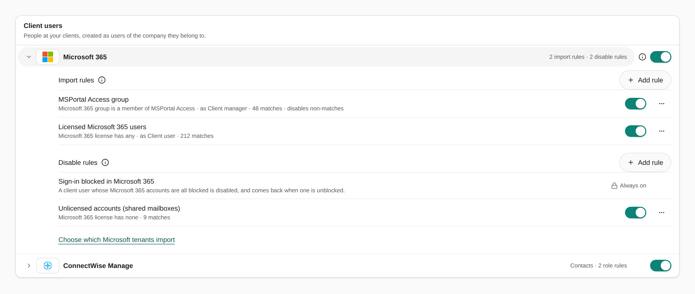
</Frame>

<Accordion title="Phone preview">
  <Frame caption="The Microsoft 365 rules on a phone.">
    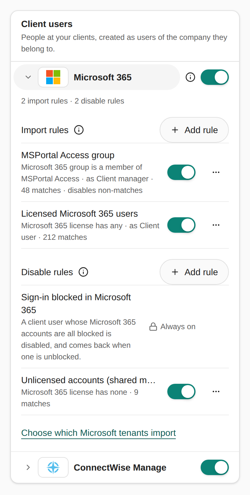
  </Frame>
</Accordion>

**Choose which Microsoft tenants import**, under the rules, opens the [Microsoft 365 Companies page](/user-guides/microsoft-365/connecting-companies#turn-user-import-on-or-off), where you turn import off for one client's tenant.

### Match by Microsoft 365 license

Use the **Microsoft 365 license** field with **is assigned** or **is not assigned**. The **Value** list shows the licenses synced from your clients' Microsoft 365 tenants, with how many companies have each one. A rule matches that license in every client tenant, so one rule covers all of them. **has any** and **has none** need no value: they match an account with at least one license, or with none. For example, import everyone with Microsoft 365 Business Premium, or disable accounts that have no license.

Licenses sync once a day. A license condition never judges an account that appeared after the last license sync, so a new hire is not caught by **has none** before their license is on file.

### What an import rule does

- **When it runs:** after each Microsoft 365 users sync, and right after you save the rule or turn a tenant's user import back on.
- **Who it creates:** a Company user in the company the person's Microsoft 365 tenant is connected to, with status **Imported** and the rule's role.
- **No invitation:** MSPortal sends no email. The Microsoft 365 account is linked to the portal user when the person first signs in. To invite people, use **Send Welcome Email** on **Company Users**.
- **Existing users stay as they are:** an import rule never changes a portal user's details or role. An address already used by a portal user in your organization, as a main address or a Microsoft alias, is skipped. With **Disable users who stop matching** on, it can disable and turn back on the people it matches, as described below.
- **Turning it off keeps users:** pausing, editing or deleting an import rule stops new imports only. Users it already imported stay. People a synced rule disabled are turned back on. Remove them from **Company Users** if they should not have access.
- **The source's switch:** it is on while at least one import rule is active. Turning it off pauses every active Microsoft 365 import rule. Turning it back on resumes the rules it paused, and leaves a rule you paused yourself paused.
- **Per tenant:** to stop imports for one client's Microsoft tenant, turn off user import on the [Microsoft 365 Companies page](/user-guides/microsoft-365/connecting-companies#turn-user-import-on-or-off).

<Tip>
  Give each group of people one rule. When rules with different roles overlap, each person is imported once, with the role of the rule that has the lowest **Priority** number.
</Tip>

### Who an import rule skips

| Preview outcome | Meaning |
| --- | --- |
| **Will be imported** | The person gets a Company user on the next import. |
| **Already a portal user** | Their address is already in use in your organization. Normal linking connects them to that user. |
| **Imports off for this tenant** | User import is turned off for their Microsoft tenant on the Microsoft 365 Companies page. |
| **Account disabled** | Their Microsoft 365 account is disabled. |
| **Cannot sign in** | A guest, service, shared or resource account, an account an [exclusion rule](#add-exclusion-rules) matches, or a person whose access was removed with **Remove Access** on **Company Users**. |
| **No email address** | Microsoft 365 has no email address for the person. |

### Keep access in sync with a group

Map a Microsoft 365 group to a role: create an import rule with the condition **Microsoft 365 group** **is a member of** the group, choose the role, and turn on **Disable users who stop matching**. A group named the same in every client tenant (for example **MSPortal Access**) is matched in all of them.

- **Joining the group:** a member without a portal user gets one, with the rule's role. A member who already has a portal user keeps it, and the rule starts keeping their access in sync.
- **Leaving the group:** once someone the rule has matched no longer matches any rule that keeps access in sync, MSPortal disables their portal user and signs them out after the next Microsoft 365 sync.
- **Rejoining:** they are turned back on after the next sync.
- **Pausing or deleting the rule:** turning the rule off, deleting it or turning **Disable users who stop matching** off turns back on the people it disabled, within a few minutes.
- **Roles:** people the rule created move to the role of the highest-priority synced rule they match, so a second rule for a **Managers** group can give managers a different role. Once someone changes a person's role by hand, the rules leave that role alone. People who were portal users before the rule keep their role.
- **Turning a rule on disables nobody:** only people a rule has matched can be disabled by it. People who were never in the group are left as they are.
- **An administrator's choice wins:** if you turn a removed person back on, the rule leaves them alone until they rejoin the group and leave it again.
- **Safety stop:** when more than 25 people, and over half of everyone the synced rules track, would be disabled in one pass, MSPortal disables no one and reports it to the MSPortal team. That pattern usually means a group failed to sync, not a mass departure. A disable rule is held the same way when it would suddenly disable more than 25 people and over half of everyone in scope. A change you make yourself is never held: saving a rule applies it, so a rule you just created or edited after checking **Preview matches** goes through. To apply a held change once you have checked it, open the rule and save it again.

## Disable client users from Microsoft 365

**Disable rules**, in the same **Microsoft 365** row, lists everything that turns a client user off.

- **Sign-in blocked in Microsoft 365** is built in and marked **Always on**. A client user whose Microsoft 365 accounts are all blocked is disabled, and comes back when one is unblocked. See [Microsoft 365 users](/user-guides/microsoft-365/users).
- **Add rule** creates your own disable rule. It disables, and signs out, each Company user whose Microsoft 365 accounts all match. They are turned back on when they stop matching, or when you pause or delete the rule. If you turn someone back on yourself, the rule leaves them alone until they stop matching and match again. People come back with the status they had before, so an invited person stays invited.

When a mailbox is converted to a shared mailbox, Microsoft 365 keeps the account enabled, so MSPortal cannot treat it as disabled. The licenses are usually removed, though. To disable those people, add a disable rule with **Microsoft 365 license** **has none**, and add **Microsoft 365 user type** **equals** **Member** so guests are left alone. Click **Preview matches** first: a portal user is disabled only when all of their Microsoft 365 accounts match.

## Import client users from PSA contacts

Each ConnectWise, Autotask and Halo PSA connection has its own row under **Client users**. Its switch turns contact import on for that connection: active contacts of your imported companies become Company users after each users sync.

<Steps>
  <Step title="Open the connection's row">
    Click the PSA's row, for example **ConnectWise Manage**. With several connections to one PSA, each row shows the connection's name.
  </Step>
  <Step title="Choose the role for everyone else">
    **Role for everyone else** is the role a contact gets when no rule below matches. A company's own default import role, set on the company, comes first.
  </Step>
  <Step title="Give some contacts another role (optional)">
    Click **Add rule** to map a contact type to a portal role. In ConnectWise and Autotask the rules use contact types. In Halo PSA they use Halo roles and the Important Contact flag. When a contact matches more than one rule, the rule highest in the list wins. Use the arrows to reorder the rules.
  </Step>
  <Step title="Turn the switch on">
    Turn on the row's switch. Each change saves right away. A change to the switch, a role or a rule starts a users sync, and the page shows **Contact import saved. A users sync has started.**
  </Step>
</Steps>

<Frame caption="Sample data: a ConnectWise connection's contacts, with the default role, two contact type rules and the built-in disable.">
  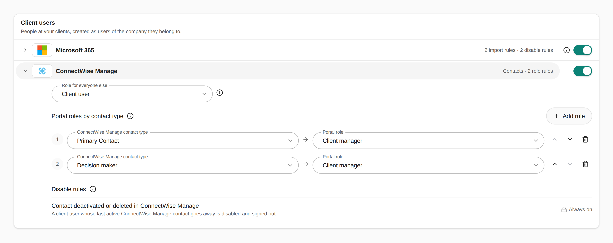
</Frame>

<Accordion title="Phone preview">
  <Frame caption="A PSA connection's contact import on a phone.">
    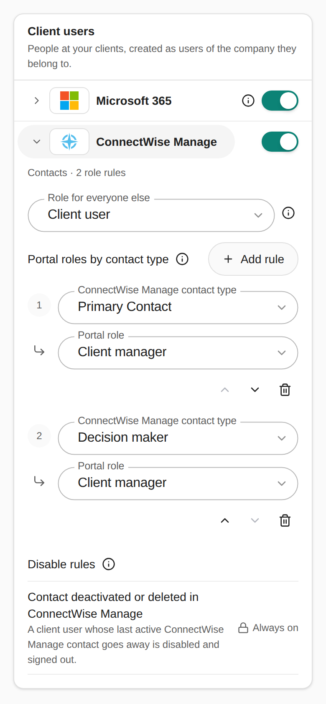
  </Frame>
</Accordion>

- **Changing a role rule updates existing users.** Users already imported from that connection move to the role their contact type now maps to.
- **Disable rules:** **Contact deactivated or deleted** is built in and marked **Always on**. A client user whose last active contact in the PSA goes away is disabled and signed out.
- **Users must be syncing.** When the connection is not syncing users, or its API key cannot read contacts, the row's summary reads **Not importing** and the row says why. Turn on **Sync Users** under **Choose data** on the connection's page. You can still turn the import off here.
- **Changing who gets a role checks every role.** Reordering, adding or removing a rule, changing the default role and turning the import on can all hand a role to new people, so each of those saves needs you to be able to give every role in the list.
- **The PSA's own page links here.** On the connection's **Choose data** task, **Contact Auto-Import** shows **On** or **Off** and the link **Set up in Automatic Import**.

<Tip>
  Choose a role with minimal permissions for **Role for everyone else** if you plan to import all contacts.
</Tip>

Syncro and NinjaOne contacts are not imported automatically. Import them with [Import users](/user-guides/integrations/import-users).

## Import your own staff

The second panel, named after your MSP, creates MSP staff. Its sources are:

- **Each PSA connection's technicians:** ConnectWise members, Autotask resources, Halo PSA agents, and Syncro and NinjaOne technicians. The row shows how many the connection has synced.
- **Your own Microsoft 365 tenant:** the tenant your own team signs in with. MSPortal offers a Microsoft 365 tenant here only when your account, or a Primary Admin's, is a member of it, so a client's directory can never create staff. A rule reads that one tenant only. If the connection is later reconnected to a different tenant, its staff rules are removed, and the people their disable rules had turned off are turned back on. If no tenant qualifies, the panel explains that and you can connect your own tenant like any other company's.

<Steps>
  <Step title="Open a source and add an import rule">
    Click the source's row, then **Add rule** beside **Import rules**. Turning on the switch of a source with no rules opens the same dialog.
  </Step>
  <Step title="Choose the staff role and priority">
    **Staff role** lists your Tenant roles. When several rules match one person, the rule with the lowest **Priority** number gives the role.
  </Step>
  <Step title="Add the conditions">
    A PSA rule starts with **PSA agent or technician** **is true**, which matches every technician. Narrow it with fields such as **PSA security role**, **PSA work role**, **Team**, **PSA group**, **Job title** or **Email address**. A Microsoft 365 rule starts with **Microsoft 365 group** **is a member of**: pick the group your team is in (the list shows your own tenant's groups only), or use **Department**, **Job title** and the other directory fields. Licenses are not available on staff rules.
  </Step>
  <Step title="Preview, then save and apply">
    Click **Preview matches** to see who will be imported and why others are skipped, then click **Save and apply**. The rule runs right away and reports how many staff it imported.
  </Step>
</Steps>

<Frame caption="Sample data: a ConnectWise connection's staff rules, one role for service managers and one for everyone else.">
  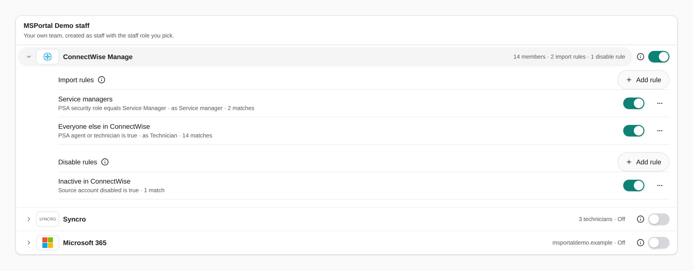
</Frame>

<Frame caption="Sample data: a new staff import rule, with the preview showing who will be imported and why others are skipped.">
  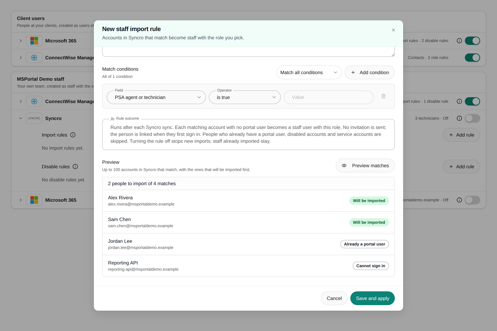
</Frame>

<Accordion title="Phone preview">
  <Frame caption="The staff rules and the rule dialog on a phone.">
    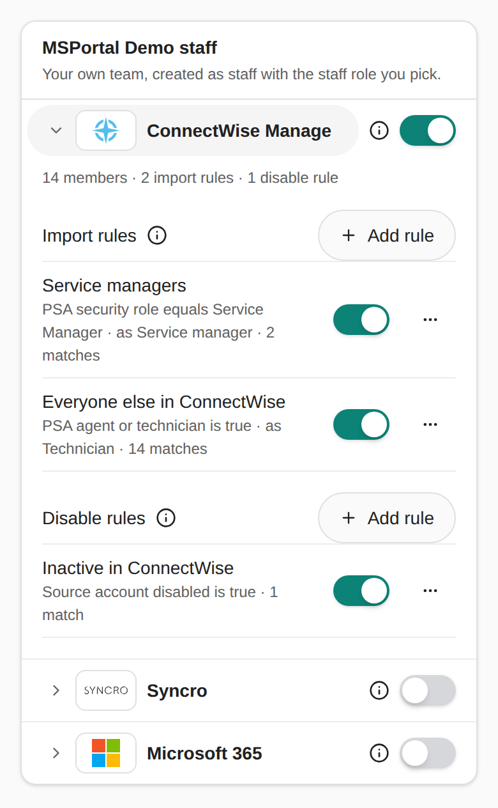
    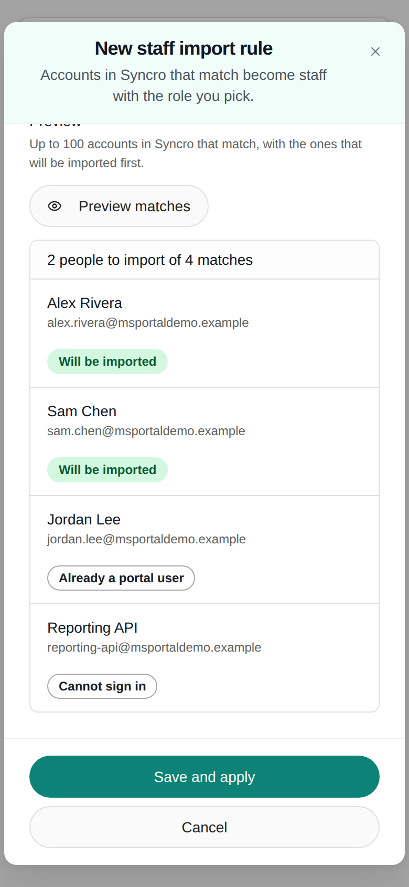
  </Frame>
</Accordion>

What a staff import rule does:

- **When it runs:** after each sync of its source, and right after you save it.
- **Who it creates:** a staff user with status **Imported** and the rule's role, linked to the technician or Microsoft 365 account it came from.
- **No invitation:** MSPortal sends no email. The person is linked when they first sign in. Send invitations from the **Users** tab when you are ready.
- **Existing users stay as they are:** a person who already has a portal user, staff or client, is skipped. A rule never changes an existing user's role and never turns a client user into staff.
- **Skipped accounts:** disabled accounts, service and API accounts, and accounts with no email address. The preview shows **Account disabled**, **Cannot sign in** or **No email address** for each.
- **Turning it off keeps staff:** pausing or deleting an import rule stops new imports only.

## Disable staff who leave

Add a disable rule to the same source, so a person who is deactivated in your PSA or Microsoft 365 loses portal access without anyone remembering to remove them.

<Steps>
  <Step title="Add a disable rule">
    Open the source and click **Add rule** beside **Disable rules**.
  </Step>
  <Step title="Choose the condition">
    A new rule starts with **Source account disabled** **is true** for a PSA, or **Source account enabled** **is false** for Microsoft 365. That is "disable the person here when they are disabled there". You can match on other facts instead, such as leaving a group.
  </Step>
  <Step title="Preview, then save and apply">
    The preview lists the staff the rule would disable. **Protected admin** marks people a rule never disables. Click **Save and apply**.
  </Step>
</Steps>

- **Who it disables:** a staff member whose accounts in that source all match. They are disabled and signed out.
- **Coming back:** they are turned back on when an account stops matching, or when you pause or delete the rule. They return with the status they had before.
- **Disconnecting the source:** removing the PSA or Microsoft 365 connection removes its staff rules and turns back on the people its disable rules had turned off.
- **An administrator's choice wins:** if you turn someone back on yourself, the rule leaves them alone until they stop matching and match again.
- **Primary Admins are never disabled** by a rule, and you cannot save a rule that would disable your own account.
- **Safety stop:** when a rule would turn off more than three people and over half of your active staff in one pass, MSPortal holds the change, because that pattern usually means a sync failed, not that most of your team left. Saving the rule, or turning it on, then asks **Disable N staff members?** with the number it would turn off. Confirm to apply it, or cancel to leave everyone on. The confirmation covers the people you were shown: anyone the rule matches later is held again.
- **NinjaOne** does not report when a technician is deactivated, so a disable rule on a NinjaOne source has to match on something else, such as a name or an email address.

## Add exclusion rules

The **Exclusion rules** panel, under your sources, lists the accounts every source leaves out. Use it for service accounts, shared mailboxes, break-glass accounts and anything else that is not a person who should sign in.

An account that matches an exclusion rule becomes a service account with sign-in blocked:

- **No sign-in and no invitation:** it cannot sign in to the portal or be invited.
- **Not a seat:** it no longer counts as a seat in financial reporting.
- **Skipped by imports:** Microsoft 365 import rules and staff import rules skip it. A PSA contact import still adds it, as a service account that cannot sign in.
- **Still visible:** its records, history and source links stay.

The first row, **Service, shared and resource accounts**, is always on: MSPortal leaves out the API users of a PSA, and the shared mailboxes and meeting rooms it recognizes in Microsoft 365, without a rule. Guests are not left out by that row. Add a rule for them if they should not sign in.

<Frame caption="Sample data: the Exclusion rules panel with the built-in row and two rules.">
  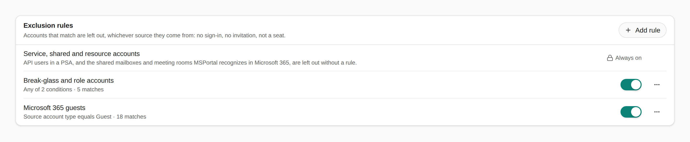
</Frame>

<Accordion title="Phone preview">
  <Frame caption="The same panel on a phone.">
    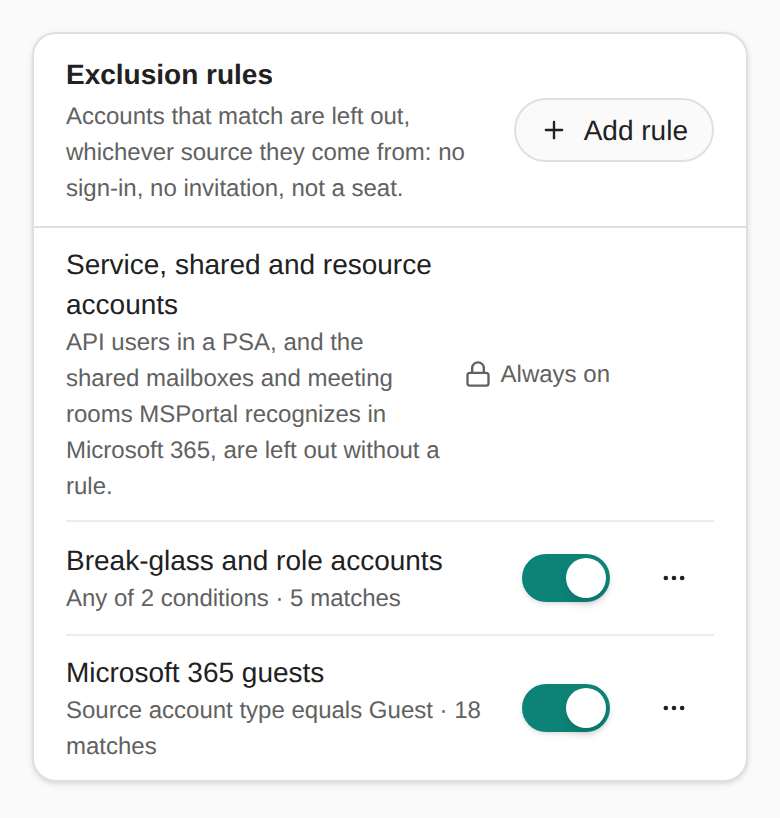
  </Frame>
</Accordion>

<Steps>
  <Step title="Add a rule">
    Click **Add rule** in the **Exclusion rules** panel. The **New exclusion rule** dialog opens.
  </Step>
  <Step title="Name the rule">
    Enter a **Rule name** and, optionally, a **Description**.
  </Step>
  <Step title="Add the conditions">
    Choose **Match all conditions** or **Match any condition**, then click **Add condition** for each one. Every condition has a **Field**, an **Operator** and a **Value**. A rule can use facts from any source: Microsoft 365 fields such as **Microsoft 365 user type**, **Microsoft 365 group** and **Source account type**, PSA fields such as **PSA agent or technician** and **Contact type**, and fields every source has, such as **Display name** and **Email address**.
  </Step>
  <Step title="Preview the matches">
    Click **Preview matches** to list up to 100 synced accounts that match, with each one's source, company and current access.
  </Step>
  <Step title="Save and apply">
    Leave **Apply this rule** on and click **Save and apply**. A paused rule is saved but has no effect.
  </Step>
</Steps>

Two common exclusion rules:

| To leave out | Conditions |
| --- | --- |
| Break-glass and role accounts | **Match any condition**: **Email address** **contains** `break`, **Email address** **contains** `role` |
| Microsoft 365 guests | **Source account type** **equals** **Guest** |

Use the switch on a rule's row to pause or resume it. It saves right away. The **⋯** menu has **Edit rule** and **Delete rule**. Pausing or deleting a rule gives back sign-in to the accounts that only this rule left out, and lets them be imported again.

## Troubleshooting

| Problem | What to do |
| --- | --- |
| The **Automatic Import** tab is missing | Your role needs read access to Users settings. |
| A panel's switches and buttons are read-only | The panel says which permission you need: Users and Company Users settings for **Client users**, Users settings for staff. |
| An import rule creates nobody | Open the rule and click **Preview matches**. Each skipped person shows why. For Microsoft 365, check that user import is on for the tenant on the Microsoft 365 Companies page and that a users sync has run. |
| A rule shows **role deleted: pick a new one** | The rule's role was deleted. Edit the rule, choose another role and save. |
| A PSA row shows **Pick a default role** | Contact import is on with no **Role for everyone else**. Choose one. |
| **You can't give this role: it has permissions your own role doesn't** | Pick a role whose permissions you hold, or ask someone with that access to save the rule. |
| A PSA contact switch will not turn on and names the API key | The PSA API key cannot read contacts. Fix the permission on the connection's page, then try again. |
| **The connection's settings changed while saving. Try again.** | A sync or another person saved the connection at the same moment. Make the change again. |
| No Microsoft 365 source under your staff | MSPortal reads staff only from a Microsoft tenant your own account, or a Primary Admin's, is a member of. Connect that tenant on the Microsoft 365 Companies page. |
| A disable rule was held | It would have turned off most of your staff at once. Open the rule and click **Save and apply**, then confirm the number of staff it asks about. |
| Your Microsoft 365 staff source disappeared after a reconnect | The connection was reconnected to a different tenant, which removes its staff rules. MSPortal trusts only accounts synced from the tenant it points at now, so wait for the next users sync, then add the rules again. If the connection was pointed at another tenant and back, disconnect it and connect it again. |
| A PSA's contact types could not be loaded | The PSA did not answer or refused the API key. Saved rules still show. Try again, or check the connection's page. |

## Frequently asked questions

<AccordionGroup>
  <Accordion title="Does an import rule invite the people it creates?">
    No. Imported users get no email. Each person is linked when they first sign in. Send invitations from **Users** or **Company Users** when you are ready.
  </Accordion>
  <Accordion title="What happens to imported users when I delete the import rule?">
    They stay. Deleting or pausing a rule only stops new imports. Deleting a disable rule turns its people back on.
  </Accordion>
  <Accordion title="Where did the Access Rules tab go?">
    Its rules are on this tab. Rules that import or disable Microsoft 365 users are under **Client users > Microsoft 365**. Rules that blocked sign-in are now exclusion rules, in the **Exclusion rules** panel, and work as before. A saved link to the Access Rules tab opens **Automatic Import**.
  </Accordion>
  <Accordion title="Where did Contact Auto-Import on my PSA connection go?">
    It is here, in that connection's row under **Client users**, with the same switch, default role and contact type rules. The connection's page shows whether it is on and links to this tab.
  </Accordion>
  <Accordion title="Can a rule turn a client user into staff?">
    No. A person who already has a portal user is skipped. Change their user type by hand if they should be staff.
  </Accordion>
</AccordionGroup>

## Related guides

- [Users & Roles](/user-guides/settings/users-roles)
- [Import users](/user-guides/integrations/import-users)
- [Connecting Microsoft 365 companies](/user-guides/microsoft-365/connecting-companies)
- [Microsoft 365 users](/user-guides/microsoft-365/users)
