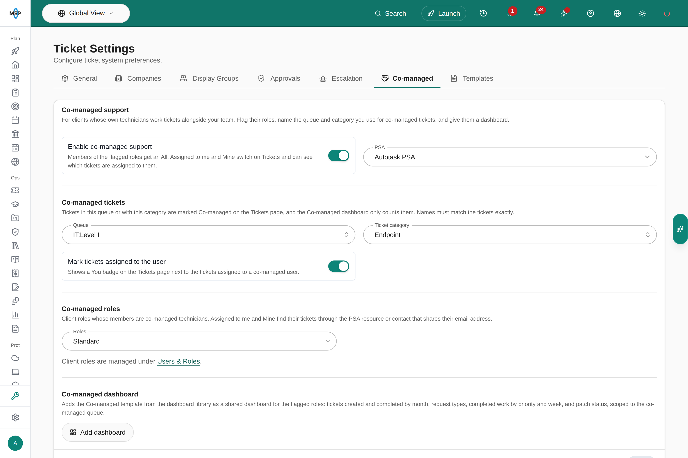
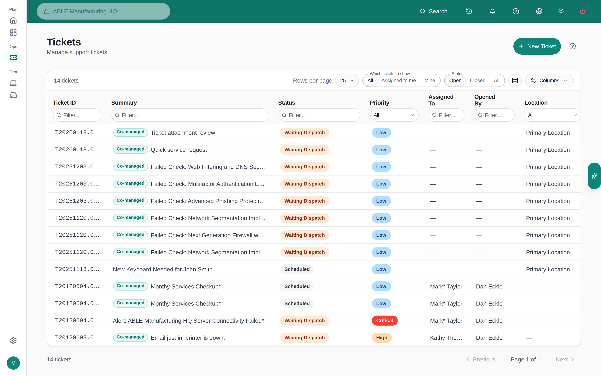

Some clients have their own IT staff, or another partner, who work tickets alongside your team. Co-managed support gives those people a view of the client's tickets in MSPortal, shows them which tickets are assigned to them, and gives them a dashboard of the co-managed work.

Members of a co-managed role get:

- an **All**, **Assigned to me** and **Mine** switch on **Tickets**;
- a **Co-managed** marker on tickets in the co-managed queue or category, and a **You** badge on tickets assigned to them;
- the **Co-managed** dashboard: open tickets, tickets created and completed by month, request types, completed work by priority and week, and patch status, counting only co-managed tickets.

You assign the work in your PSA, as you do today. MSPortal shows it to the client's technicians.

## Before you start

- Changing the settings needs the **manage** Tickets settings permission. With less, the tab reads "You can view these settings but not change them."
- Adding the dashboard also needs the **manage** Dashboards settings permission.
- Connect your PSA under [Integrations](/user-guides/settings/integrations). The queue and category lists come from your synced tickets.
- Create a client role for the co-managed technicians under [Users & Roles](/user-guides/settings/users-roles) and give it to the client's IT staff. Use a separate role from the one the client's other employees have, so only the technicians get the co-managed views.

## Set up co-managed support

<Steps>
  <Step title="Open Settings > Tickets > Co-managed">
    <Frame caption="Co-managed support on MSPortal Demo, set up for an Autotask queue and category.">
       Tickets > Co-managed with Enable co-managed support on, Autotask PSA selected, Queue IT:Level I, Ticket category Endpoint, Mark tickets assigned to the user on, the Standard role under Co-managed roles, and the Add dashboard button." />
    </Frame>
  </Step>
  <Step title="Turn on Enable co-managed support">
    If you have more than one PSA connected, choose the one the co-managed tickets live in under **PSA**.
  </Step>
  <Step title="Name the co-managed tickets">
    Under **Co-managed tickets**, pick the **Queue** (the **Service board** in ConnectWise, the **Team** in Halo PSA), the **Ticket category**, or both. Tickets in that queue or with that category are marked **Co-managed** on the Tickets page, and the Co-managed dashboard counts only them. Pick from the list: names must match the tickets exactly.
  </Step>
  <Step title="Choose whether to mark assigned tickets">
    Leave **Mark tickets assigned to the user** on to show a **You** badge next to the tickets assigned to each co-managed technician.
  </Step>
  <Step title="Flag the co-managed roles">
    Under **Co-managed roles**, pick the client roles whose members are co-managed technicians. Only client roles are listed.
  </Step>
  <Step title="Click Save">
    "Co-managed settings saved." confirms it. Turning **Enable co-managed support** off later hides the switch, markers and dashboard tickets from the technicians but keeps your settings.
  </Step>
  <Step title="Add the dashboard">
    Under **Co-managed dashboard**, click **Add dashboard**. MSPortal adds the **Co-managed** template from the dashboard library as a shared dashboard for the roles you flagged, with every ticket widget scoped to the co-managed queue. Save your changes first: the dashboard uses the saved queue and roles. **Open dashboard** then takes you to it.
  </Step>
</Steps>

## Give the role access to tickets and the dashboard

The co-managed role still follows its own permissions and display group. Check both under **Settings > Users & Roles** and **Settings > Tickets > Display Groups**:

| The technicians need to | Set this on their role |
|---|---|
| See all of the client's tickets under **All** | A [display group](/user-guides/settings/tickets#create-a-display-group-for-a-role) for your PSA with **Ticket Visibility** set to **All Tickets**. A role with no display group, or with **Own Tickets Only**, shows only their own tickets under **All**. |
| Open the Co-managed dashboard | The **read** Dashboards permission. Without it, the shared dashboard does not open for them. |
| Update tickets | The Tickets permissions you want them to have, such as adding notes or changing status. |

## What the technicians see

On **Tickets**, members of a co-managed role get the **Which tickets to show** switch:

| View | Shows |
|---|---|
| **All** | Every ticket their role can see, the same list as before. |
| **Assigned to me** | Tickets assigned to them in your PSA. |
| **Mine** | Tickets they raised or are the contact on. |

<Frame caption="Tickets for a co-managed technician at a Demo company. Co-managed marks tickets in the co-managed queue.">
  
</Frame>

**Assigned to me** matches the person to your PSA by their PSA resource: the PSA user linked to them in MSPortal, or otherwise the PSA resource (an Autotask resource, a ConnectWise member, a Halo agent) with the same email address as their MSPortal sign-in. To assign co-managed work, give each technician a resource in your PSA with that email address, such as an Autotask co-managed resource, and assign the ticket to it. **Mine** uses the PSA contact with their email address.

Your own staff do not see the switch. It appears only for client users in a flagged role.

## Troubleshooting

| Problem | What to do |
|---|---|
| There is no **Co-managed** tab | Co-managed support is not turned on for your portal. Ask MSPortal support. |
| The tab says "You can view these settings but not change them." | You need the **manage** Tickets settings permission. |
| A technician has no **All / Assigned to me / Mine** switch | Check that their role is flagged under **Co-managed roles**, that **Enable co-managed support** is on and saved, and that they are a client user, not staff. |
| **All** is empty or shows only the technician's own tickets | Give their role a display group with **Ticket Visibility** set to **All Tickets**. |
| **Assigned to me** is empty | Check that the ticket is assigned in your PSA to a resource with the technician's email address, and that your PSA has synced since. |
| No tickets are marked **Co-managed** | Check the **Queue** and **Ticket category** match the names on your tickets. Pick them from the list rather than typing. |
| **Add dashboard** is disabled | The text under it says why: save your changes first, flag at least one role, set the queue or category, or get the **manage** Dashboards settings permission. |
| The dashboard does not open for a technician | Give their role the **read** Dashboards permission. |
| "N widgets left out because its integration is not connected" | A widget needs an integration you have not connected, such as an RMM for patch status. The rest of the dashboard was added. |

<CardGroup cols={2}>
  <Card title="Ticket settings" icon="ticket" href="/user-guides/settings/tickets">
    Display groups, delivery and routing.
  </Card>
  <Card title="Users & Roles" icon="users" href="/user-guides/settings/users-roles">
    Create the client role and set its permissions.
  </Card>
</CardGroup>
