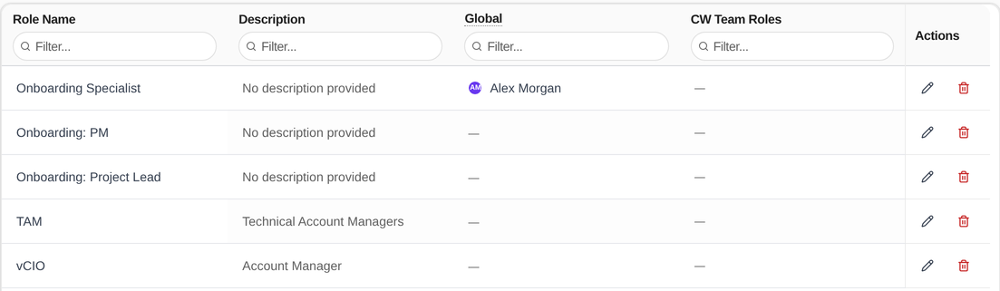
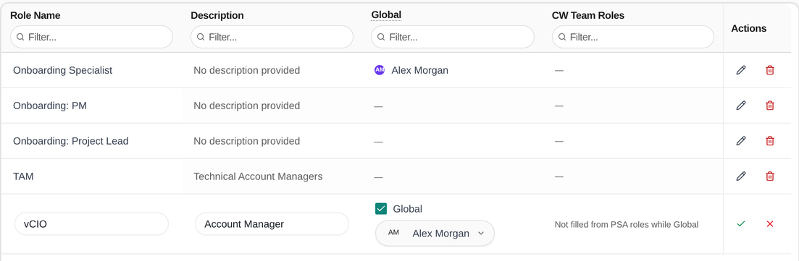
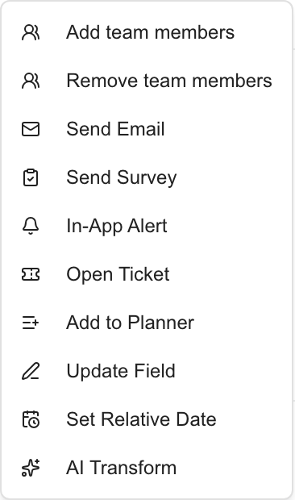
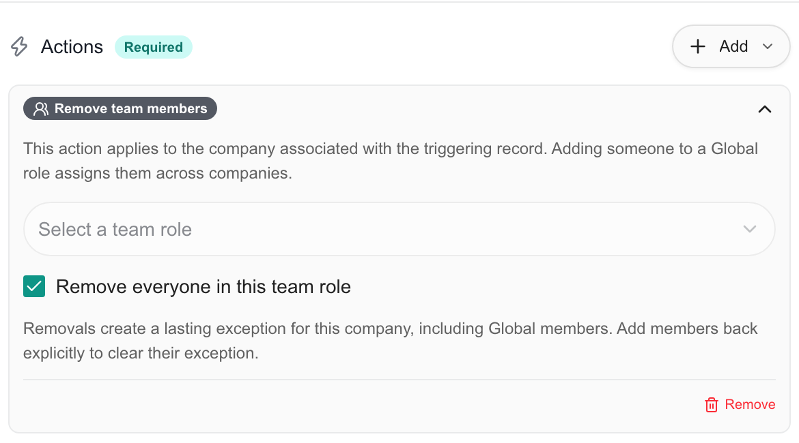

Use a **Global team role** when one person should hold a role at every company, such as a shared service manager or onboarding lead. A Global role has exactly one holder, and that person replaces anyone else in the role. Use the **Add team members** and **Remove team members** automation actions when membership should change in response to a record or event. This page is for MSP staff.

Team roles describe responsibilities. They do not replace the Tenant or Company permission roles managed under **Settings > Users & Roles > Roles**.

## Before you start

- Create the team role first, or add it in the same step. See [Account teams and Team Roles](/user-guides/getting-started/onboarding/company-roles).
- Seeing the **Global** column needs read access to Company Users settings. Changing a Global role needs write access to Company Users settings, and your billing must be active.
- Saving an automation that has a membership action needs write access to both Automation settings and Company Users settings.
- These controls select MSP staff, not customer contacts or Company users.

<Frame caption="Branch preview. The Global column shows who holds each Global role.">
  
</Frame>

## Make a team role global

<Steps>
  <Step title="Open Team Roles">
    Go to **Settings > Users & Roles** and click **Team Roles**. The **Global** column shows the holder of each Global role.
  </Step>
  <Step title="Edit the role">
    Click the edit icon on the role's row, or double-click one of its cells. The row becomes editable in place. To make a new role Global, click **Add Role** and fill in the new first row.
  </Step>
  <Step title="Check Global and pick the person">
    Check **Global**, then pick one person in the selector that appears beside it. Only active MSP staff are offered.
    <Frame caption="Branch preview. Global is checked and one person is picked in the role's row.">
      
    </Frame>
  </Step>
  <Step title="Save the row">
    Click the check mark or press Enter, then confirm. MSPortal assigns that person to the role at every current company and removes anyone else from it. New companies get the same person automatically.
  </Step>
</Steps>

To change the holder, edit the row and pick someone else. MSPortal asks you to confirm, and the previous holder is removed from the role at every company. To stop using Global, edit the row and uncheck **Global**. MSPortal asks you to confirm, and the holder's inherited assignments are removed from every company.

The holder is the only person in a Global role. When you turn Global on, any other staff member already assigned to the role at any company is removed from it, and the people removed are not restored if you turn Global off later. While the role is Global, no other staff member can be added to it: a company's **Team** tab shows the role as Global with no selector, bulk role actions and the company roles import leave it alone, and automation actions and PSA sync skip other people. A client contact who holds the role at their own company is not affected.

<Note>
A Global role is held by one named person, so it is not filled from your PSA. While **Global** is checked the PSA roles selector is hidden. Turning Global on for a role that has a PSA role mapping removes that mapping, and MSPortal asks you to confirm first. Uncheck **Global** to map PSA roles again.
</Note>

## Keep a company-specific exception

A Global role's holder is managed in one place. A company's **Team** tab, a user's **Teams** section, bulk role actions and the company roles import show or skip a Global role; none of them adds or removes its holder.

To leave one company out, use a **Remove team members** automation action for that role. It removes the holder from the matched company and records a lasting exception, so Global inheritance and PSA reconciliation do not restore the assignment. An **Add team members** action that selects the holder clears the exception for the matched company.

Turning Global off removes the holder's inherited assignments. Direct company assignments and company-specific removal exceptions remain. It does not delete staff accounts or the team role.

## Automate membership changes

<Steps>
  <Step title="Start a rule">
    Go to **Settings > Automation Rules** and click **Add Rule**. Set the trigger, scope and conditions. See [Rule Wizard Walkthrough](/user-guides/settings/automation/wizard).
  </Step>
  <Step title="Add the action">
    In **Actions**, click **Add** and choose **Add team members** or **Remove team members**.
  </Step>
  <Step title="Choose the role and staff">
    Pick a team role under **Select a team role**. Pick people under **Select staff members**. For removal you can instead check **Remove everyone in this team role**.
  </Step>
  <Step title="Test and save">
    Click **Run Test**, click **Next**, then click **Create Rule**. Save it inactive first if you are still preparing the rollout.
  </Step>
</Steps>

The actions work like this.

| Action | Configuration | Result |
| --- | --- | --- |
| **Add team members** | Select a team role and one or more staff members | Adds those people to the matched company's role and clears their exclusions there. It never changes who holds a Global role, and it skips anyone who is not the holder of a Global role. |
| **Remove team members** | Select a team role and specific staff, or select **Remove everyone in this team role** | Removes those members from the matched company's role and records company-specific exclusions. |

The company comes from the triggering record. For a Company rule it is the matched company itself; for other records it is their associated company. Records without an associated company are skipped without a membership change. You cannot configure a different target company inside the action.

**Remove everyone in this team role** resolves the role's membership when the action executes. It does not save a snapshot of today's roster or delete the role itself. New people added to the role later are not permanently blocked by a previous removal run.

Membership actions have no approval hold. Check the rule's scope, conditions and **Enable this rule** setting before you turn it on. **Run Test** lists matching records. It does not change any membership.

### Example: finish an onboarding handoff

<Steps>
  <Step title="Create the team role">
    Create a company-specific **Onboarding** team role and assign the staff handling the handoff.
  </Step>
  <Step title="Create the rule">
    Add a rule with the **Onboarding** entity and the **Onboarding Event** trigger. Choose the completion event that fits your workflow.
  </Step>
  <Step title="Limit the scope">
    Set **Scope** to **Specific Companies** and pick the intended companies. Add conditions if needed.
  </Step>
  <Step title="Add the action">
    Add **Remove team members**, select **Onboarding** and check **Remove everyone in this team role**.
  </Step>
  <Step title="Save inactive, then enable">
    Save the rule with **Enable this rule** off. Turn it on from the rules list when you are ready.
  </Step>
</Steps>

Only the event's company loses those assignments. An event with no company is skipped. After it runs, check **Execution Log** and the company's team.

## Where the changes appear

Global membership uses the same company team assignments as the team views and the **Role Members** recipient option in automations. These actions change membership in MSPortal only. They do not change a permission role, delete accounts or write team changes back to your PSA.

## Troubleshooting

| Symptom | What to check |
| --- | --- |
| Roles or staff fail to load | Check your Company Users settings permissions, then reload |
| The Global column is missing | You need read access to Company Users settings. Company users never see it |
| A member does not inherit into one company | They may have a company-specific exception. Add them back on that company's **Team** tab |
| A person appeared at more companies than expected | Check whether they hold a Global role |
| A Global role shows **No one assigned** | Edit the row and pick a person, or uncheck **Global** |
| A role has no selector on a company's **Team** tab | It is a Global role. Change who holds it under **Settings > Users & Roles > Team Roles** |
| People disappeared from a role | The role was made Global. Its holder replaced them at every company |
| The PSA roles selector is missing while editing | **Global** is checked. A Global role has no PSA role mapping |
| A membership action reports no change | Check that the record has a company, the person's current membership and the selected role. Repeating an add or remove can change nothing |
| A selected person or role no longer works | It may have been removed or changed. Reopen the rule and pick it again |
| The **Global** checkbox is disabled | You need write access to Company Users settings |

## Related guides

- [Users & Roles](/user-guides/settings/users-roles)
- [Automation Rules](/user-guides/settings/automation/index)
- [Rule Wizard Walkthrough](/user-guides/settings/automation/wizard)
