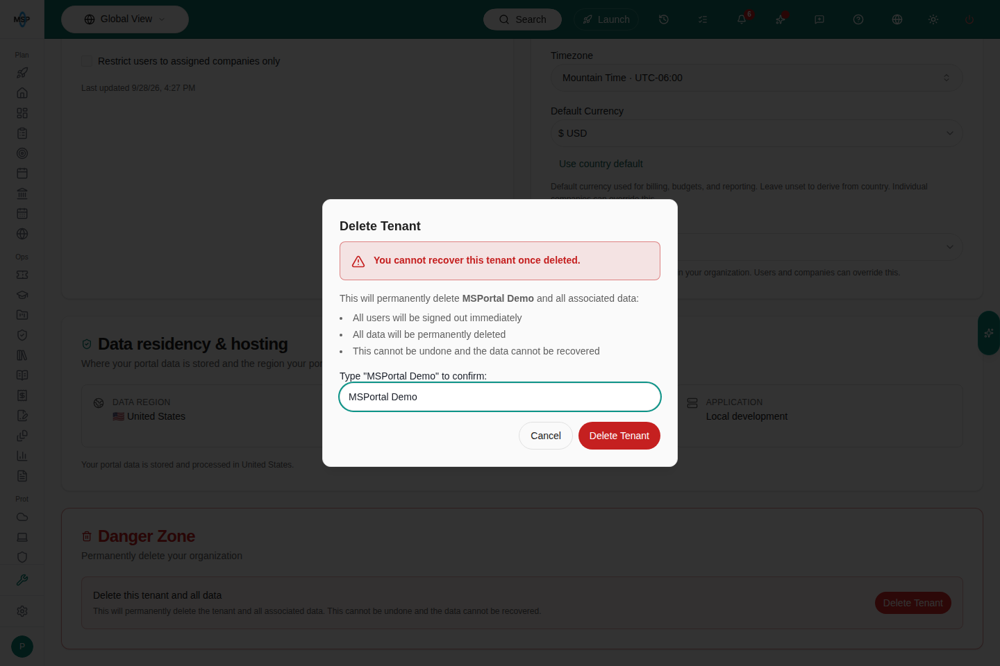
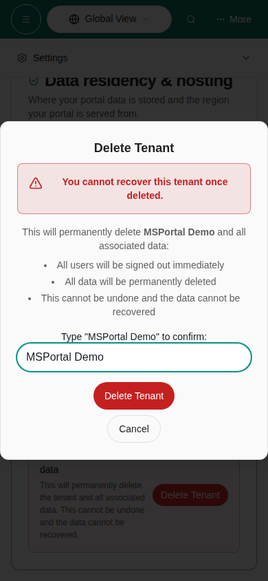

Tenant Settings controls your organization's details, locations and preferences, and shows where your data is hosted. This page is for MSP staff who manage those settings.

Branding and AI have their own pages under **Settings > Customization**. See [Branding settings](/user-guides/settings/branding) and [AI settings](/user-guides/settings/ai).

## Before you start

- You need Tenant Settings access. Read access lets you view the page. The header **Save Settings** button needs write access. **Delete Tenant** shows only to users with manage access.
- Tenant Settings access does not open Branding or AI. Those pages have their own Branding Settings and AI Settings permissions.

## Open Tenant Settings

<Steps>
  <Step title="Open Settings > Tenant">
    The page shows the **Tenant Details**, **Locations & Preferences** and **Data residency & hosting** cards, and the **Danger Zone** for users with manage access.
  </Step>
</Steps>

## Save your changes

The header has **Reset** and **Save Settings** buttons. **Save Settings** stays disabled until you change something.

- **Save Settings** saves the tenant details and the preferences.
- **Reset** returns the form to its last saved values. It does not undo location changes. Those save on their own.
- If you leave the page with unsaved changes, MSPortal asks you to choose **Discard changes** or **Keep editing**.

## Update tenant details

<Steps>
  <Step title="Find the Tenant Details card">
    It holds the basic organization fields.
  </Step>
  <Step title="Edit the fields">
    | Field | What it is |
    |-------|------------|
    | **Company Name** | Your organization's display name. Required. |
    | **Billing Email** | Where billing notifications go. |
    | **Primary Admin** | The main administrator contact. Pick a current staff user from the list. |
    | **Restrict users to assigned companies only** | When checked, users only see companies they are assigned to. Assign companies in [Users & Roles](/user-guides/settings/users-roles). Roles with **Bypass company restrictions** still see every company. |
  </Step>
  <Step title="Click Save Settings">
    A confirmation appears and the card shows when it was last updated.
  </Step>
</Steps>

## Manage locations and preferences

<Steps>
  <Step title="Find the Locations & Preferences card">
    It lists your locations. Each one shows its name, its address, and a **Primary** badge on the primary location.
  </Step>
  <Step title="Click Add Location">
    Enter a **Location Name** (required), the **Address**, and an optional **AI Context**. The AI assistant uses the name and context to answer location questions. Click **Add**.
  </Step>
  <Step title="Edit, delete or set a primary location">
    Open the location's actions menu and choose **Set as primary**, **Edit location** or **Delete location**. Deleting the primary location promotes another location. Each of these saves right away. You do not need **Save Settings**.
  </Step>
  <Step title="Set the preferences">
    Choose a **Timezone**, a **Default Currency** and a **Default Language**. Leave **Default Currency** on **Use country default** to derive it from the country. Users and companies can override the language, and companies can override the currency. Click **Save Settings**.
  </Step>
</Steps>

The **Data residency & hosting** card shows your data region, database region and application region. It is read-only. It does not move your data.

## Delete the tenant

Only users with manage access see the **Danger Zone** card at the bottom of the page.

<Steps>
  <Step title="Click Delete Tenant">
    A **Delete Tenant** confirmation opens. It warns that all users are signed out right away and that all data is permanently deleted and cannot be recovered.
  </Step>
  <Step title="Type the tenant name and confirm">
    You must type the tenant name to enable the confirm button. After deletion you are signed out right away, even if the form has unsaved changes.
  </Step>
</Steps>

<Frame caption="Type the tenant name to confirm permanent deletion.">
  
</Frame>

<Frame caption="The same confirmation on a phone.">
  
</Frame>

Creating another tenant with the same email in the same region keeps the original trial deadline. Deleting a tenant does not restart its trial. The signup setup page shows the remaining days and says MSPortal will contact you. An expired trial stays expired. See [Billing settings](/user-guides/settings/billing).

## Troubleshooting

| Problem | What to do |
| --- | --- |
| **Save Settings** is disabled. | You have not changed anything, a save is running, or you do not have write access to Tenant Settings. |
| I cannot find branding, domains or AI settings. | They moved to **Settings > Customization > Branding** and **Settings > Customization > AI**, with their own permissions. Old links to the Branding and AI tabs open the new pages. |
| **Delete Tenant** is missing. | It needs manage access to Tenant Settings. |

## Frequently asked questions

<AccordionGroup>
  <Accordion title="Does Reset undo location changes?">
    No. The header **Reset** returns the details and preferences to their last saved values. Locations save on their own.
  </Accordion>
  <Accordion title="Can I move my data to another region?">
    No. The **Data residency & hosting** card only reports where your data and portal run.
  </Accordion>
  <Accordion title="Does Tenant Settings access let someone change branding or AI?">
    No. Give the role Branding Settings or AI Settings access in [Users & Roles](/user-guides/settings/users-roles#settings-permissions).
  </Accordion>
</AccordionGroup>

## Related guides

- [Branding settings](/user-guides/settings/branding)
- [AI settings](/user-guides/settings/ai)
- [Billing Settings](/user-guides/settings/billing)
- [Users & Roles](/user-guides/settings/users-roles)
- [Settings overview](/user-guides/settings/index)
