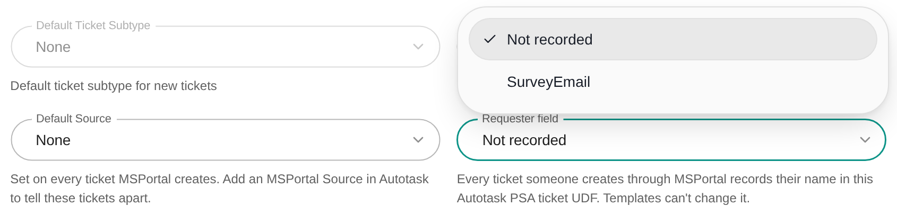
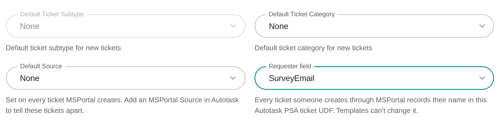
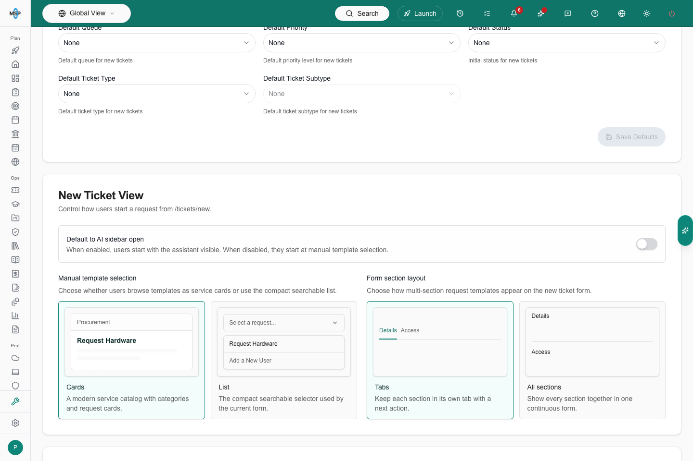
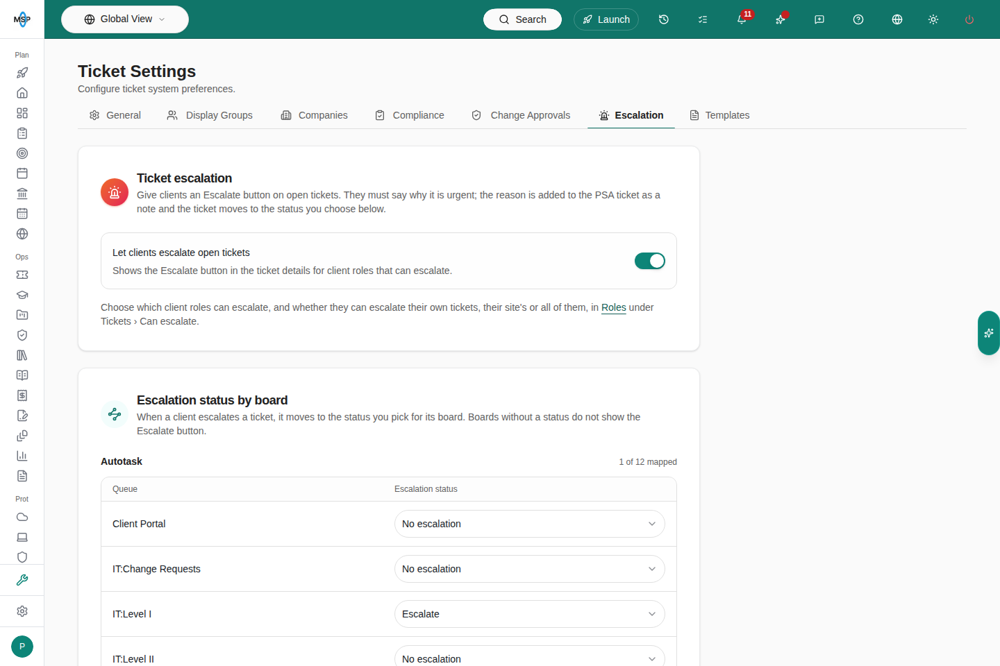

Use Ticket settings to choose where new tickets go, set their default routing, and control which tickets and fields each role sees. This page is for MSP staff. Company users ask their IT provider to change these rules.

## Before you start

- You need the **write** or **manage** Tickets settings permission to change anything. With read access only, the controls are disabled.
- Deleting a ticket category or a display group needs the **manage** permission.
- To route tickets to a PSA, connect it first under [Integrations](/user-guides/settings/integrations). The board, status, priority and type lists come from your PSA's synced data. If a list is empty, sync the integration.
- Open **Settings > Tickets**. The tabs are **General**, **Companies**, **Display Groups**, **Approvals**, **Escalation** and **Templates**. When co-managed support is turned on for your portal, a **Co-managed** tab appears before **Templates**: see [Co-managed support](/user-guides/settings/comanaged-support).

## Choose where tickets are delivered

<Steps>
  <Step title="Open Settings > Tickets > General">
    The **Ticket Delivery & Defaults** card is at the top.
    <Frame>
      
    </Frame>
  </Step>
  <Step title="Set Delivery Method">
    Choose **PSA Integration** to create tickets in your PSA. Choose **Email (SMTP)** to send them to an email address. The change saves immediately.
  </Step>
  <Step title="For PSA delivery, pick the PSA Integration">
    Select the connected PSA that should receive tickets. If you have more than one, the page tells you how many it found. The change saves immediately.
  </Step>
  <Step title="Enter a Fallback Email Address">
    Under PSA delivery, enter an address that receives the ticket by email if the PSA connection fails. It saves when you click out of the field.
  </Step>
  <Step title="For email delivery, enter the Email Address">
    The **Email Address (for email delivery)** field is only editable when **Delivery Method** is **Email (SMTP)**. It saves when you click out of the field. If the save fails, an error message appears instead of the saved confirmation, so fix the address and click out of the field again.
  </Step>
</Steps>

## Set ticket defaults

The **Ticket Defaults** card appears under the delivery settings once a PSA is selected. Templates and company overrides can supply their own values and take priority over these defaults.

<Steps>
  <Step title="Open Settings > Tickets > General">
    Scroll to **Ticket Defaults**.
  </Step>
  <Step title="Pick the routing values">
    The fields depend on your PSA.

    | PSA | Fields |
    |---|---|
    | ConnectWise | **Service Board**, **Priority**, **Status**, **Ticket Type**, **Ticket Subtype**, **Source**, **Requester field** |
    | Autotask | **Queue**, **Priority**, **Status**, **Ticket Type**, **Ticket Subtype**, **Ticket Category**, **Work Type**, **Source**, **Requester field** |
    | Halo PSA | **Team**, **Priority**, **Status**, **Category**, **Impact**, **Urgency**, **Source**, **Requester field** |
    | Syncro | **Priority**, **Status** |

    ConnectWise and Autotask require a board or queue and a status. Halo requires a category and a status. Status and type lists narrow to the board you pick.

    Autotask **Work Type** and **Source** list the active values in your Autotask instance. Leave either on **None** to create tickets without it, as before. If a saved value is later made inactive in Autotask, the field turns red and reads **Unavailable**, and tickets are created without that value until you choose another.

    **Source** is set on every ticket MSPortal creates in ConnectWise, Autotask and Halo PSA. To tell portal tickets apart from email, phone or another portal in your PSA, add a Source such as **MSPortal** to your PSA's ticket sources, then choose it here. The list loads live from your PSA, so a Source you just added appears the next time you open the page. Leave **Source** on **None** to let your PSA apply its own default. Syncro tickets have no Source. If a saved ConnectWise or Halo Source is deleted in the PSA, the field turns red: choose another so new tickets get a valid Source.
  </Step>
  <Step title="Click Save Defaults">
    **Save Defaults** stays disabled until you change at least one value. A confirmation toast appears when the defaults are saved.
  </Step>
</Steps>

### Requester field

Use **Requester field** to record, in your PSA ticket, the name of the person who created each ticket through MSPortal. It works with ConnectWise, Autotask and Halo PSA. Syncro has no ticket UDFs, so the field does not appear for it.

The picker lists the free-text ticket UDFs (user-defined fields) in the PSA connection you selected for ticket delivery. Create the UDF in your PSA first, as a text field on tickets. In Halo PSA, add it to the ticket types your tickets use, or Halo drops the value. MSPortal reads the list of UDFs from your PSA once a night, so a UDF you just created appears after the next sync.

<Steps>
  <Step title="Open Settings > Tickets > General">
    Scroll to **Ticket Defaults**. The **Requester field** sits beside **Default Source**. Changing it needs the **write** or **manage** Tickets settings permission.
  </Step>
  <Step title="Pick the UDF">
    Open **Requester field** and choose the UDF that should hold the requester's name, such as "Submitted By". Choose **Not recorded** to stop recording it.
    <Frame caption="The Requester field list in an Autotask Ticket Defaults card.">
      
    </Frame>
  </Step>
  <Step title="Click Save Defaults">
    The help under the field reads "Every ticket someone creates through MSPortal records their name in this Autotask PSA ticket UDF. Templates can't change it." With ConnectWise or Halo PSA selected, it names that PSA instead.
    <Frame caption="The Requester field set to an Autotask ticket UDF, before Save Defaults.">
      
    </Frame>
  </Step>
</Steps>

What gets recorded:

- Every ticket a person creates through MSPortal gets the signed-in submitter's name in the UDF. That covers ticket forms and templates, the AI assistant, released approvals, the new-ticket page and the browser extension.
- MSPortal fills the value in when it creates the ticket, so a requester cannot type a different name.
- It wins over a template field mapped to the same UDF. For that reason, template editors do not offer the requester UDF, and a template field still mapped to it shows "*name* (records the requester, from Ticket Defaults)".
- Tickets that no person submits, such as automation and compliance tickets, are not affected.
- The ticket's PSA contact is still the submitter, as before.
- If the PSA refuses the value, for example because the UDF was deleted or renamed, the ticket is still created without it.

The setting belongs to the selected PSA connection. If you switch **PSA Integration** to another PSA, the Requester field is cleared: pick a UDF again for the new PSA. The same field appears in the PSA connection's **Configure tickets** step under **Settings > Integrations**.

To record a different person, such as the employee a request is for, map a template field to its own UDF. See [Send template answers to PSA fields](/user-guides/ticketing/send-answers-to-psa-fields).

| Problem | What to do |
|---|---|
| "Couldn't load your Autotask PSA ticket UDFs. Try again later." | MSPortal could not read the UDF list from your PSA. Your saved choice is kept. Reload the page later, and check the PSA connection under [Integrations](/user-guides/settings/integrations) if it persists. |
| The field shows "*name* (not found in Autotask PSA)" | The saved UDF no longer exists in the PSA, or was renamed. Pick another UDF, or choose **Not recorded**, and click **Save Defaults**. |
| A new UDF is missing from the list | MSPortal reads UDFs once a night. Check that it is a text field on tickets, then look again after the next sync. |
| The name does not appear in Halo PSA | Add the UDF to the ticket type the ticket uses. |

## Set an Autotask status after a client reply

Open **Settings > Integrations > Autotask PSA > Configure tickets** and choose **Status after a client comment**. This is a setting on the Autotask connection, separate from the defaults for new tickets above. **None** disables it. It applies only after a company user's public note; staff and internal notes do not trigger it.

**Replies on closed tickets** defaults to **Keep closed or resolved**. Select **Change to reply status** to apply the chosen status to closed tickets too. Each selection saves immediately. These reply settings have no company overrides in this release.

Follow [Set the status after a client comment](/user-guides/integrations/enable-autotask-integration#set-the-status-after-a-client-comment) for permissions, screenshots and troubleshooting.

## Choose how the new-ticket page looks

<Steps>
  <Step title="Open Settings > Tickets > General">
    Find the **New Ticket View** card.
  </Step>
  <Step title="Set the options">
    - **Default to AI sidebar open**: on, users start with the assistant visible. Off, they start at manual template selection. The setting is off until you turn it on.
    - **Manual template selection**: choose **Cards** or **List**.
    - **Form section layout**: choose **Tabs** or **All sections** for templates with several sections.

    Each choice saves immediately.
    <Frame>
      
    </Frame>
  </Step>
</Steps>

These options change the new-ticket page only. Users can still start a request from the [Home assistant](/user-guides/ticketing/open-a-ticket-with-ai) or the [manual ticket form](/user-guides/ticketing/open-a-ticket).

## Let users email ticket notes

When this is on, MSP staff and company users can email a public ticket note to people straight from the ticket. It is off by default and works on service tickets from HaloPSA, ConnectWise, Autotask and Syncro.

<Steps>
  <Step title="Open Settings > Tickets > General">
    Find the **Email ticket notes** card.
  </Step>
  <Step title="Turn on Allow emailing ticket notes">
    The change saves immediately, and "Emailing ticket notes is on." confirms it. Public notes then show an **Email to** field under the editor.
  </Step>
  <Step title="Set a reply mailbox for ConnectWise, Autotask or Syncro">
    HaloPSA sends the email itself, so it needs nothing more. For ConnectWise, Autotask and Syncro, MSPortal sends the email, and replies need somewhere to land. Go to **Settings > Integrations**, open the PSA connection, and select **Configure tickets**. Under **Emailing contacts from notes**, enter your PSA's inbound support mailbox in **Reply mailbox**, such as `support@example.com`. Replies go to that mailbox with the ticket number in the subject, so your PSA adds them to the ticket. Changing the reply mailbox needs permission to manage the integration.
  </Step>
</Steps>

Until a reply mailbox is set, staff see "To email notes, set a reply mailbox in this PSA connection's ticket settings." in place of **Email to** on that PSA's tickets, and company users see no **Email to** field.

How emailing works:

- Anyone who can add notes to a ticket, MSP staff or company user, can email its public notes. Project tickets are not included.
- A note can go to up to 10 people. The ticket's company contacts are suggested as you type, and any full email address can be added.
- The people on a note stay in **Email to** for the ticket's next notes until someone removes them.
- Internal notes, private notes, and ConnectWise **Internal** and **Resolution** notes are never emailed.
- Under each emailed note, a status line shows **Emailed to**, **Emailing**, or **Could not email** with the people's names. Hover over a line to see the addresses.

See [Find and follow up on a ticket](/msp-guides/ticketing/follow-up-on-a-ticket#email-a-note-to-people) for the steps on a ticket.

## Tell managers about new tickets

When this is on, a person's manager hears about each ticket that person submits through MSPortal. It is for the manager's information only: nothing waits for the manager, nothing needs approving, and who can see the ticket does not change. To have a manager approve requests instead, use a [**The requester's manager** approval step](/user-guides/ticketing/ticket-approval-chains). To let managers see their reports' tickets, give their role [**Own and All Reports' Tickets**](#create-a-display-group-for-a-role).

<Steps>
  <Step title="Connect Microsoft 365 for the company">
    Managers come from Microsoft 365. The users sync records each user's manager. See [Manager data issues](/user-guides/microsoft-365/connecting-companies#manager-data-issues) for users whose manager could not be synced.
  </Step>
  <Step title="Open Settings > Tickets > General">
    Find **Tell requesters' managers about new tickets**, next to **Allow emailing ticket notes**.
  </Step>
  <Step title="Turn it on">
    The change saves immediately, and "Managers now hear about their team's new tickets." confirms it. Turn it off the same way.
  </Step>
</Steps>

What the manager gets:

- An email from your organization's ticket sender with who submitted the ticket, its title, the company and the ticket number. It says no action is needed.
- When the manager can sign in to MSPortal as a user of the same company, an in-app notification too, and both link to the ticket. What opens follows the manager's own ticket visibility.
- When the manager exists only in Microsoft 365, the email alone, without a link.

When no notice is sent:

- The requester has no manager in Microsoft 365, or the manager's account is disabled there.
- The manager is the requester.
- The manager was asked to approve the request in an approval chain, so they already know about it.
- The ticket came from an automation, a compliance or remediation action, or an embedded template inside another request (the main request covers it).
- No PSA ticket was created, for example when the PSA was down and the request went to the fallback email address.
- The manager's address belongs to a user of another company. A manager only ever hears about their own company's requesters.

Each manager hears about a ticket once, even if it is submitted again or the email is retried.

To change the email's wording, create a **Manager Ticket Notice** template in [Settings > Email](/user-guides/settings/email) and set it as the default. Without one, managers get the built-in email in their language. The in-app notification always uses the built-in wording.

## Manage ticket categories

The **Ticket Categories** card lists each category with its name, icon and color.

<Steps>
  <Step title="Open Settings > Tickets > General">
    Scroll to **Ticket Categories**.
  </Step>
  <Step title="Add a category">
    Click **Add Category**. Enter a name, pick an icon and a color, then click the save icon on the row. Click the X to cancel.
  </Step>
  <Step title="Edit or delete a category">
    Click the pencil icon on a row to edit it, then save or cancel. Click the trash icon to delete it and confirm. Deleting needs the **manage** permission.
  </Step>
</Steps>

## Create a display group for a role

A display group controls which tickets a role sees, which boards and statuses it can use, and which ticket fields appear. Each group applies to one PSA provider.

<Steps>
  <Step title="Open Settings > Tickets > Display Groups">
    The table lists each group with its PSA provider, assigned roles and created date. You can copy, edit or delete a group from its row.
    <Frame>
      
    </Frame>
  </Step>
  <Step title="Click Create Group">
    The **Create Display Group** dialog opens.
  </Step>
  <Step title="Enter a Name and Description">
    For example, "Standard Technician" or "Manager View". The description is optional.
  </Step>
  <Step title="Choose Ticket Visibility">
    - **All Tickets**: every ticket in the companies the user can already access.
    - **Same Location Only**: tickets at the user's assigned location. Set the user's location first, or they see no location-scoped tickets.
    - **Own Tickets Only**: only tickets the user opened or is the contact on.
    - **Own and All Reports' Tickets**: the user's own tickets plus the tickets of everyone who reports to them in Microsoft 365, directly or through other managers. Needs the Microsoft 365 integration; manager relationships sync with users.
    - **Own Department's Tickets**: the user's own tickets plus the tickets of everyone in their department (from Microsoft 365 or the PSA contact).

    A role with several display groups gets the union of their modes: **All Tickets** wins outright, and the other modes add to each other.

    None of these add companies. A user at a parent company reaches child companies through the [Parent Admin role](/user-guides/settings/parent-company-access).
  </Step>
  <Step title="Select the PSA Provider">
    With one PSA connected, it is selected for you. Changing the provider clears the boards, ticket types and fields you picked.
  </Step>
  <Step title="Pick Assigned Roles">
    Select one or more roles. A role can have one display group per PSA provider, so check existing assignments before you move a role.
  </Step>
  <Step title="Optional: narrow the tickets">
    - **Restrict to Boards / Queues**: leave empty to allow every board.
    - **Allowed Ticket Statuses**: leave empty to allow every status. The list follows the provider and the boards you selected.
    - **Hide Ticket Types**: leave empty to show every type. New types in your PSA stay visible.

    For Autotask, a **Show recurring tickets** switch lets the role see tickets generated from recurring ticket templates.
  </Step>
  <Step title="Choose Field Visibility">
    Check the fields to show. Use **Select All Fields** or a section's **All in...** checkbox to select many at once.
  </Step>
  <Step title="Click Create Group">
    When you edit an existing group, the button reads **Update Group**. Check the result by signing in as, or asking, a user with the assigned role.
  </Step>
</Steps>

### Hours and billing fields for company users

Company users see only the fields their group selects. These fields are off until you select them.

| PSA | Opt-in fields |
|---|---|
| ConnectWise | **Hours Worked**, **Billing Method**, **Billing Amount**, **Hourly Rate**, **Currency**, **Est. Time Cost**, **Est. Time Revenue** |
| Autotask | **Hours Worked**, **Estimated Hours** |
| Halo PSA | **Hours Worked** |
| Syncro | **Total Hours** |

Select **Hours Worked** to show a ticket's worked hours and the hours on each time entry. MSP staff always see these fields. Internal notes, project budget and billable hours, and PSA reference IDs stay hidden from company users whatever the group selects.

### Example: most users see only their own tickets

<Steps>
  <Step title="Create a Standard User group">
    Set **Ticket Visibility** to **Own Tickets Only** and assign the role most company users hold.
  </Step>
  <Step title="Create a Company Admin group">
    For the same PSA provider, set **Ticket Visibility** to **All Tickets** and assign the role your trusted contacts hold.
  </Step>
  <Step title="Move users between roles">
    Change a user's role to change what they see. No per-user ticket setting is needed.
  </Step>
</Steps>

### Example: let company users escalate open tickets

Company users can escalate an open ticket by changing its status to your escalation status, such as **Escalated**. The change is written to your PSA, so your board's workflow can alert the team.

<Steps>
  <Step title="Limit the statuses first">
    In the display group for the role, set **Allowed Ticket Statuses** to your escalation statuses only, such as **Escalated** on each board the role can use. If you leave the list empty, the role can pick every status, including closed ones.
  </Step>
  <Step title="Grant Update statuses">
    In **Settings > Users & Roles > Roles**, open the Company role and turn on **Update statuses** under Tickets.
  </Step>
  <Step title="Check every board">
    A board that has no escalation status in your PSA offers nothing to pick. Add one in your PSA and sync, or leave that board's users to add a note instead.
  </Step>
</Steps>

Every role that can update statuses needs a display group. A role without one can pick any status.

## Set company routing overrides

The **Companies** tab shows each company's PSA routing values. These apply when a ticket is created for that company and override the General defaults.

<Steps>
  <Step title="Open Settings > Tickets > Companies">
    The grid lists each company with its company types and its board or queue, priority, status and type. Halo adds **Category**, **Impact** and **Halo Urgency**. The **Last Updated** column shows when the row last changed.
  </Step>
  <Step title="Change a value">
    Click a cell and pick a value. Each change saves immediately and shows **Saved**. Choose **None (use default)** to clear an override and fall back to the default.
  </Step>
  <Step title="Optional: edit several companies at once">
    Tick the checkbox on each company row, click **Bulk Edit (N)**, check the fields to change, set their values and click **Update N Companies**.
  </Step>
  <Step title="Optional: set defaults by company type">
    Click **Manage type mappings** to set routing defaults for a company type. They apply to companies that have one matching type and no company override. Use **Apply to all companies of this type** to overwrite the overrides on every company with that type.
  </Step>
</Steps>

## Set compliance ticket defaults

Tickets created from the Compliance page use their own defaults instead of the General ones.

<Steps>
  <Step title="Open Settings > Tickets > Compliance">
    You need delivery set to **PSA Integration** with a PSA selected on the General tab. Otherwise the tab tells you to select one first.
  </Step>
  <Step title="Pick the routing values">
    The **Compliance Ticket Defaults** card shows the same fields as **Ticket Defaults** for your PSA. A blank field falls back to the general defaults. For Autotask, **Work Type** and **Source** read **Default** when they use the general defaults. ConnectWise and Halo compliance tickets always use the **Source** from **Ticket Defaults**. ConnectWise and Autotask require a board or queue and a status. Halo requires a category and a status.
  </Step>
  <Step title="Click Save Compliance Defaults">
    The button turns on once you change a value.
  </Step>
</Steps>

## Set up change approvals

<Steps>
  <Step title="Open Settings > Tickets > Approvals">
    The **Approvals** table lists every rule that makes a ticket wait for a decision. **Ticket change requests** is the built-in rule for changes technicians request from a ticket; approval chains for request forms sit beside it. The **?** in the table header explains how approvals work.
  </Step>
  <Step title="Open Ticket change requests">
    Select the row, or choose **Edit** from its menu. The **Ticket change approvals** dialog opens.
  </Step>
  <Step title="Choose where the decision is made">
    Under **Decided in**, select **MSPortal** or **Autotask**. For Autotask, pick the **Autotask integration**. Tickets from other PSAs always use MSPortal approvals.
  </Step>
  <Step title="Pick the Approver company role">
    Requests notify this company role.
  </Step>
  <Step title="Turn on On and click Save">
    The row shows **On** with the role as its step. **Turn off** in the row menu pauses the rule without losing its settings. See [Change management](/user-guides/ticketing/change-management) for requesting and approving changes.
  </Step>
</Steps>

## Let clients escalate tickets

Use **Escalation** to give clients an **Escalate** button on their open tickets. A client must say why the ticket is urgent. Their reason is added to the PSA ticket as a note, and the ticket moves to the escalation status you choose for its board.

1. Turn on **Let clients escalate open tickets**.
2. Under **Escalation status by board**, choose a status for each ConnectWise board, Autotask queue or HaloPSA team that clients may escalate. Syncro has one **All tickets** row. Boards left at **No escalation** do not show the button.
3. Optionally, under **Email alert**, choose up to 10 people in **Send the alert to**. They get an email with the client's reason whenever a ticket is escalated. Leave it empty to skip the email.
4. Click **Save**.

Choose which client roles can escalate in **Settings > Users & Roles > Roles**, under Tickets > **Can escalate**: **None**, **Own tickets**, **My site** or **All tickets**. By default, company admin roles can escalate all of their company's tickets, and client roles that can add ticket notes can escalate their own.

<Frame caption="The Escalation tab with an escalation status chosen for each team or queue.">
  
</Frame>

## Manage request templates

Open **Settings > Tickets > Templates** to see the template catalog. Click **New Template** to create one. The [ticket-template guide](/user-guides/ticketing/how-to-create-a-ticket-template) covers fields, conditions, routing, company access and embedded requests.

## Troubleshooting

| Problem | What to do |
|---|---|
| Controls are disabled | You have read access only. Ask an admin for the write or manage Tickets settings permission. |
| The board, status or type list is empty | Open the PSA under [Integrations](/user-guides/settings/integrations) and run a sync. For ConnectWise and Autotask, pick a board first. |
| The **Compliance** tab asks you to select a PSA | On **General**, set **Delivery Method** to **PSA Integration** and pick a **PSA Integration**. |
| **Save Defaults** is disabled | You have not changed a value yet. Change a field and the button turns on. |
| **Save Defaults** shows an error | Fill the required fields. ConnectWise and Autotask need a board or queue and a status. Halo needs a category and a status. |
| A user sees the wrong tickets | Check the user's company, role and display group. For location-based groups, check the user's assigned location. |
| A parent-company user sees only their own company | Follow [Give a parent-company user access to child companies](/user-guides/settings/parent-company-access). |
| Routing differs from the General defaults | The template or a company override on the **Companies** tab is supplying its own value. |
| A change did not stick | Reopen the setting and look at the saved value, then try again. |

## Frequently asked questions

<AccordionGroup>
  <Accordion title="What delivery methods can I choose?">
    **PSA Integration** and **Email (SMTP)**. Portal visibility is controlled by display groups and roles.
  </Accordion>
  <Accordion title="Which settings wait for a Save click?">
    Delivery Method, PSA Integration, New Ticket View, **Allow emailing ticket notes**, **Tell requesters' managers about new tickets**, category rows and the Companies grid save immediately, and the email fields save when you leave them. **Ticket Defaults** uses **Save Defaults**. **Compliance** uses **Save Compliance Defaults**. **Ticket change approvals** uses **Save** in its dialog. Display groups use **Create Group** or **Update Group**.
  </Accordion>
  <Accordion title="Where do I choose which statuses a role can use?">
    In the display group, under **Allowed Ticket Statuses**, next to the board and ticket-type restrictions.
  </Accordion>
  <Accordion title="Can company users escalate an open ticket?">
    Yes. Give their Company role **Update statuses** and allow only your escalation statuses, such as **Escalated**, in the display group. They then pick that status in the ticket details. See [Example: let company users escalate open tickets](#example-let-company-users-escalate-open-tickets).
  </Accordion>
  <Accordion title="Does All Tickets let a company user see other companies?">
    No. A company user sees only their own company unless they hold the Parent Admin team role for a parent company, which adds its child companies. See [Give a parent-company user access to child companies](/user-guides/settings/parent-company-access).
  </Accordion>
  <Accordion title="Can company users see the hours worked on their tickets?">
    Yes, when you allow it. Open the display group for their role, select **Hours Worked** and click **Update Group**. They then see the ticket's worked hours and the hours on each time entry. Internal notes stay hidden.
  </Accordion>
  <Accordion title="Does hiding a field stop a user from opening the ticket?">
    No. Field visibility and ticket visibility are separate. Use **Ticket Visibility** to control which tickets a role can reach.
  </Accordion>
  <Accordion title="Do the General defaults apply to compliance tickets?">
    Only when a compliance field is blank. Set the **Compliance** tab to route those tickets differently.
  </Accordion>
  <Accordion title="Why is Email to missing from a ticket note?">
    Check that **Allow emailing ticket notes** is on, that the note is a public note, and that the ticket is a service ticket from HaloPSA, ConnectWise, Autotask or Syncro. For ConnectWise, Autotask and Syncro, the PSA connection also needs a **Reply mailbox**.
  </Accordion>
  <Accordion title="Why didn't a manager hear about a new ticket?">
    Check that **Tell requesters' managers about new tickets** is on, that the requester's company is connected to Microsoft 365 with the manager synced, and that the ticket reached the PSA. See [When no notice is sent](#tell-managers-about-new-tickets) for the other cases.
  </Accordion>
  <Accordion title="Does the New Ticket View setting submit a ticket?">
    No. It changes how the new-ticket page looks. A user still completes and submits the request.
  </Accordion>
</AccordionGroup>

## Related guides

- [Ticketing](/user-guides/ticketing/index)
- [Integrations](/user-guides/settings/integrations)
- [Change management](/user-guides/ticketing/change-management)
- [Create a ticket template](/user-guides/ticketing/how-to-create-a-ticket-template)
- [Send template answers to PSA fields](/user-guides/ticketing/send-answers-to-psa-fields)
