Tasks give MSP staff a personal to-do list, a board, and working notes that follow you across MSPortal. Company users can also see and update their company's meeting action items and shared tasks on the same list and board when their Company role includes **Tasks**. See [Tasks for company users](#tasks-for-company-users).

<Frame caption="Personal tasks in List view, using synthetic Demo data.">
  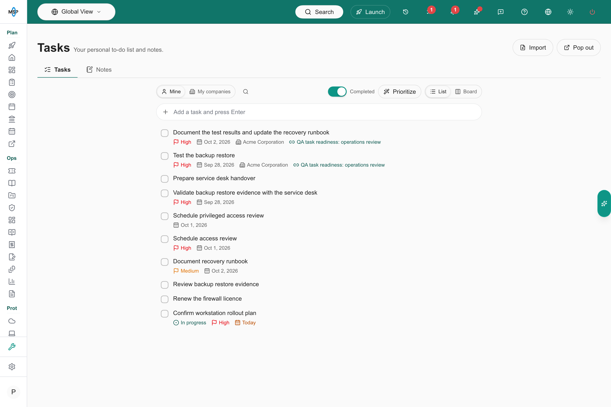
</Frame>

## Before you start

- MSP staff always have their own task list. Company users need a Company role that includes **Tasks** (see [Give company users access](#give-company-users-access)).
- **Prioritize** and **Create tasks from notes** need AI turned on for your portal.
- Your task changes save for everyone who can see the task, and your other open windows update.
- To audit other people's lists you need the **See all task lists** permission (**Audit: See all task lists** in the role editor).

## Open your task list

<Steps>
  <Step title="Click the task list button">
    In the top bar, click **Open task list** (the checklist icon). A badge shows how many of your open tasks are due today or overdue. The side panel opens and stays open while you move around MSPortal.
  </Step>

  <Step title="Choose whose tasks to show">
    In the panel header, choose **Mine**, **My companies** or **All companies**. **Mine** has tasks you own. **My companies** has tasks for companies you are assigned to. **All companies** has every company's tasks and appears when your role can read **Companies** settings. Tasks without a company never appear there.
  </Step>

  <Step title="Choose List or Board">
    Use **List** or **Board** in the toolbar below the **Tasks** and **Notes** tabs.
  </Step>

  <Step title="Open the full workspace (optional)">
    Click **Open in a new window** in the panel header to open the full Tasks workspace in its own window. Changes you save there update the side panel.
  </Step>
</Steps>

You can also open Tasks from the Planner: open the **Planner Menu** and choose **Tasks**. Tasks stay separate from the Planner's roadmap items.

<Frame caption="Task side panel.">
  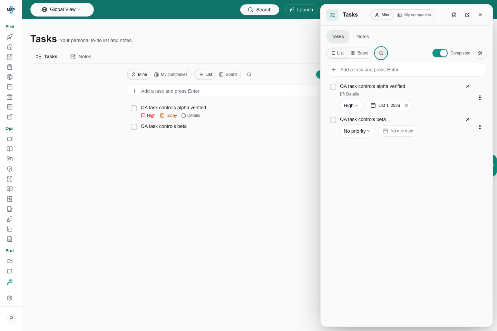
</Frame>

<Frame caption="Separate task window.">
  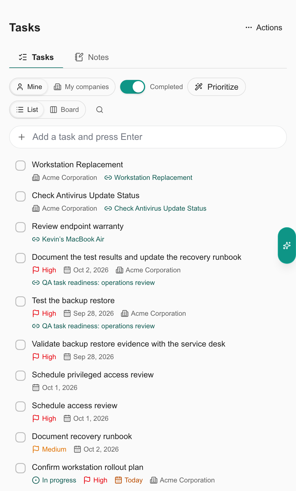
</Frame>

<Note>In Board view, card lists scroll vertically within their columns. Scroll sideways to move between status columns; individual columns do not scroll sideways.</Note>

## Add and organize tasks

<Steps>
  <Step title="Add a task">
    Type into **Add a task and press Enter**, then press **Enter**. The task goes on your personal list.
  </Step>

  <Step title="Edit it">
    In the side panel, click a task title to edit it inline. Click the check button or press **Enter** to save. Change the priority and due date with the dropdowns on the row. Click the outward-arrow button to open **Edit task** for notes and other details. In the full workspace, click a title to open the editor.

    <Frame caption="Task editor.">
      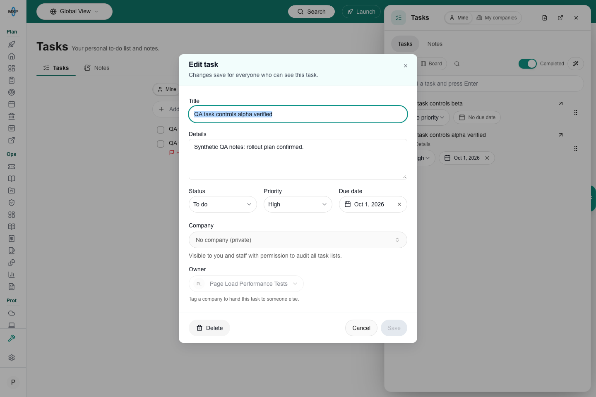
    </Frame>

    <Frame caption="The date picker stays fully visible in the editor.">
      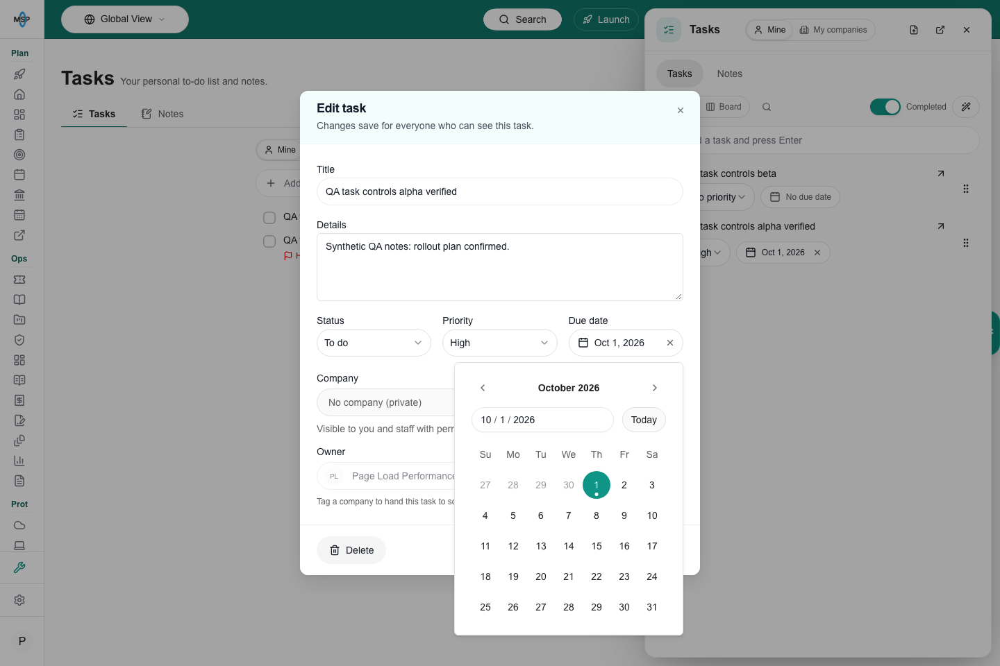
    </Frame>
  </Step>

  <Step title="Complete it">
    Tick the checkbox. Completed tasks stay under **Completed**. Untick one to reopen it.

    <Frame caption="Completed tasks can be reopened.">
      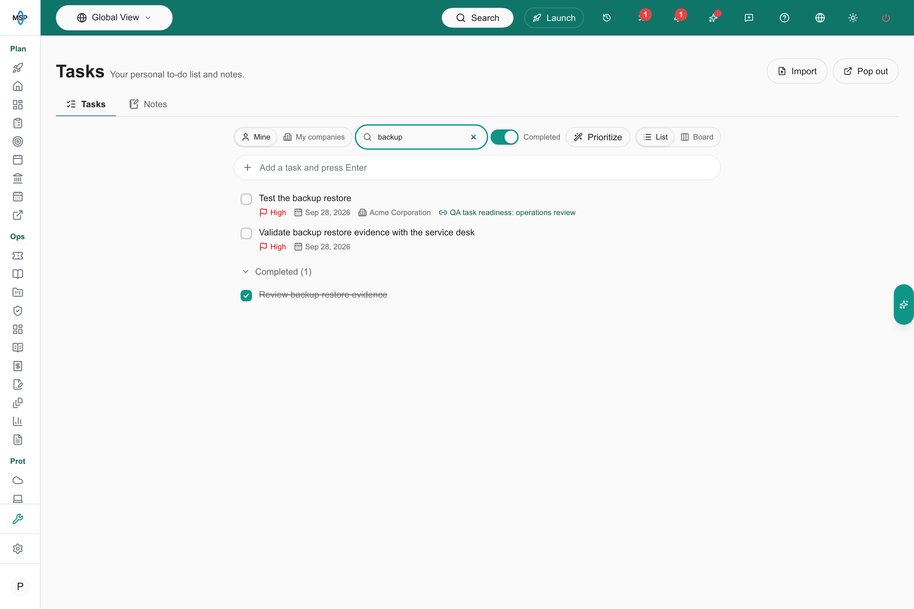
    </Frame>
  </Step>

  <Step title="Reorder or change status">
    In **List**, drag a task by its grip to reorder it. In **Board**, drag the grip to move a task between **To do**, **In progress**, **Blocked**, and **Done**. Dragging does not complete a task. You can also set **Status** in the editor.

    <Frame caption="Board view.">
      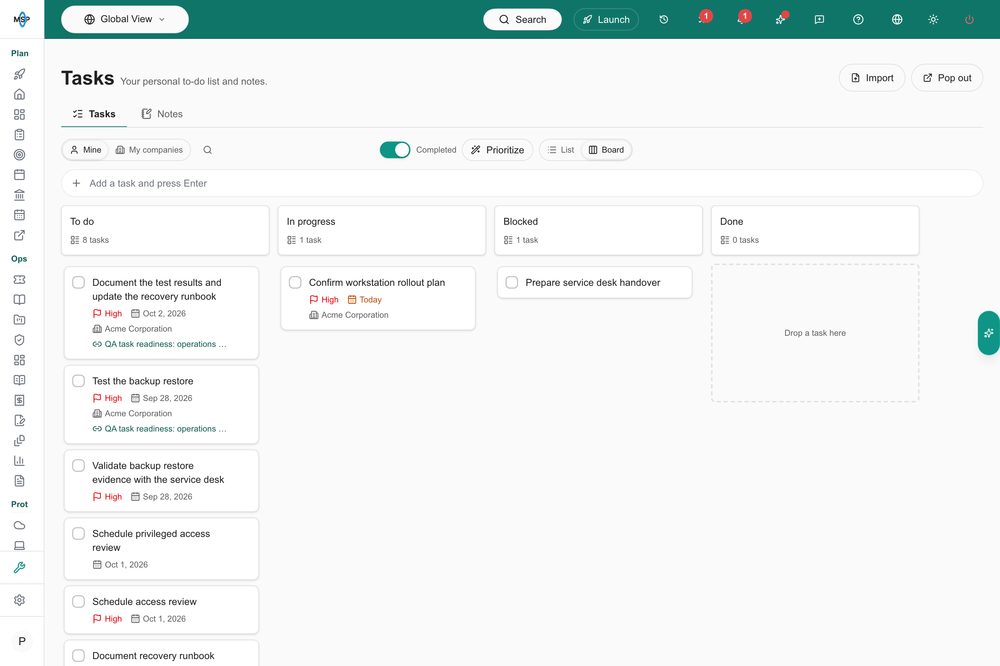
    </Frame>
  </Step>

  <Step title="Search">
    Click **Search tasks** to open a floating search field and filter the current view. Clear the search before you drag to reorder.

    <Frame caption="Floating search in the side panel.">
      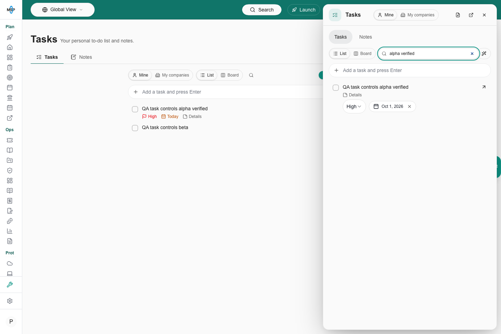
    </Frame>
  </Step>

  <Step title="Delete a task (optional)">
    Open the task, click **Delete**, check the task name, and confirm. Deleting a task does not delete the ticket, device, or other record it was linked to.
  </Step>
</Steps>

A note icon with **Details** marks tasks that have notes. Inline changes save immediately. If a save fails, your editor stays open with your draft so you can try again.

## Prioritize with AI

<Steps>
  <Step title="Open the view you want ranked">
    Choose the task view, such as **Mine**, in the list or panel.
  </Step>

  <Step title="Click Prioritize">
    Click **Prioritize**. AI ranks your own open tasks in that view and sets their priorities, using dates, status, and task context. Tasks owned by colleagues are left alone. You need at least two open tasks you can edit.
  </Step>

  <Step title="Review the result">
    A message such as "Prioritized 12 tasks." appears. Check the new order and priorities.
  </Step>

  <Step title="Restore the previous order (optional)">
    Click **Restore** beside **Prioritize** to put back the order and priorities from before the latest ranking. **Restore** stays available while you stay in that view. A new ranking replaces the previous restore point.

    <Frame caption="Restore stays beside Prioritize after a ranking, using synthetic Demo tasks.">
      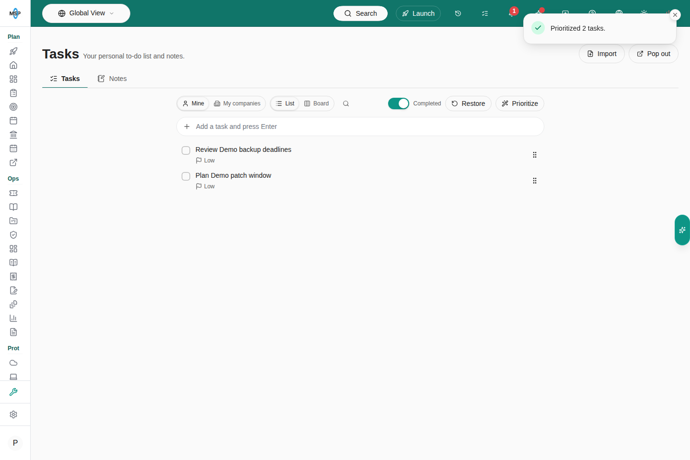
    </Frame>

    <Frame caption="The same task controls on a phone.">
      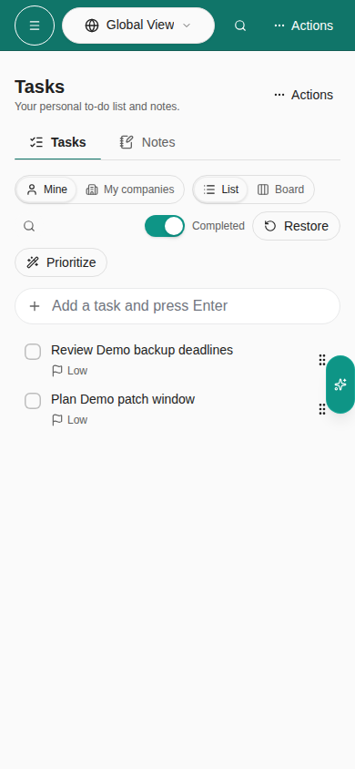
    </Frame>
  </Step>
</Steps>

Up to 200 eligible tasks are ranked in one pass. If you have more, the message says how many further down kept their places.

## Share tasks with a company

<Steps>
  <Step title="Open the task">
    Click the task title or the details button.
  </Step>

  <Step title="Tag a company">
    Choose a **Company** in the editor. A task with no company is private to you. A task tagged to a company is shared with that company's assigned team.
  </Step>

  <Step title="Hand it to a colleague (optional)">
    Choose a company first, then pick a different **Owner**. You need permission to assign work for that company.
  </Step>

  <Step title="Show it to the company's users (optional)">
    Turn on **Show to the company's users**. Users at that company whose role includes **Tasks** can then see the task and its details. With write access they can update its title, status, priority and due date. A **Shared with company** label marks shared tasks in your list. Choosing a different company turns the switch off.
  </Step>
</Steps>

### Who can see what

- **Mine** has tasks you own, including tasks tagged with a company.
- **My companies** has tasks for companies you are assigned to. **All companies** has every company's tasks, for staff who can read **Companies** settings. These views do not follow the top-bar company selector.
- A task without a company is private to its owner. Staff with **See all task lists** can read it in the audit view.
- Company tasks are shared with the company's assigned team. Staff with company-settings access can also view them. Editing needs an assignment to the company or company-settings write access.
- A task created from a meeting action item keeps the meeting's company. Its owner and supported fields stay in sync with the action item. To change the company, change it in the meeting.
- Scratch notes are private to their owner and are not part of task-list audit.
- Company users see only tasks for their own company: tasks staff showed to the company's users, and tasks from action items on that company's meetings they can see. They never see private tasks, other companies' tasks, notes, or company tasks staff kept internal.

<Frame caption="A linked task follows its meeting's company.">
  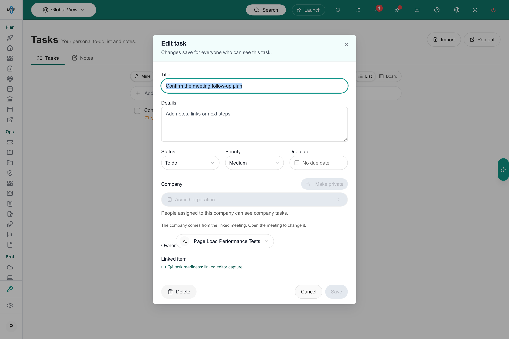
</Frame>

## See a company's action items

Open the company's details and click the **Action Items** tab. Everyone assigned to the company can see and update these tasks, and they appear in each person's **My companies** list.

<Frame caption="Company Action Items tab.">
  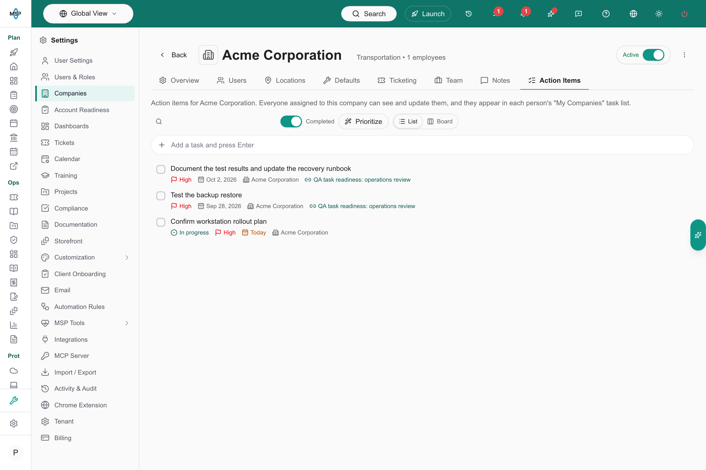
</Frame>

## Tasks for company users

Company users whose role includes **Tasks** get a list and board of the work agreed with their MSP, for example action items from a quarterly business review.

### What company users see

- Action items from meetings of their company that they can see. Their role also needs **Meetings** read access.
- Tasks staff turned on **Show to the company's users** for.
- Only their own company's tasks, following the company selector when they can see more than one company.

They do not see private tasks, other companies' tasks, company tasks staff did not share, or the **Notes** tab. Notes on an action item task stay with staff unless staff shared the task.

### What company users can change

With **Tasks** write access, company users can change a task's title, status, priority and due date, and drag cards between board columns. A change to an action item task also updates the action item on the meeting. They can change an action item task only if they can edit that meeting's action items, for example as an attendee with **Meetings** write access.

Company users cannot add or delete tasks, change a task's company or owner, edit its details, or use **Prioritize** and **Create tasks from notes**.

### Open Tasks as a company user

Open the **Planner Menu** and choose **Tasks**, or click the task list button in the top bar. Choose **List** or **Board**.

### Give company users access

<Steps>
  <Step title="Open the Company role">
    Go to **Settings > Users & Roles**, open **Roles**, and edit the Company role.
  </Step>
  <Step title="Set Tasks">
    In **Main Navigation**, tick **Read** on **Tasks** to let users see their company's tasks, or **Write** to let them update them too. Company roles do not have **Tasks** until you turn it on.
  </Step>
  <Step title="Check Meetings access">
    For action items to appear, the role also needs **Meetings** read access. To update action item tasks, users need to be able to edit the meeting's action items.
  </Step>
  <Step title="Save the role">
    Click **Update Role**. The change applies to everyone with that role.
  </Step>
</Steps>

## Audit task lists

<Steps>
  <Step title="Open Task Lists">
    Go to **Settings > Activity & Audit** and open **Task Lists**. You need **See all task lists**.
  </Step>

  <Step title="Read the table">
    The table shows each task's **Owner**, **Task**, **Status**, **Priority**, **Due**, **Company**, **Source**, **Created**, and **Completed**. Private tasks are labeled **Private**. The rows are read-only.

    <Frame caption="Task-list audit.">
      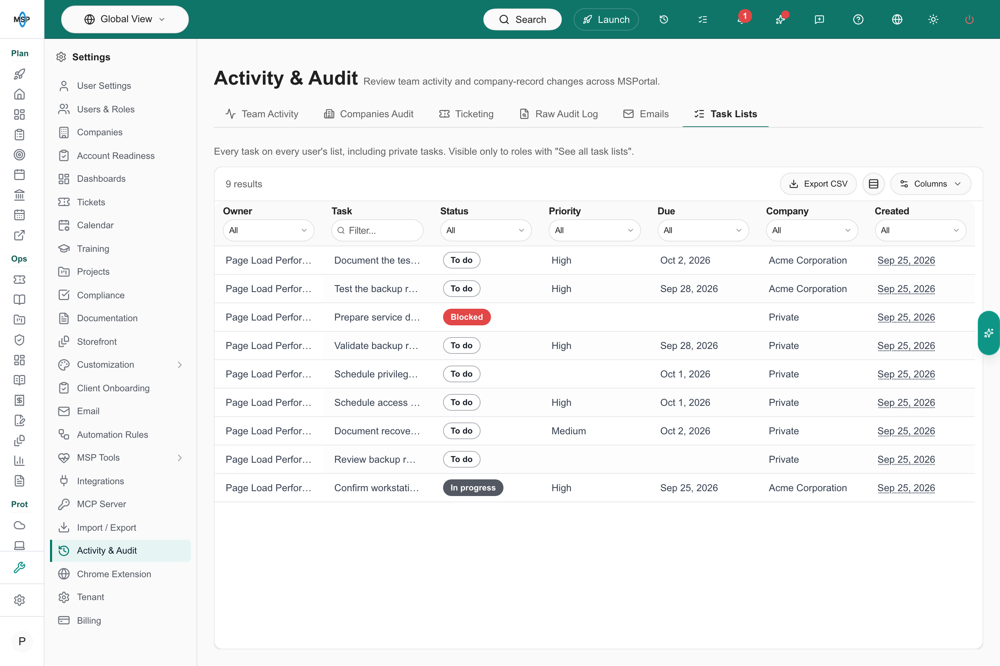
    </Frame>
  </Step>

  <Step title="Scope it to a company">
    Pick a company in the company selector. The audit follows it.

    <Frame caption="Audit follows the selected company.">
      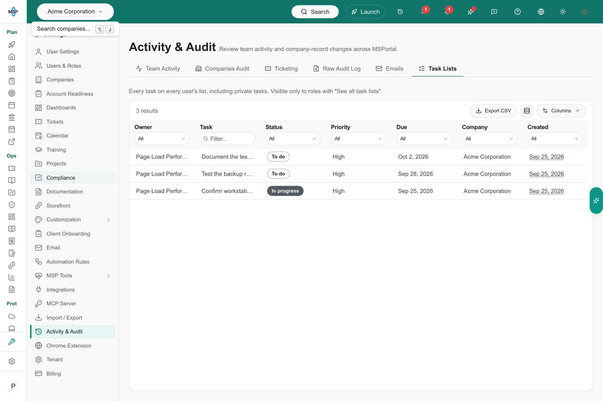
    </Frame>
  </Step>
</Steps>

## Use tasks on a phone or in dark mode

The task workspace adapts to small screens and follows your light or dark appearance setting. On a narrow screen, scroll the board sideways to reach other columns.

<Frame caption="Mobile workspace.">
  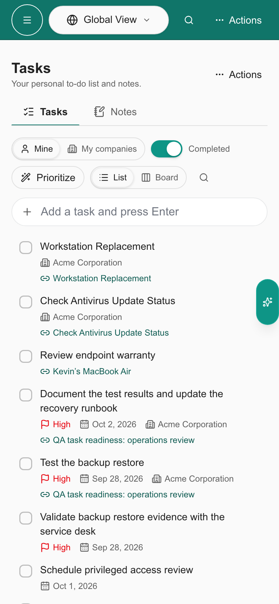
</Frame>

<Frame caption="Dark appearance.">
  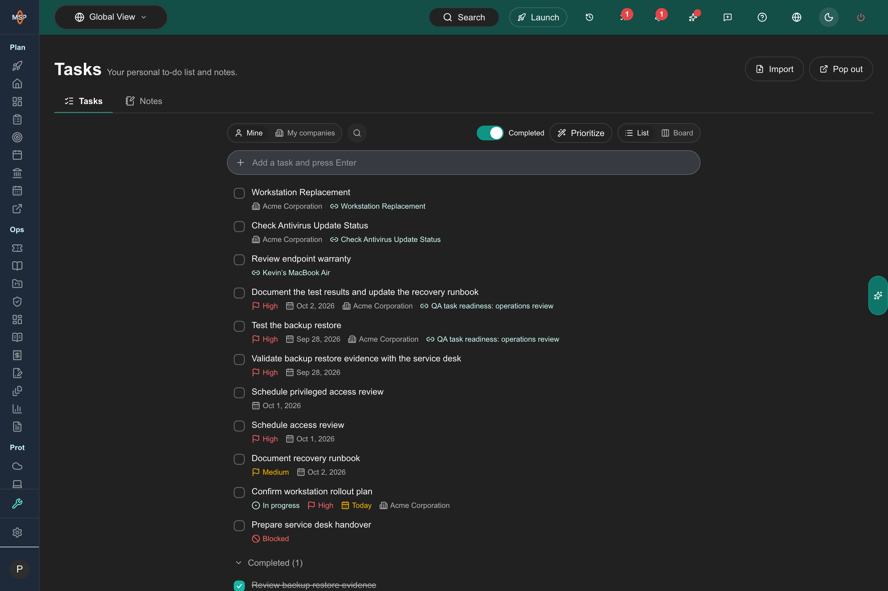
</Frame>

<Frame caption="Inline controls on a phone.">
  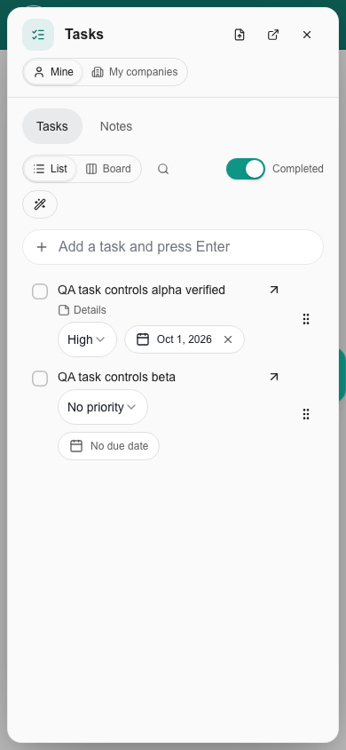
</Frame>

<Frame caption="The complete date picker on a phone.">
  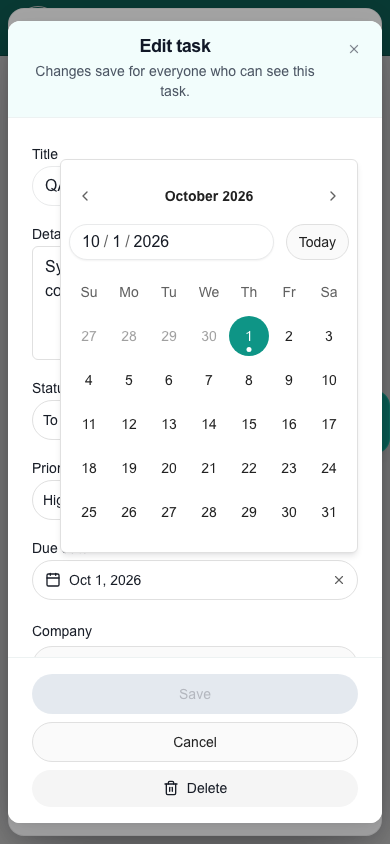
</Frame>

## Troubleshooting

| Problem | What to do |
| --- | --- |
| A company user has no task list button | Their Company role needs **Tasks**. See [Give company users access](#give-company-users-access). |
| A company user does not see an action item | Their role needs **Meetings** read access, and the action item must be on a meeting for their company. |
| A company user cannot see a company task | Open the task and turn on **Show to the company's users**. |
| **All companies** is missing | Your role needs read access to **Companies** settings. |
| **Prioritize** does nothing | You need at least two open tasks you can edit. Colleagues' tasks are skipped. |
| A task did not save | Your editor stays open with the draft. Click save again. |
| You cannot reorder a task | Clear the search first. You cannot drag while a search is active. |
| You cannot pick another **Owner** | Tag the task with a company first. You also need permission to assign work for that company. |
| A task's company will not change | It was created from a meeting action item. Change the company in the meeting. |
| **Task Lists** is missing from **Activity & Audit** | Your role needs **See all task lists**. |

## Frequently asked questions

<AccordionGroup>
  <Accordion title="Who can see my tasks?">
    Only you, unless you tag a company. A task with a company is shared with that company's assigned team and with staff who can read **Companies** settings. Staff with **See all task lists** can also read private tasks in the audit view. The company's own users see it only if you turn on **Show to the company's users**.
  </Accordion>
  <Accordion title="Do tasks appear on the Planner roadmap?">
    No. **Tasks** in the Planner Menu opens the task list and board. Roadmap items and tasks stay separate.
  </Accordion>
  <Accordion title="Does deleting a task delete the ticket or device it came from?">
    No. A task keeps a link to its source, and deleting the task does not change the source.
  </Accordion>
  <Accordion title="Do My companies and Mine follow the company selector?">
    No. They are personal views and ignore the top-bar company selector. The audit view does follow it.
  </Accordion>
  <Accordion title="Does dragging a task complete it?">
    No. Only the checkbox completes a task. Dragging moves it.
  </Accordion>
  <Accordion title="Can AI change other people's tasks?">
    No. **Prioritize** only changes your own open tasks.
  </Accordion>
</AccordionGroup>

## Related guides

- [Import lists and add linked items](/user-guides/tasks/import-tasks)
- [Use notes and extract tasks](/user-guides/tasks/notes)
- [MCP tools reference](/user-guides/mcp-server/tools-reference)
