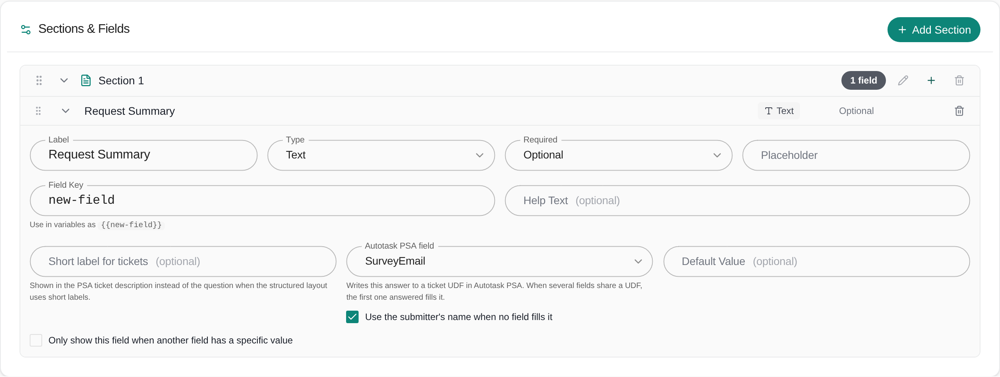
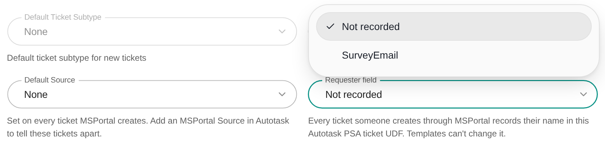

A ticket template's answers always go into the PSA ticket description. With a field's PSA mapping, MSPortal also writes the answer to a ticket UDF (user-defined field) in your PSA, so technicians can filter, report and run workflows on it. A common use is recording who a request is for, separately from who submitted it.

**Audience:** MSP staff who edit ticket templates.

## Before you start

- Your role needs the **write** or **manage** Tickets settings permission (**Settings > Tickets**). Seeing the list of UDFs also needs Tickets settings access.
- Ticket delivery must use ConnectWise, Autotask or Halo PSA. Syncro has no ticket UDFs, so the mapping does not appear for it.
- Create the UDF in your PSA first, as a free-text field on tickets. In Halo PSA, add it to the ticket type the template uses, or Halo drops the value.
- MSPortal reads the list of UDFs from your PSA once a night. A UDF you just created appears after the next sync.

## Map a field to a UDF

<Steps>
  <Step title="Open the template">
    Go to **Settings > Tickets > Templates** and open the template, or click **New Template**.
  </Step>
  <Step title="Expand the field">
    Under **Sections & Fields**, click the field row to open its editor. The PSA mapping sits on one row with **Short label for tickets** and **Default Value**. Its label names your PSA: **Autotask PSA field**, **ConnectWise Manage field** or **Halo PSA field**.
  </Step>
  <Step title="Pick the UDF">
    Open the PSA field and choose the UDF. **Not sent** keeps the answer out of every UDF. The help under it reads "Writes this answer to a ticket UDF in Autotask PSA. When several fields share a UDF, the first one answered fills it."
  </Step>
  <Step title="Optional: fall back to the submitter">
    Once a UDF is picked, **Use the submitter's name when no field fills it** appears. Turn it on to write the submitter's name to the UDF when no field mapped to it has an answer.
  </Step>
  <Step title="Save the template">
    Click **Save Template**. The mapping applies to tickets created from the template after you save.
  </Step>
</Steps>

<Frame caption="A Text field mapped to an Autotask UDF, with the submitter fallback on.">
  
</Frame>

Not every field type can be mapped. **Label (display text)**, **Embedded Template**, **PSA Classification**, **File Upload**, **File Attachment** and **Screenshot** fields have no PSA field. The PSA field also stays hidden while your PSA has no free-text ticket UDFs.

## What gets sent

| Field | Value written to the UDF |
|---|---|
| **Text**, **Long Text**, **Email**, **Phone**, **URL** | The answer as typed, on one line. Formatted text is sent as plain text. |
| **User** picker | The selected person's name |
| **Dropdown**, **Radio Buttons**, **Multi-Select** | The option label, not its stored value |
| Other fields, such as dates, checkboxes and device or location pickers | The answer as text |
| A field with a **Default Value** the requester left alone | The saved default |
| A field hidden by its condition | Nothing. Hidden fields are skipped. |

When several fields map to the same UDF, the first one in the form that has an answer fills it. If none has an answer and one of them has **Use the submitter's name when no field fills it** on, the UDF gets the submitter's name.

The mapping applies to every ticket created from the template: from the form on **Tickets > New Ticket**, the AI assistant, the browser extension, and requests released after approval.

Only free-text ticket UDFs are offered. Dropdown, number, date, IP address, password, phone and URL UDFs are left out of the list.

## Example: record who a request is for

A client wants each ticket to show the employee who needs help, even when a manager or colleague submits it. Set up a "Requested For" text UDF in your PSA, then map two fields to it.

<Steps>
  <Step title="Add a user picker">
    Add a **User** field labelled "Select the employee who needs help". Map it to **Requested For**.
  </Step>
  <Step title="Add a text fallback">
    Below it, add a **Text** field labelled "Name of the employee", for people not yet in the list. Map it to **Requested For** as well.
  </Step>
  <Step title='Cover "this is for me"'>
    On either field, turn on **Use the submitter's name when no field fills it**. A requester asking for themselves can leave both fields empty.
  </Step>
  <Step title="Save and test">
    Click **Save Template**, then submit a test request for a company you use for testing. Check the **Requested For** UDF on the new PSA ticket.
  </Step>
</Steps>

The picker comes first in the form, so it wins when both fields are answered. To record who submitted the ticket as well, set the [Requester field](/user-guides/settings/tickets#requester-field) in Ticket Defaults to a separate UDF, such as "Submitted By".

## Requester field and template mappings

The **Requester field** in **Settings > Tickets > General > Ticket Defaults** writes the submitter's name to one UDF on every ticket a person creates through MSPortal. Templates cannot change it, so:

- The template editor does not offer that UDF.
- A field mapped to it before it became the Requester field shows "*name* (records the requester, from Ticket Defaults)". The submitter's name fills that UDF. Pick another UDF for the field, or choose **Not sent**.

<Frame caption="The Requester field lists your PSA's free-text ticket UDFs. The one you pick here is left out of template fields.">
  
</Frame>

## Troubleshooting

| Problem | What to do |
|---|---|
| The PSA field does not appear | Check that ticket delivery uses ConnectWise, Autotask or Halo PSA, that the field type can be mapped, and that your PSA has a free-text ticket UDF. A new UDF appears after the next nightly sync. |
| The field shows "*name* (not found in Autotask PSA)" | The UDF is gone from your PSA, or the mapping was picked while a different PSA connection was selected for ticket delivery. MSPortal does not send it. Pick a UDF from the current list, or choose **Not sent**, and save. |
| The field shows "*name* (records the requester, from Ticket Defaults)" | That UDF is the [Requester field](/user-guides/settings/tickets#requester-field). Pick another UDF for this field. |
| The ticket was created but the UDF is empty | The PSA refused the value, for example because the UDF was renamed or deleted, or the answer is too long for it. MSPortal still creates the ticket without that UDF. Also check that the field was visible and answered. |
| The value is missing in Halo PSA | Add the UDF to the ticket type the template uses. |
| A user picker sent the wrong name | The UDF gets the name of the person picked in the form. Check the answer in the ticket description. |

## Related guides

<CardGroup cols={2}>
  <Card title="Ticket settings" icon="gear" href="/user-guides/settings/tickets#requester-field">
    Record the requester in a PSA field
  </Card>
  <Card title="How to create a ticket template" icon="file-lines" href="/user-guides/ticketing/how-to-create-a-ticket-template">
    Fields, conditions, routing and access
  </Card>
  <Card title="Ticket description layout" icon="align-left" href="/user-guides/ticketing/ticket-description-layout">
    Short labels for answers in the ticket description
  </Card>
  <Card title="Integrations" icon="plug" href="/user-guides/settings/integrations">
    Connect and sync your PSA
  </Card>
</CardGroup>
