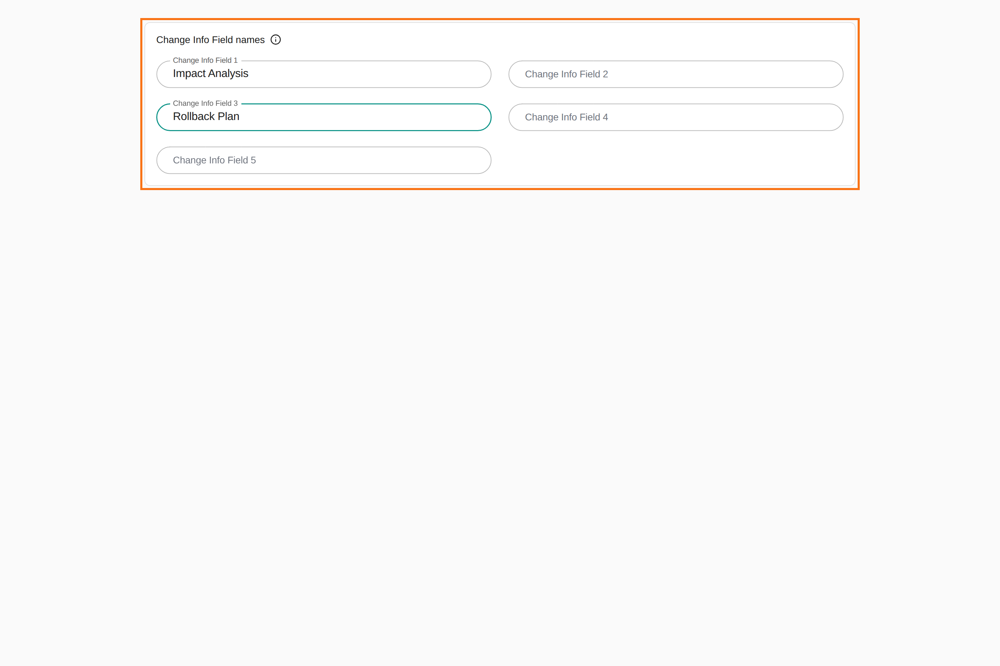
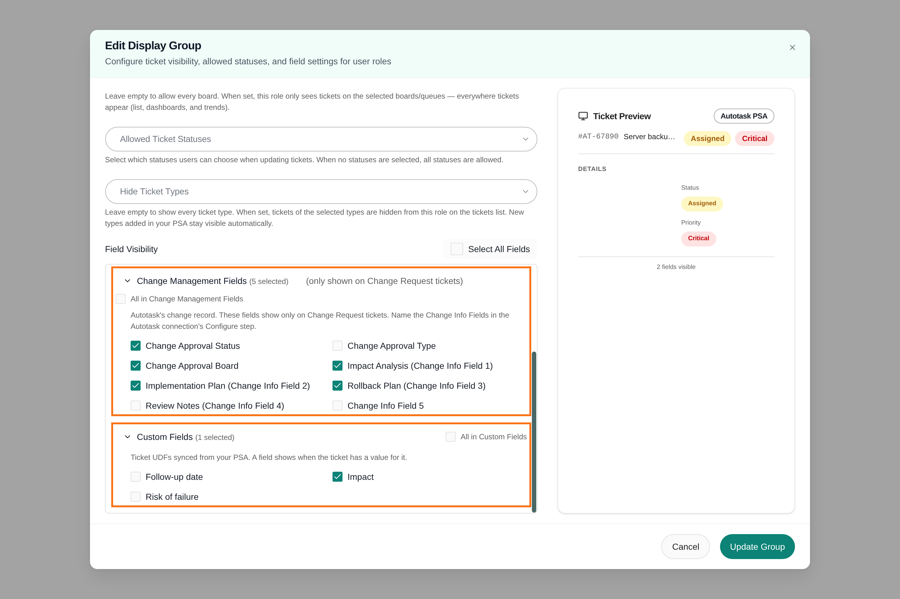
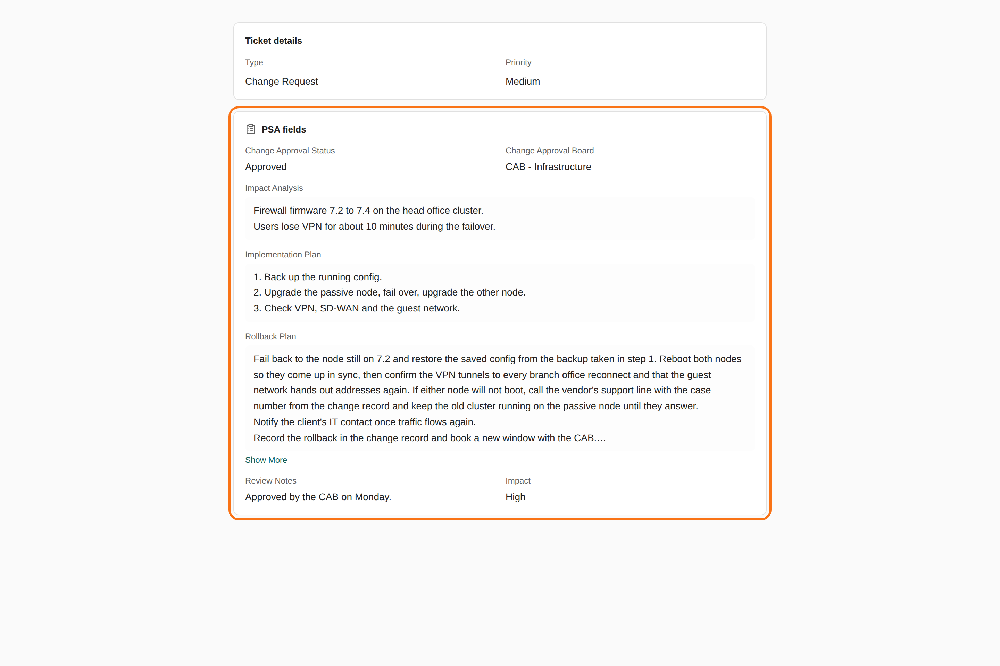
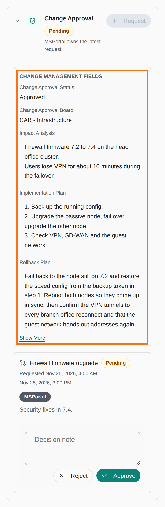

Your PSA holds ticket fields that MSPortal's ticket details do not show by default: ticket UDFs (user-defined fields) and, in Autotask, the Change Management fields of Change Request tickets. MSPortal shows them in a **PSA fields** section of the ticket. For a change record this puts the impact analysis, implementation plan, rollback plan and approval status in front of the people who review and approve the change.

**Audience:** MSP staff who manage ticket settings or the Autotask integration.

## Who sees what

| Viewer | Sees |
|---|---|
| MSP staff who can open the ticket | Every PSA field the ticket has a value for |
| Client users who can open the ticket | The fields their role's [display group](/user-guides/settings/tickets#create-a-display-group-for-a-role) ticks, and none without a display group |
| Change approval email recipients | The fields their own role can see |

Client users see fields only on tickets they can already open, so the role's ticket visibility, such as **Own Tickets Only**, still applies. Empty fields are left out.

## Name the Change Info Fields

Autotask's API sends Change Info Fields 1 to 5 without the names you gave them in Autotask, so MSPortal shows them as **Change Info Field 1** to **5** until you name them.

<Steps>
  <Step title="Open the Autotask connection">
    Go to **Settings > Integrations**, open your Autotask connection and choose the **Configure** step.
  </Step>
  <Step title="Name each field">
    Under **Change Info Field names**, type the name each field has in your Autotask, such as **Impact Analysis** or **Rollback Plan**. Each name saves when you leave the box. Leave a box empty to keep the Autotask name.
  </Step>
</Steps>

<Frame caption="Change Info Field names in the Autotask connection's Configure step.">
  
</Frame>

## Show fields to a client role

<Steps>
  <Step title="Open the display group">
    Go to **Settings > Tickets > Display Groups** and edit the group assigned to the client role, or create one.
  </Step>
  <Step title="Tick Change Management Fields">
    Under **Field Visibility**, open **Change Management Fields (only shown on Change Request tickets)**. It lists Autotask's **Change Approval Status**, **Change Approval Type**, **Change Approval Board** and the five Change Info Fields, with the names you gave them. These fields show only on Change Request tickets.
  </Step>
  <Step title="Tick Custom Fields">
    **Custom Fields** lists the ticket UDFs synced from your PSA. A ticked field shows when the ticket has a value for it.
  </Step>
  <Step title="Click Update Group">
    The group's other field settings stay as they were.
  </Step>
</Steps>

<Frame caption="A display group with Change Management Fields and Custom Fields ticked.">
  
</Frame>

## Where the fields show

- **Ticket details.** The **PSA fields** section sits under the ticket's details. Picklists show their names, such as **Approved** or the name of your change approval board. Long text keeps its line breaks and folds after six lines; **Show More** opens the rest.
- **Change approval panel.** When a ticket has a change request, its **Change record** sits above the approver's decision.
- **Change approval email.** The email asking someone to approve a change lists their fields under **Change details**. In a custom **Change Approval Request** email template, add the `{{psa_fields}}` variable where the list should go.

<Frame caption="A Change Request ticket's PSA fields, as staff see them.">
  
</Frame>

<Frame caption="The change approval panel on a phone, as a client approver sees it.">
  
</Frame>

## Halo PSA

Halo sends a ticket's custom fields only when MSPortal asks for them. MSPortal asks for the Halo UDFs ticked in a display group, so a newly ticked field fills in as each ticket next syncs, for staff and client users alike.

## Related guides

- [Change management](/user-guides/ticketing/change-management)
- [Ticket settings](/user-guides/settings/tickets)
- [Enable the Autotask integration](/user-guides/integrations/enable-autotask-integration)
