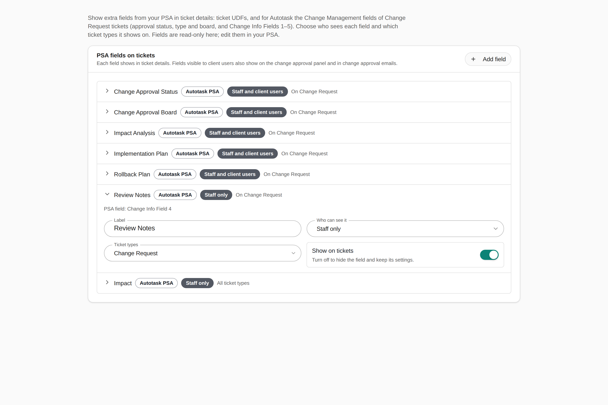

Your PSA holds fields that MSPortal's ticket details do not show by default: ticket UDFs (user-defined fields) and, in Autotask, the Change Management fields of Change Request tickets. Pick the ones your technicians and clients need under **Settings > Tickets > PSA fields**, and MSPortal shows them next to the ticket. For a change record this puts the impact analysis, implementation plan, rollback plan and approval status in front of the people who review and approve the change.

**Audience:** MSP staff who manage ticket settings.

## Before you start

- Your role needs the **write** or **manage** Tickets settings permission to pick fields. Read access shows the list without changes.
- Ticket delivery must use Autotask, ConnectWise or Halo PSA.
- MSPortal reads the list of ticket UDFs from your PSA once a night. A UDF you just created appears after the next sync.
- Fields are read-only in MSPortal. Edit their values in your PSA; MSPortal shows the new value after the ticket's next sync.

## Pick a field

<Steps>
  <Step title="Open Settings > Tickets > PSA fields">
    The list shows the fields you already picked, with who can see each one and which ticket types it shows on.
  </Step>
  <Step title="Click Add field">
    Search by name and click **Add** beside the field. Autotask connections list the Change Management fields first: **Change Approval Status**, **Change Approval Type**, **Change Approval Board** and **Change Info Field 1** to **5**, then your ticket UDFs.
  </Step>
  <Step title="Set its label">
    The field opens after you add it. Autotask's API does not include the names you gave the Change Info Fields, so type the label your team uses, such as **Impact Analysis** or **Rollback Plan**. A UDF keeps its PSA name unless you type another label.
  </Step>
  <Step title="Choose who can see it">
    **Who can see it** is **Staff only** for a new field. Choose **Staff and client users** to show it to client users as well.
  </Step>
  <Step title="Choose the ticket types">
    Leave **Ticket types** empty to show the field on every ticket, or pick the types it belongs to. Change Management fields start on **Change Request**, the type Autotask gives change records.
  </Step>
</Steps>

Every change saves as you make it. **Show on tickets** hides a field without losing its label and settings.

<Frame caption="Settings > Tickets > PSA fields, with Review Notes open: its label, who can see it, ticket types and Show on tickets.">
  
</Frame>

## Where the fields show

- **Ticket details.** A **PSA fields** section under the ticket's details lists every picked field that has a value on the ticket and applies to its type. Picklists show their names, such as **Approved** or the name of your change approval board. Long text keeps its line breaks and folds after six lines; **Show More** opens the rest.
- **Change approval panel.** When a ticket has a change request, its **Change record** sits above the approver's decision.
- **Change approval email.** The email asking a client to approve a change lists the fields visible to client users under **Change details**. In a custom **Change Approval Request** email template, add the `{{psa_fields}}` variable where the list should go.

<Frame caption="A Change Request ticket's PSA fields, as staff see them.">
  
</Frame>

## Who sees what

| Viewer | Sees |
|---|---|
| Staff who can open the ticket | Every picked field that applies to the ticket |
| Client users who can open the ticket | Only fields set to **Staff and client users** |
| Change approval email recipients | Only fields set to **Staff and client users** |

Client users see fields only on tickets they can already open, so the role's ticket visibility, such as **Own tickets only**, still applies.

<Frame caption="The change approval panel on a phone, as a client approver sees it: client-visible fields only.">
  
</Frame>

## Halo PSA

Halo sends a ticket's custom fields only when MSPortal asks for them, so a Halo UDF you pick fills in as each ticket next syncs. Tickets that have not changed since keep showing nothing for that field until they do.

## Related guides

- [Change management](/user-guides/ticketing/change-management)
- [Ticket settings](/user-guides/settings/tickets)
- [Send template answers to PSA fields](/user-guides/ticketing/send-answers-to-psa-fields)
